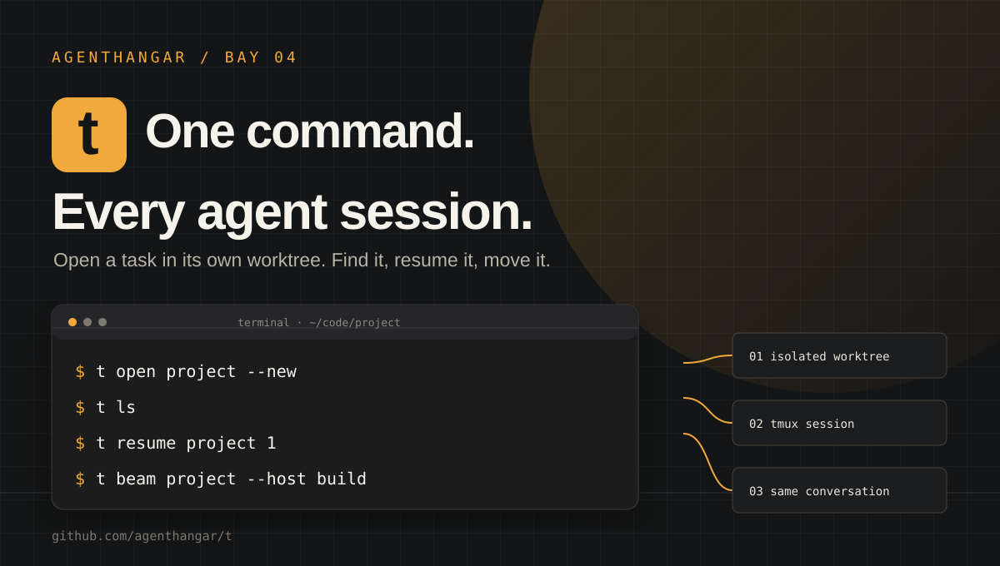
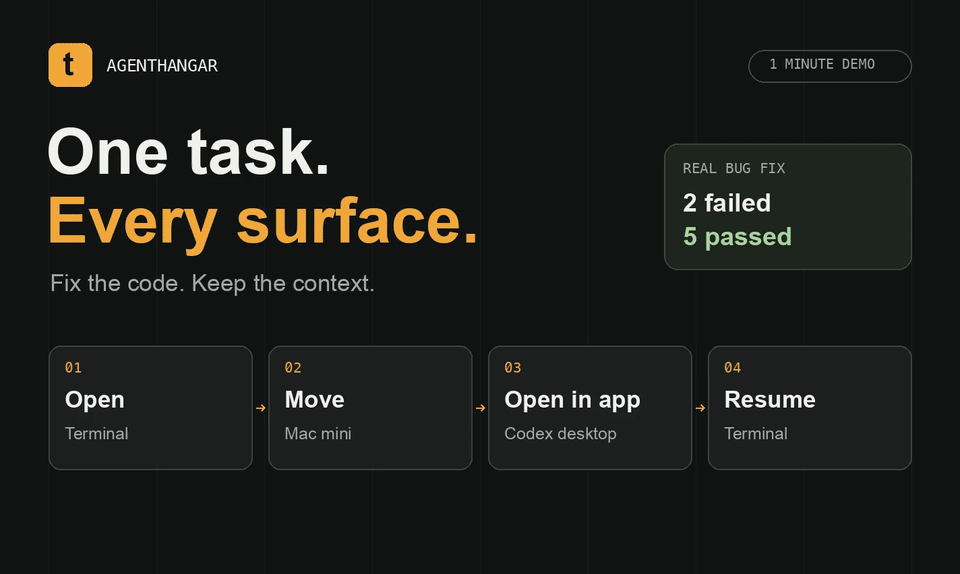

# t



**Your terminal. Your desktop. Same task.**

Start in the terminal. Continue in the Codex desktop app. Keep your conversation,
isolated Git worktree, and running web preview together. On macOS, use
`t session open my-project 1 --app` to move a local Codex conversation to the
desktop, and `t session open my-project 1 --cli` to return after following t’s
instructions to release that desktop chat.

Terminal workflows support macOS and Linux. Move sessions to a configured SSH
host and check in from another computer or a phone’s terminal while that host
stays awake and reachable. Desktop handoff is specific to Codex on macOS.

t manages sessions in tmux and gives each task its own Git worktree. It includes
Claude Code and Codex session workflows, plus Cursor transfer tools.

<p>
  <a href="#agents"><picture><source media="(prefers-color-scheme: dark)" srcset="docs/media/logos/claude-dark.svg"></picture></a>
  &nbsp;&nbsp;&nbsp;&nbsp;
  <a href="#agents"><picture><source media="(prefers-color-scheme: dark)" srcset="docs/media/logos/openai-dark.svg"></picture></a>
  &nbsp;&nbsp;&nbsp;&nbsp;
  <a href="#agents"><picture><source media="(prefers-color-scheme: dark)" srcset="docs/media/logos/cursor-dark.svg"></picture></a>
</p>

Supported workflows vary by agent; see the [support matrix](#agents).
[Logos belong to their respective owners](docs/media/logos/README.md).

[Get started](#install) · [Work from anywhere](#work-from-anywhere) · [Commands](#commands) · [Configuration](#configuration) · [Agent support](#agents) · [Coming soon](#coming-soon) · [AgentHangar](https://agenthangar.ai)

## Watch one task move



[Watch the 66-second demo](docs/media/terminal/workflow.mp4) ·
[Static cover](docs/media/terminal/workflow-poster.png) ·
[Capture notes and sources](docs/media/terminal/README.md)

GPT-6.1-Sol fixes a real task-CLI bug: two failing tests become five passing tests,
with the code change and actual CLI output visible. The same task moves to mini,
runs the tests there, returns through Codex desktop, and resumes in the terminal
for another verification turn. The 66-second cut keeps reading sections at normal
speed and plays session setup at 2×. The app window was not filmed; mini needed
Codex sign-in at capture time, so no remote model turn is shown.

### Open → another host → desktop → resume

```sh
t open my-project --codex             # start in an isolated worktree
t beam my-project 1 --host mini       # move to your configured host
t beam my-project 1 --from mini       # bring it back locally
t open my-project 1 --app             # continue in Codex desktop (macOS)
t open my-project 1 --cli             # return after releasing the desktop chat
t resume my-project 1                 # revive a saved conversation after its CLI ends
t resume my-project 1 --app           # choose the exact saved Codex conversation for the Mac app
```

The [sample project and actual patch](docs/media/terminal/fixture/README.md)
reproduce the bug fix. Host transfer uses `t beam`; `t push` backgrounds a local session.

The same local conversation and worktree stay together. Desktop handoff can
include its running web preview and referenced Markdown plan. See
[the desktop workflow details](#work-from-anywhere) for ownership and release behavior.

The earlier [host-handoff walkthrough](docs/media/demo.mp4) follows a Codex thread
from Mac to mini and back. It is an edited rendering of verified command output;
its final desktop open request was sent but app delivery was not confirmed.
[Read its evidence notes](docs/media/README.md).

## Work from anywhere

- **Start with your agent.** `t session open my-project` gives Claude Code an isolated
  worktree and tmux session; add `--codex` to use Codex. Detach and come back to
  the same session whenever you need it.
- **Move between local and cloud development.**
  `t session move my-project 1 --host cloud` moves the session to a configured
  SSH host; `t session move my-project 1 --from cloud` brings it back. Use your
  own workstation or cloud VM with t and your agent installed.
- **Take it on the go.** Connect to that host from your phone's SSH terminal.
  `t session list` shows the sessions, `t session read my-project 1 --dump`
  lets you scroll their output, and `t session open my-project 1` reconnects
  you. A detached session stays available while its host stays awake and reachable.
- **Move between terminal and desktop.** On macOS, `t session open my-project 1 --app` opens
  the same local Codex conversation in the desktop app, along with its web
  preview and referenced Markdown plan. The worktree and dev server stay in
  place. To return, run `t session open my-project 1 --cli`. If Codex still has that
  conversation loaded, follow the command's release instructions and retry;
  other desktop chats can stay open. It resumes the same conversation and
  attaches automatically. The `t app` commands remain available for scripts and advanced options.

- **Submit to an existing AgentCore runtime.** `t agentcore invoke` submits JSON
  using your existing AWS CLI profile; continue with the same session ID and use
  `t agentcore stop` to terminate it. See the [supported workflow](docs/agentcore.md)
  for setup and limitations. Automated tests cover the CLI contract; live AWS
  behavior remains unverified.

**Coming soon:** [Teleport for SSH access](https://github.com/agenthangar/t/issues/10).

## Install

You need **zsh, Python 3, Git, and tmux**. Install `fzf` for the interactive pickers,
`gh` for GitHub integration, and `rsync`/SSH for moving sessions between hosts.
The test suite runs on macOS and Linux with Python 3.12. Desktop handoff is macOS-only.

To try a fresh install and worktree session in a disposable Docker container, see
the [playground guide](docs/playground.md).

With Homebrew:

```sh
brew install agenthangar/tap/t
t
```

Homebrew installs the formula without changing your home directory. Run `t` in a
terminal for guided setup: choose agents, review shell and agent integrations,
select repositories, and start a session. Missing agent tools are optional installs.
The review shows the commands and configuration changes before applying them.
Setup and terminal session launch find native agents in `~/.local/bin` before that
directory is on your shell's `PATH`. Choose agent sign-ins separately: select
Claude, Codex, or both, or leave the checklist empty to skip. Only selected
sign-ins run after review; you can install an agent now and run `t login` later.
Agents already signed in are labeled **logged in** and listed separately from
the optional login choices, with their status repeated in review.
Shell links follow Homebrew's stable `opt` path across upgrades; there is no manual
shell configuration step before starting your first session.

Setup discovers primary checkouts under `~/code`, `~/config`, and the current
directory, skipping session worktrees. It can also offer to install GitHub CLI
and run `gh auth login`. With GitHub connected, choose organizations and repositories
to clone. Nothing is selected for cloning by default; destinations are shown as
`~/code/<organization>-<repository>` to avoid worktree-name collisions. Existing
matching clones are detected and preserved.

Available Tailscale peers are offered as optional remote hosts. After reviewed
registration is saved, choose **Verify SSH now** or **Later**. Verification runs
OpenSSH in your terminal so you can review and accept its native host fingerprint
prompt; it does not install t or configure access remotely. Failed or refused
verification keeps the registration and continues to the next host. All setup steps can be skipped
or canceled. On a choice screen, `q` or Esc goes back and keeps your choices,
including checkboxes changed before pressing Enter. At review, `n` or Esc goes
back; `q` cancels setup. Ctrl-C cancels from any screen. Completed actions remain
in place if a later step fails.

Returning users run `t` to choose a work session. Run `t config onboard` (or choose
**Find repositories and hosts** from the session entry screen) to discover newly
cloned repositories, connect GitHub, or add hosts later. Discovery runs during
setup, not in the background. Explicit commands, help, lists, status, and machine
output never start onboarding. Bare `t` without a terminal prints help.

If an older installation shadows Homebrew, `type -a t` identifies which copy your
shell is running. `t system integrate` remains available for explicit maintenance.

Or install a versioned release directly:

```sh
curl -fsSL https://raw.githubusercontent.com/agenthangar/t/main/scripts/install-release.py | python3
```

This installs the latest tagged release under `~/.local/share/t/releases/` and
links the command into `~/bin`. No repository checkout or pip packages are needed.
The installer verifies the release archive's SHA-256 checksum before unpacking it.
Set `XDG_DATA_HOME` or `T_INSTALL_DIR` to choose another installation location.
You can also download and inspect the installer before running it with Python 3.

The installer appends a marked t startup block to `${ZDOTDIR:-$HOME}/.zshrc`,
creating the file when needed and preserving existing content. Previously documented
startup snippets are retained without adding a second plugin source. It prints an exact
`source` command for the current terminal; a new interactive zsh loads t automatically.
The block follows `~/bin/t` and Homebrew upgrades. A canonical Git installation
automatically selects the current t development worktree without changing that link.
Links-only updates do not edit shell startup files.

For an older or incomplete installation, run:

```sh
t doctor                    # read-only diagnostics; no config menu, Git fetch, or gh telemetry
t doctor --repair           # repair zsh startup and a missing ~/bin/t link
# Then run the exact source command printed by repair, or open a new terminal.
```

`t install` offers missing shell setup as a preselected, reviewed action even when
all agents are already installed; deselecting it or cancelling writes nothing.
`t system diagnose --repair` is the equivalent grouped spelling. Repair is additive
and repeatable; an edited managed block or a conflicting `~/bin/t` is reported for
manual review. It does not install agents, log in, change trust/permissions, or reload
tmux. Other diagnostic findings retain their suggested explicit actions. Startup
inspection reads the rc file without executing user shell code; after loading it,
`whence -w t` should report `t: function`.

```sh
t agent install            # choose and install agent CLIs; review their vendor commands
t repo add ~/config/my-project  # register a checkout you already have
t config setup             # select checkouts under ~/config and optional SSH hosts
t session open my-project  # start an isolated worktree + tmux slot
t session list             # see your running sessions
```

Sessions open directly into the agent without displaying internal shell commands.
Detach from tmux with `Ctrl-b d`; reattach with `t session open my-project 1`.

New slot worktrees use an identifiable directory such as
`$DEV_WORKTREE_ROOT/t/t-12`, `cashfwd/cashfwd-4`, or `hive/hive-7`.
The slot argument remains numeric (`t session open t 12`), as do tmux slot IDs
and history associations. Existing numeric directories such as `t/12` are reused
without being moved. Saved conversations retain their exact IDs and paths;
resume can rebuild either layout after a worktree is swept. Codex receives that
directory name when opening a workspace; this does not group every worktree
under one common heading in the app. Live GUI rendering is not verified by the
automated compatibility tests.

Both layouts work with CLI open/resume, desktop discovery and handoff, navigation,
and retained history. If both `t/12` and `t/t-12` exist, slot actions refuse to
choose: inspect the two worktrees and use `t session history t 12` to select a
specific conversation. t never resolves this collision by moving either tree.

Upgrade t's CLI and shell plugin together on each host before using labeled
worktrees. A current sender checks the destination's layout capability before
stopping its source writer; an older receiver is refused with an update hint.
A current receiver can accept an older sender's numeric path. Older commands
do not understand labeled worktrees: upgrade on that host before opening or
resuming them. Transfer preserves the exact cwd and requires matching configured
worktree roots; different home directories or roots are refused before the
source is stopped. Attach on the source host, align the configuration for future
work, or use history's verified resume into a fresh local workspace. Existing
worktrees and agent history should not be manually renamed to bridge hosts.

`t open` browses sessions across all local repositories, including from inside a
worktree; `t open my-project` filters to that repo. Attached CLI and loaded desktop
sessions are hidden by default; `--attached` includes them. Idle sessions and
unloaded desktop workspaces remain visible. An explicit slot still opens directly.

`t history 5` browses every saved conversation associated with slot 5 in the
current repository. `t history t 5` and `t session history t 5` name the repository
explicitly. With no arguments, history infers your current slot or lets you choose
one. It retains inactive and live conversations, archived records, and records
whose worktrees or transcripts have been removed. It always asks you to select a
conversation before resuming, including when only one exists.

History uses the same session information as `t ls`: status and active context,
CLI or desktop interface, agent glyph and recorded model, host, session, and
working-on summary. Saved conversations keep their recorded metadata; missing
historical model or interface evidence stays unknown. The picker aligns these
fields and keeps the summary visible on small terminals. Its details pane shows
full values, date, branch and commit evidence, every associated PR, and the exact
conversation ID. At 80×24 and larger the pane opens by default; **Ctrl-/** toggles
it on smaller screens, and **Shift-↑/↓** scrolls it. PR suffixes use **O** open,
**M** merged, **C** closed, and **?** unknown; extra PRs show a count.

History shows 50 conversations per page. Search covers all pages; Ctrl-F and
Ctrl-B move between pages, Ctrl-/ opens details, Enter resumes the exact selected
conversation, and Escape cancels. Ctrl-R or `--refresh` refreshes metadata from
registered hosts without downloading their transcripts. Unreachable hosts retain
their cached records. `--limit N --page N --json` provides paginated metadata;
without a terminal the command only prints an aligned table, retaining dates,
branches, PR states, and full conversation IDs. JSON also includes the normalized
`display` fields and recorded metadata provenance. PR state reads use the cache;
Ctrl-R or `--refresh` updates it explicitly.

A live terminal conversation attaches to its existing owner. A desktop or
foreground owner offers an explicit handoff path. An inactive conversation reuses
its original workspace only when recorded ownership and revision still match;
otherwise it gets a new slot branch based on the verified historical commit.
For example, `t session resume t 4` can resume an inactive conversation into a
new slot while another conversation uses slot 4. Codex writer checks protect
the selected conversation and its destination workspace.
Existing dirty work stays in its source workspace. If the historical commit is
unavailable, the picker explicitly offers current main or cancel. Legacy history
can lack commit, host, title, or PR evidence; these details stay unknown. Associated
PRs require structured tool evidence or a matching branch and commit; incidental
links appear separately in details. History records are private under
`$XDG_STATE_HOME/t/history/v1` (default `~/.local/state/t/history/v1`).

`t resume <repo> [slot] --app` selects one saved Codex conversation and opens its
exact ID in the local macOS app, preserving its history and recorded worktree.
It uses the existing guarded CLI-to-desktop handoff when that same conversation
is running locally. A different conversation in the slot, a remote or foreground
owner, unverifiable ownership, unsupported agent, or multiple marked rows stops
the operation without substituting another conversation. `--app` conflicts with
`--cli`, `--fg`, and `--host`; registered hosts contribute saved metadata by default.
Without a terminal, an explicit slot selects its newest saved conversation as
usual. Use `--days all` to include older histories. Desktop delivery remains an
OS open request, not proof that the app loaded the conversation.
Copied histories must already be indexed by the local Codex installation; otherwise
the error gives the CLI selection command to index that exact conversation first.
Older histories without a verifiable writer-lock contract are refused until a
current Codex CLI owns them and can perform the guarded handoff.

`t resume` includes saved conversations from every registered host by default.
Discovery matches repository identity, so host aliases, home directories and
worktree roots can differ. Canonical checkouts, swept Codex rollouts, and renamed
workspaces with the exact recorded Git origin also appear. `--remote` remains a
compatibility option. Only a selected remote transcript is downloaded and its
identity is checked before use; unavailable hosts retain cached history.

Cross-host defaults are **t transfer for Claude** and **native desktop Hand off
for Codex**. `t config show` prints the effective mechanism; change it in
**t config → agent settings → Cross-host handoff**, then Save changes. Codex
can explicitly opt into t transfer. For scripted configuration, persist
`DEV_HANDOFF[codex]=t` (or `native`) in `T_LOCAL_RC`; Claude accepts only
`DEV_HANDOFF[claude]=t`. Native host handoff is app-mediated: open
the chat in Codex, choose its footer run location, select the destination, then
**Hand off**. Save the same repository as a project on both hosts. There is no
supported CLI adapter, so t prints these steps and returns nonzero before
stopping an owner or transferring files. This applies to saved cross-host resume
and moves in either direction; same-host resume and remote attach stay unchanged.
See [Codex remote connections](https://learn.chatgpt.com/docs/remote-connections#hand-off-a-chat-between-hosts).

With t transfer, after selection, cross-host saved resume verifies the latest recorded workspace on the
prior host, including its conversation, repository, branch and worktree generation.
It carries the actual branch tip, including unpushed commits. Outstanding tracked,
staged and ordinary nonignored untracked code is committed there as a local
checkpoint with normal Git identity and hooks, then transferred privately without
pushing to origin. Private credentials or agent artifacts, a changed workspace,
live ownership, conflicts, or diverged conversation revisions stop the resume.
Existing destination branches and files are preserved by allocating a fresh slot.
If the host is unreachable, a warning identifies the local-code fallback; a
validated local or cached transcript is still required. Missing local revisions
retain the explicit main-or-cancel choice. Discovery and cancellation never
checkpoint work. Live moves using t retain the existing commit/push and transcript
sync transaction; they require the source to reach the destination.

An inactive conversation remains selectable when its historical slot now runs
another conversation. It resumes in a safely allocated workspace; the existing
owner and its files stay intact. Selecting an exact live conversation attaches
to that owner. `--fg`, `--app`, and `--host` retain their selected destinations.
`t resume api 2` opens the shared filtered picker for conversations associated
with slot 2, including live and saved work and conversations later moved to
another slot. Even one conversation waits for selection. Ctrl-F shows inactive
work; Ctrl-A shows all, and Escape cancels without attaching or resuming.
Without a terminal, an explicit slot retains newest-saved selection.

Saved Codex candidates are cached under `${XDG_CACHE_HOME:-~/.cache}/claude-sessions`.
Repeated `t resume` calls reuse unchanged metadata; each invocation checks for new,
changed, removed, or replaced rollouts and index/WAL changes. One discovery snapshot
serves every worktree in a resume scan. Other saved-conversation lookups reuse the
same cache. Live ownership is checked afresh before resume; deleting the disposable
`candidates-*.json` files simply rebuilds them on the next lookup.

For example, run `t resume my-project --days all` again after cancelling the picker:
unchanged discovery metadata is reused, while new conversations appear immediately.
Terminal progress messages identify ownership checks, saved-candidate discovery,
and metadata loading. Open/close session scans, session lists, history, and issue
commands also report discovery stages. Redirected output and JSON remain quiet.

`t open`, `t resume`, and `t kill` share the compact resume picker design:
**Space/Tab marks ✓ and Enter acts on the selection**. A plain green checkmark
stays readable on the darker cyan focused row, without a colored block.
In `t open`, press **k** to kill the marked sessions, or the focused session
when nothing is marked. This confirms the selection and retains close safety
checks. For example, run `t open --attached`, mark sessions, and press **k**.
Successful kills refresh the list with search and filters reset to opening defaults.
The open picker reserves **k** as an action key rather than query text.
**Ctrl-F** opens the Filters picker. Choose State or a column, select its value,
then choose Apply filters. **Ctrl-A** turns filtering off to show the whole
snapshot; **Ctrl-L** turns it back on with your saved choices.

The settings picker includes attachment state for open, live sessions for resume,
and attached/pending work for close. Columns include agent, host and repository;
open also offers progress, interface, model, session, context and task, while close
includes interface. Each value picker includes All to clear that column.
Reset filters to defaults stages the original state and clears column choices.
Enter chooses a setting; Esc in a value picker keeps that value, and Esc in the
Filters picker discards all staged changes. Apply filters enables the saved choices.

The main header shows one highlighted filter summary, with explicit ON/OFF text
when color is unavailable. Narrow headers abbreviate Ctrl as `^` and show the
selected column count; open Filters to see complete values. Filtering keeps your
search and removes hidden marks. Choices use the current snapshot without
expanding repository scope or fetching new sessions.

`●` means a CLI terminal is attached or a desktop conversation is loaded;
`○` means unattached/unloaded. A `✓` **inside** the row means an agent has loaded
conversation context, independently of terminal attachment. It does not mean the
agent is generating. `↻` means work continued after a merged PR (edits or commits
not known to have landed); “not marked” is not proof that work is finished.
The separate `✓` in the left selection gutter means you marked that row to open.

Resume never invents a historical interface. Resume and close use the same
Filters picker and on/off keys as open.
Resume sorts by the last actual user turn, newest first; unknown times come last.
Alt-T restores that sort, Alt-R sorts by repository, Alt-G by agent, Alt-O by
host/origin, and Alt-V by session (numeric slots sort naturally, e.g. 2 before 10).
Text sorts ascend, then use newest turn and session identity to break ties.
Filter settings, reset and on/off preserve the selected sort; Alt-T restores last-turn sorting.
For example, `t resume --live` followed by Alt-R groups live and saved sessions by
repository. Live labels remain visible alongside their last-turn time.
The open picker keeps session and task text prominent, without a last-turn
column, details preview, or new-session shortcut. Start fresh explicitly with
`t open api --new`. Resume and close retain **Ctrl-/** for full details.
Search still matches the full task and metadata when a compact row shortens them.

The default views are unattached sessions for `t open`, inactive conversations
for `t resume`, and unattached sessions with no pending work for `t kill`. Kill
requires a clean worktree and proof that its commits have landed; open/unknown
PRs and uncertain work stay hidden until Ctrl-P or Ctrl-A. `t resume --live`
and `t open --attached` start with all rows; Ctrl-F restores their defaults.

CLI opens use this terminal for the first selection and new tabs for the rest,
with attach commands when tabs are unavailable; desktop selections open in the
app. `--fg` opens one session. In `t kill`, mark sessions with Space/Tab and
press Enter to confirm and close the whole selection without further prompts.
Explicit targets still confirm live-agent interruption unless `-y` is supplied.
Desktop ownership checks apply in both cases.

Worktree sessions use the fetched default branch recorded in `origin/HEAD`,
falling back to fetched `origin/main` or `origin/master` when that record is missing
or dangling. After a remote default-branch change, refresh the record with
`git fetch origin` and `git remote set-head origin -a`.
`t repo create` can create
and register a GitHub repository with the expected setup, showing its plan first.
To use an existing GitHub repository, run `t repo clone https://github.com/owner/repo.git`.
Use `t system diagnose` when something is missing.

## Commands

Run `t` or `t help` for a short overview, then `t help <noun>` or
`t <noun> <verb> --help` for details. Commands use the `t <noun> <verb>` form,
with `t share` as the context sharing command.
Contributors can find the behavior, keyboard, and appearance rules in the
[command and terminal contract](ui/README.md).

Every existing-repository argument accepts its registered short alias, checkout
directory basename, or unambiguous local origin repository name. For example, with `app=/path/to/application`, `t session cd app 2`
and `t session cd application 2` enter the same worktree. Exact aliases take
precedence; if several different checkouts match the same basename or origin name, use an
explicit alias. Origin names come from local Git metadata, without a network request,
and preserve case. Remote opens resolve names on the selected host. Remote resumes
use verified repository identity for local matches; target-only names resolve on
the selected host.
New aliases, paths, search text and delegated commands keep their literal meaning.

The older spellings still work; `t help aliases` lists them. Bare `t config`
continues to open its interactive menu.

For opening sessions, `t session open --help` shows a concise reference with
examples; `t help session open` adds session targeting, defaults, and remote
behavior. Start a fresh Codex session in the current repo with
`t open --codex --new` (`codex` without `--` is a repository name).

Opening and resuming serialize local tmux launches for the same worktree and
conversation, including repository aliases. Foreground launches recheck ownership
before invoking the agent. A failed tmux launch reports the failure instead
of sending a second launch into an existing pane. Unavailable registered hosts
produce highlighted warnings while resume and session pickers continue with
local and reachable hosts. Saved resumes still check known owners and local
launch locks; ownership on an unavailable host cannot be verified. A failed local
ownership scan still stops the launch. To start a fresh conversation locally, use
`t session open my-project --here --new --cli`.
Remote ownership scans time out after 15 seconds rather than waiting indefinitely
for a host's login shell.

### Work

| Command | Purpose |
| --- | --- |
| `t session open <repo> [slot]` | Open or reattach a task; `--new` starts another, `--codex` selects Codex, `--app` opens the desktop app, `--cli` resumes in the terminal |
| `t issue list [repo] [-a]` | List issues in the current, named, or all registered GitHub repositories |
| `t issue status [repo] <number>` | Inspect existing work without starting an agent |
| `t issue start [repo] [number ...]` | Continue or start work on one or several issues |
| `t issue open [repo] [number ...]` | Open one or several GitHub issues in your browser |
| `t share` / `t share --to claude` | Review captured conversation context and start a new agent session; `--to` also works without a terminal when the source is known |
| `t share --to agent:id [--file summary.md] [--attach history.md]` | Share context with an exact existing conversation; `--file` supplies your own text |
| `t share targets` / `t share inbox` / `t share read <message-id>` | Find conversations and read received shares |
| `t session list [-r] [-a]` | List sessions across local or remote hosts and repositories |
| `t session close <repo> <slot>` / `t session restart <repo> <slot>` | Stop a slot or recover a stuck agent in the same conversation |
| `t session push` / `t session pop` | Move between foreground and detached tmux |
| `t session resume` / `t session search <query>` | Find and resume saved conversations; search finds Claude transcripts by content, then resumes the selected one |
| `t session cd [repo] [slot]` / `t session read <repo> [slot]` | Enter a worktree or read its terminal log (`--dump` writes plain output) |
| `t session move [repo] [slot] [-r] [--host <host>]` | Select current sessions, then a destination, or move an explicit slot; `--from <host>` pulls it here or sends directly with `--host` |
| `t remote open [host] [repo] [slot]` | Choose a host and attach to an existing session; `--new` starts fresh |
| `t remote resume [host] [repo] [slot] [--all]` | Choose a host and resume saved history discovered there |
| `t move [repo] [slot] [-r] [--host <dest>]` | Alias for `t session move`; `t remote move` remains compatible with `--remote` |
| `t session view-plan` / `t session paste` | View a Claude session plan or pass an attachment |
| `t session open-app [push\|pull] [repo] [slot]` | Advanced Codex handoff options for macOS, including preview, plan, and thread selection; `t app` is the short form |
| `t repo list` / `t repo locate <repo>` / `t repo cd <repo>` | List names and paths, print a checkout path, or enter it in the shell |
| `t repo add [path] [--alias NAME]` | Register an existing checkout; omit path to use the current checkout |
| `t repo create` / `t repo clone <github-url> [alias]` | Create a repository or clone and register an existing one |
| `t cursor list` / `t cursor resume [id]` / `t cursor send [id]` | List, resume, or move Cursor CLI chats |
| `t hosts run <host> <command>` | Run a command through the host's login zsh |
| `t hosts` | Show host-management commands and examples |
| `t hosts list [--json]` | List registered SSH host aliases and targets |
| `t hosts show <alias>` | Show a host's target and defaults |
| `t hosts add <alias> <target> [--default]` | Register an SSH config name, address, or user@host |
| `t hosts edit <alias> <target> [--default]` | Change a registered host's target |
| `t hosts remove <alias>` | Unregister a host and clear its defaults; `delete` and `rm` also work |
| `t hosts default [alias] [--clear]` | Show, set, or clear the legacy `t beam` default destination |

`hosts` manages remote machines. Run `t hosts` to see its commands,
`t hosts list` to list machines, and `t hosts <verb>` to manage them or run remote commands.
For example, `t hosts add mini chris@mini.local --default` registers `mini` and
makes it the default destination for legacy `t beam`; `t session move` still asks for a destination. Configure SSH keys,
ports, and jump hosts in `~/.ssh/config`; registering a host saves local
settings without connecting to it or installing software there.

In `t config open` → **Hosts** → **Add host**, t scans for new online Tailscale
hosts each time you open the picker. Choose **Refresh Tailscale hosts** to check
again while the menu is open, or **Enter SSH host manually** for another target.
Registered and pending hosts are excluded by their known names and addresses.
Choosing a peer stages its registration; review **Save changes** to apply it.
After saving added or changed SSH targets, choose **Verify SSH now** or **Later**.
Verification uses the normal OpenSSH fingerprint prompt, once per distinct target;
renaming an alias or changing the default host does not connect. Ctrl-C stops the
remaining verifications and keeps the saved configuration. Explicit `t hosts add`
and `t hosts edit` remain noninteractive.

For manual entry, enter an SSH target such as
`alice@mini.example`; the short name is prefilled as `mini` (with a numeric suffix
if needed). To rename a registered host, choose Hosts → host → Short name,
then Save changes. SSH targets and default-host references are preserved.
First-run onboarding also generates unique short names for selected hosts.

`t session move` (also `t move`) opens a multi-selection picker of current local
Claude and Codex CLI conversations, then a destination host picker. Space/Tab
marks sessions; Enter moves the marks or the focused session. Use `-r`/`--remote`
to include registered remote sources, `--all` to browse every repository, or name
`api` to scope selection. The current checkout scopes the default view; outside
a checkout all repositories appear. Attached and detached sessions are included;
saved history and desktop reservations are excluded. Selection also opens inside
an agent. `--host mini` supplies the destination explicitly; a configured default
never bypasses selection. Every alias of each selected source host is excluded.

Multiple selections move sequentially with detached destinations. All identities
are rechecked after both pickers before any move. A failure or cancellation stops
the remaining moves and reports completed, failed and unattempted sessions.
`t session move api 2 --host mini` bypasses session selection. Scripts must supply
a slot or `--session ID`, a destination, and `--detach`. `--from HOST` receives
here; combine it with `--host DEST` for a direct remote-to-remote move. The legacy
`t beam` shortcut retains its implicit-current and default-host behavior.

Use the `remote` family to choose where to work:

```sh
t remote open                         # choose a host, then an existing session there
t remote open mini api 2        # attach to this slot on mini
t remote open mini api --new    # start fresh on mini
t remote resume mini api        # choose saved history discovered on mini
t remote resume mini --all       # all repositories, regardless of remote login directory
t resume t 11                          # select an exact conversation from slot 11 history
t session resume --all                  # local and remote-only repositories; clone only after selection
t session move -r                      # choose current sessions, then their destination
t session move api 2 -r                # discover the source, then choose its destination
t session move api 2 --from mini --host cloud
t session move api 2 --from mini --host cloud --detach
```

Omitting `--host` opens a single host picker whose heading names the action:
open an existing session, start a new session, resume saved work, or move a session.
For open, the selected host runs the session. For resume, it supplies the saved
conversations and runs the resumed session. For move, it is the destination;
the picker also names the current source host. Aliases and SSH targets appear
below the action heading, and even one configured host waits for Enter. `remote move` remains a compatibility alias for `session move --remote`, including local
and registered remote Claude/Codex CLI sessions, retains host identity when slot
names repeat, and rechecks the selected conversation before moving. A named or
current repository scopes selection; outside a checkout it spans all repositories.
Repositories absent locally are resolved on each remote source. A unique repo/slot
match proceeds directly to the destination picker; ambiguous repository selectors fail.
`--all` widens the move picker. Explicit `--from` plus a slot or `--session ID`
skips session selection. Esc/Ctrl-C cancels with status 130; an empty current
session inventory does nothing. Nonterminal invocations require explicit choices.

Combining `--from SOURCE --host DEST` moves directly from SOURCE to DEST through
the source's guarded transfer path. SOURCE needs working SSH and rsync access to
DEST, and both must have compatible `t` installations and repository paths.
The controller never resumes a temporary local copy. Failed ownership, stop,
worktree push, transcript sync, or landing checks stop the transfer. If a failure
occurs after stopping the source, its transcript and worktree remain there for
recovery; the destination is not launched with stale code.

`remote open` shows the chosen host’s sessions in a local picker and opens additional
selections in local terminal tabs before attaching the first session.
The explicit `[repo] [slot] --host HOST` form remains compatible. Unflagged
repository-only targets that could be mistaken for hosts require `--host`.
`remote open` browses the chosen host; an empty inventory does not create a
session. `--new` explicitly requests a fresh session. `remote resume H`
discovers saved history on H, while `session resume --host H` carries locally
discovered history to H. A live selection with a different `--host` is refused
before any batch action and provides an exact `session move` command. Matching
host aliases may attach to the existing owner. Desktop resume remains local.

### Configuration and tools

For local coding delegation, open **t config → Local worker & models** or run
`t config local`. Review installation of Codex/Ollama, select and download a local
model, and connect the worker to Codex through MCP. The lead keeps its conversation;
workers use isolated repository snapshots and return findings, patches, and test
evidence. `t config local --show` is read-only. See [local workers](docs/local-workers.md)
for setup, cancellation, limits, and automated setup examples.

| Command | Purpose |
| --- | --- |
| `t config open` / `t config show` / `t config edit` | Open the settings menu, print settings, or edit its source |
| `t config setup` | Register repositories and optional SSH hosts |
| `t profile init` / `t profile edit` / `t profile show` / `t profile apply <repo>` | Manage a reusable AGENTS.md profile |
| `t policy check` / `t policy show` / `t policy apply` | Inspect or apply an explicitly configured permission policy |
| `t login` / `t agent login` | Review and run logins for logged-out or expiring tools; see [login behavior](docs/login.md) |
| `t agent install` / `t agent status` / `t agent trust <dir>` | Install agents, inspect their status, or trust a folder |
| `t system integrate` / `t system update` / `t system diagnose` | Link t into this account, update it, or diagnose the installation |
| `t config onboard` | Repeat guided setup and discover agents, repositories, and hosts |
| `t help [noun [verb]]` / `t help agents` / `t help aliases` | Read command help, agent support, and compatibility aliases |

The sessions MCP entry point (`t mcp`) is used for registration and tool serving;
it is not part of the everyday interactive command set. Agent capabilities vary:
see [Agent support](#agents) or `t help agents`.

Send a new objective to a live local Claude or Codex terminal slot with:

```sh
t session goal api 3 'Finish the login tests, then report the remaining failures'
t session goal api 3 'Investigate the timeout before making further changes' --json
```

Both repository and slot are required. This submits an instruction to the exact
current conversation; it does not claim the agent has adopted or completed it.
Inspect the session's composer for drafts or dialogs before sending input.
Desktop, foreground, and remote instruction delivery are not supported.

The sessions MCP server exposes `open_session`, `resume_session`, `kill_session`,
`restart_session`, `send_instructions`, `pause_session`, and `set_session_goal`,
alongside its three discovery tools. Lifecycle tools take explicit `repo` and
numeric `slot`; close also requires `confirm: true`. Open and resume use the
existing ownership/worktree checks and leave the CLI slot detached, with an
attachment command in the result. Resume restores the newest saved conversation;
to continue a paused live turn, send an instruction such as "Continue the current
objective". Instruction, pause, and goal tools require the full current
`session_id` and refuse stale owners or the calling agent. Use
`session_command` with `{"command":"list"}` to retrieve current IDs for both agents.

`session_command` covers every `t session` verb, using `command` and an array of
literal CLI `arguments`. For example:

```json
{"command":"goal","arguments":["api","3","Finish the login tests"]}
```

List returns structured session rows, history returns JSON, read dumps output,
and cd returns the resolved directory. Terminal-dependent workflows (push, pop,
move, interactive search/paste, and conditional lifecycle modes) return
`terminal_required` with the exact command, without starting work or a picker.
Explicit `open-app` uses the existing desktop handoff checks.

Pause requests the default Escape interrupt key; it does not suspend processes,
stop background subagents, or guarantee queued work remains paused. Goal is a
conversational objective change, not an agent-native goal API. Delivery results
report `acknowledged: false`; inspect subsequent agent output to verify the effect.
Installation registers the `sessions` MCP server with installed Codex and Claude Code
clients. `t mcp install` retries registration; existing registrations, including
custom or disabled entries, are preserved. Set `T_NO_MCP=1` to skip installation.
Search includes saved Claude transcripts and Codex active/archived rollouts under
`CODEX_HOME` (default `~/.codex`), excluding injected context and subagent rollouts.
After registration, refresh MCP tools or reopen the client if tools are unavailable.
The same lookup backend is available without runtime MCP tools:

```sh
t mcp --call find_sessions '{"query":"dashboard mobile","repo":"t"}'
t mcp --call session_detail '{"session":"SESSION_ID"}'
```

Only the original three lookup tools are automatically allowed. Installing or
running `t mcp install` replaces the old blanket `mcp__sessions` permission with
those lookup rules, preserving custom per-tool rules and deny/ask settings.

Slow terminal session/host scans and saved-history discovery show a small spinner
after a short delay. It clears before results, pickers, or errors; redirected,
JSON, MCP, and remote scanner output stays free of progress animation.

`ls` and `list` are interchangeable for `session`, `repo`, `cursor`, `hosts`,
`issue`, and `workflow`. Root `t ls` and `t list` both list sessions.
The old `t repos` family has been removed; use `t repo list`, `t repo locate`,
`t repo cd`, and `t repo add`.

### Existing spellings

Older scripts and habits continue to work. Use `t help aliases` for the full list;
these are the common migrations:

| Existing | Grouped command |
| --- | --- |
| `t open`, `t ls`, `t kill`, `t beam` | `t session open`, `t session list`, `t session close`, `t session move` |
| `t push`, `t pop`, `t find`, `t plan`, `t app` | `t session push`, `t session pop`, `t session search`, `t session view-plan`, `t session open-app` |
| `t new`, `t checkout` | `t repo create`, `t repo clone` |
| `t setup` | `t config setup` |
| `t instructions --init/--edit/--show`; `t instructions <repo> --apply` | `t profile init/edit/show`; `t profile apply <repo>` |
| `t permissions`, `t permissions --show/--apply` | `t policy check`, `t policy show/apply` |
| `t install`, `t trust`, `t integrate`, `t update`, `t doctor` | `t agent install`, `t agent trust`, `t system integrate`, `t system update`, `t system diagnose` |

If a CLI cannot reconnect but its tmux slot is still live, run
`t session restart <repo> <slot>` from a separate terminal. `--dry-run` shows the target
first. Restart saves the pane text, including any visible unsent draft, to a
private file under `${XDG_CACHE_HOME:-~/.cache}/t/restart/`; it prints that path
before stopping the client. Only visible draft text can be recovered this way;
copy any draft that extends beyond the pane before restarting. The saved text is
not submitted automatically. The old client must exit before the same conversation
resumes in the same pane; worktree edits and dev servers stay in place. Use
`t session open <repo> <slot>` to attach. For a remote slot, use
`t hosts run <host> t session restart <repo> <slot>`.
Every Codex recovery resumes with `--no-daemon` so relaunching one conversation
does not reconnect through the shared server used by other windows. Recovery
refuses to stop an `app-server` process or proceed without `--no-daemon` support.

For sessions opened through `t`, a local monitor automatically offers **Save draft
and restart** or **Dismiss** when a recognized final connection error remains
visible, or when tmux reports that the agent pane has exited (even if the screen
still shows work in progress). An exited Codex or Claude pane offers to resume its
verified conversation; an unverified pane shows the attention panel below.
A bright, bordered panel appears in the center of the affected terminal,
including over SSH, and works without a model connection. Press **r** to restart
or **q** to dismiss; **Enter** defaults to Dismiss. Offers are bound
to the exact conversation and process or exited pane; a changed or recovered
session is left alone. Completion and error messages stay in the window that
opened recovery, and are skipped if that window has left the affected pane.
An open recovery menu does not expire while waiting for your choice; Restart
always rechecks the conversation and process before acting.
Detached sessions get the offer when you return. Dismissal suppresses repeats until
the error clears. While recovery is needed, the status bar shows a shortcut to
reopen the menu: normally **Ctrl-b**, then **Shift-r** (uppercase **R**). It uses
your configured tmux prefix and chooses another key if **R** is already bound;
follow the shortcut shown in the status bar. Reopening checks the current pane
again and does not restart anything until you choose **r** in the menu. The hint
disappears when the failure clears. Authentication and rate-limit errors do not
trigger recovery.
If the monitor cannot verify the conversation, a panel asks you to copy your draft
before quitting and relaunching. It stays visible until dismissed. The monitor
keeps checking and, after dismissal, can offer recovery once the conversation is
verified.

Fresh local slots can open while a configured remote host is offline, for example
`t session open my-project --new --codex --cli` or
`t session open my-project --new --app`. Automatic fresh-slot allocation skips
known remote desktop reservations and chooses the next locally unused slot from
one discovery snapshot. Explicit slot requests still refuse conflicting owners;
`t session open my-project 3 --app` can also reopen a locally reserved desktop
workspace when another host is offline, after checking local ownership. Saved
CLI and desktop resumes warn and continue checking local and reachable owners;
known owners still block conflicting launches. Other existing workspace claims
and live transfers retain their ownership checks.

Codex CLI starts and resumes (including `--fg` and transfers) use `--no-daemon`.
Each session uses its own backend, avoiding feature-setting conflicts with
a running shared server while preserving model, effort, and speed preferences.
The shared server and its other clients keep running.

For existing sessions, Codex's **Background server has incompatible feature settings** screen,
**Cannot use the background server / Experimental feature request failed** screen,
and its startup menu reporting a stopped or unreachable background server,
get a separate **Run without daemon this time** offer. It relaunches only
that client with `--no-daemon`, retaining its exact conversation (or a verified fresh
launch if startup failed before creating one). It leaves the shared server and
global settings alone. The failure is checked again before stopping the client.
An older CLI and a newer daemon can disagree on shared feature defaults even
without overrides; see the [investigation and disposable reproduction](docs/codex-background-server.md).

Codex's **Failed to start turn … invalid cwd: No such file or directory** error
offers **Save draft and restart here**. If the slot's worktree still exists,
recovery resumes the exact conversation with that directory explicitly selected and
`--no-daemon`. This also handles a shared daemon rooted in a deleted worktree.
`t session restart <repo> <slot>` recognizes the same error. A missing worktree is refused
without recreating or resetting it.

Automatic worktree cleanup keeps directories still used by an agent, shared server,
updater, or their helpers, even after the tmux session closes. Deleting a daemon's
working directory can break its next restart and disconnect other sessions. Cleanup
retries after those processes exit; an incomplete process check also keeps the directory.

Codex and Claude use their existing `t session open` slots. `t cursor resume <chat-id>` now
opens or attaches a dedicated Cursor tmux session with the same recovery menu. On
first use, it adds a `sessionStart` entry to Cursor's `~/.cursor/hooks.json`, preserving
other hooks, to track the current chat even after `/new` or `/resume`. Cursor sessions
use chat IDs rather than numbered dev slots. The monitor starts when a managed session
is opened/resumed and exits when no managed sessions remain; it needs no service
manager. Export `T_RECOVERY_DISABLE=1` before opening sessions to disable automatic
monitor startup. Native desktop apps and CLIs launched outside `t` are not monitored.
The monitor runs from a stable directory and reloads its code after an update.
Before opening another Cursor chat, `t` requires existing Cursor CLIs to have verified
current chat IDs; close an untracked CLI first to avoid duplicate conversation owners.

### Sharing context between agents

```sh
t share                              # choose a recipient, review context, start a new session
t share --to claude                  # hand this conversation to a new Claude session
t share --to claude --from codex:<conversation-id> --json
t share --to claude --file summary.md --attach history.md
t share targets --json
t share --to codex:<conversation-id> --file summary.md
t share --to claude:<conversation-id> --host mini --file - < summary.md
t share inbox
t share read <message-id>
t share read <message-id> --attachment history.md
t share --retry <message-id>
```

For a new session, `t share` identifies the current conversation or offers a
searchable source picker, lets you choose Claude, Codex, or Cursor, and shows the
context before launch. It selects the original request and recent conversation
messages within a stated limit. This is an extract of selected messages, not a
generated summary. Capturing Cursor chats is not currently supported; in a
terminal, enter context yourself or use `--file` with UTF-8 text.
`--from agent:id` selects an exact source; `--from agent` filters the interactive picker.
An agent-only `--to` starts a new local session in a new worktree at the source
HEAD. After the terminal review, `t` enters the new session. The source session
remains open, and uncommitted edits stay in its worktree. Without a terminal,
provide `--to` and an identifiable source (or `--from agent:id`); the new
session remains detached and `t` prints how to open it. `--json` returns the
launch result without entering the session.

To address an existing conversation, use `--to agent:id`. An exact destination
with `--file` sends directly; without `--file`, the captured context is reviewed
in a terminal. With `--host`, an agent-only `--to` offers a picker for existing
remote conversations; new remote sessions are not supported. The recipient
reads a delivered share with `t share inbox` and `t share read`; reading does
not remove it or interrupt the receiving agent. Use `--for agent:id` with those
commands outside the receiving conversation. Messages remain on the receiving
host without automatic expiration. The combined context and UTF-8 attachments
have a 10 MiB limit. If delivery is uncertain, retry the saved message with
`t share --retry <message-id>`.

### Working on GitHub issues

```sh
t issue list                         # current repo, or all registered repos from ~
t issue list --all                   # all registered repos, even inside a checkout
t issue list api --state all         # all issues in the registered "api" repo
t issue list --repo owner/repo       # choose a GitHub repository explicitly
t issue list owner/repo --json       # machine-readable GitHub issues
t issue status 123                   # inspect ownership without starting work
t issue status api 123 --json        # structured discovery for a registered repo
t issue start                        # select one or several open issues
t issue start api 123 124            # work on two independent issues
t issue start https://github.com/owner/repo/issues/123 --codex
t issue open api 123 124             # open several issues in your browser
t issue open                         # select issues to open interactively
t issue open https://github.com/owner/repo/issues/123
```

Every verb accepts a registered repository alias, checkout basename, local origin repository name, or GitHub `owner/repo`, either
positionally or with `--repo`. `list` shows the current checkout's issues, or
issues from all registered GitHub repositories when run outside a checkout;
`-a`/`--all` widens the list from inside a checkout. Its `REPO`, `ISSUE`,
`STATE`, and `TITLE` columns identify each result, and `--json` includes the
canonical repository. `--state all` includes closed issues and is independent
of the repository scope. An explicit repository and `--all` conflict.

Without a repository, `status`, `start`, and `open` use the current registered checkout.
Outside a checkout, `status` requires an explicit repository; `start` and `open` can present
a repository picker interactively. An issue URL already names its
repository. Supplying a repo both positionally and with `--repo` is an error.
JSON, remote scans, and other non-interactive commands never prompt.

`list` and `status` are read-only. `open` accepts issue numbers or URLs and asks
GitHub CLI to open each in the user's browser. With no issue number, it uses the
same multi-select issue picker; it does not start an agent or create a worktree.
An explicit GitHub `owner/repo` or issue URL does not require a registered
checkout for `open`.

`start` accepts explicit issue numbers or a
GitHub issue URL. With no number, it presents the same multi-select picker used
for sessions; Space or Tab marks issues, and Enter starts the marked issues.
Ctrl-A shows all issues; Ctrl-F restores open issues; Ctrl-/ shows full details. Each issue
is checked independently for an existing owner. The command starts all new
sessions before attaching to one. Additional CLI sessions open in terminal tabs,
with attach commands printed when tabs are unavailable.

Before starting, `t issue` checks local and registered remote hosts, including
ordinary Git worktrees and agent activity outside `t`. It also checks GitHub PRs,
issue references and branch names, Codex Cloud tasks using your Codex CLI login,
and Cursor Cloud agents using `CURSOR_API_KEY`. Checks are read-only; the command
does not post issue comments, assign issues, or stop cloud agents.

A verified existing session attaches in place. A unique saved workspace is selected
automatically and goes through the existing resume workflow, with local ownership
checks enforced. Ambiguous matches show their evidence for review.
Pasted terminal output and other incidental transcript references are listed as
mentions, not owners, and do not block continuation. Issue markers, direct task
assignments, and branch/commit evidence identify work to continue. A legacy saved
workspace with issue commits resumes without a stop/publish handoff; local live
sessions attach in place. Local work never enters the external-agent takeover flow.
Number- or title-only matches still require selection; selecting local work is
enough to continue, without a second typed acknowledgment.
If several conversations belong to a saved workspace, the normal resume picker
still selects the conversation to continue.

Status and the existing-work picker show host/session, agent and model, interface,
working-on summary, conversation ID, last-turn timestamp, worktree, branch, evidence,
and available continuation commands. The picker includes a details preview. JSON
keeps version 1 and adds `mentions` alongside `matches`, plus `owners` and
`association` details on workspace rows; a live session in a workspace does not by
itself prove that its current conversation owns the issue.

A unique explicitly referenced or issue-linked GitHub PR is continued automatically
in a fresh local worktree, using its exact published commit and reusing the PR.
Other PR matches and published branches use the existing selection picker. A branch
without a PR can also be recovered; the new agent opens a PR for its continued work.
Published state is checked again before launch. This works even if the original host
is offline, but recovers only pushed commits, not unpushed changes or conversations.
An external task can be left running or taken over after you stop or hand it off
and publish a PR. Takeover starts from that PR's exact published commit in a fresh
local worktree and asks the agent to update the existing PR. Unpublished cloud
edits must be exported or published first. New work uses your configured CLI agent
(`--claude` and `--codex` override it) and is instructed to implement, test, and
open a PR, following the repository's merge and deployment instructions.

Unavailable registered hosts (including incompatible remote scanners) are warned
and skipped. Unconfigured optional providers (Cursor without `CURSOR_API_KEY`, or
an absent Codex CLI) are also warned and skipped. No override is needed:

```sh
t issue start my-project 123  # continue local work or recover a linked GitHub PR, even with an offline host
```

Skipped hosts may still have unseen active work. Known owners still block or route
to the existing session. Other failed discovery checks block new work;
`--allow-incomplete-check` permits those gaps, but never bypasses local discovery
or known-owner checks. `status` retains skipped sources in `incomplete` with
`skipped: true`, and returns exit status
2 when discovery is incomplete, 0 when complete; command failures return 1.
A closed issue is reported without launching work. In a batch, failures are
reported per issue and the command returns nonzero after processing the rest.

Discovery covers only accessible accounts and identifiable issue references.
Private cloud work without a repository/issue reference may be undiscoverable;
task titles and branch numbers are candidates, not proof. A local launch lock
prevents concurrent `t issue` invocations from creating duplicate local sessions,
but does not provide an atomic lock across cloud services or machines. Issue
associations and launch briefs stay in private Git metadata; the initial task
also carries its association so moved conversations remain discoverable.

The installer adds an issue-first workflow to Codex's global `AGENTS.md` (and an
existing `AGENTS.override.md`) and Claude's global `CLAUDE.md`, respecting
`CODEX_HOME` and `CLAUDE_CONFIG_DIR`. It preserves your prose and updates only its
marked block; symlinks or malformed markers are reported for manual repair.
For a new fix or enhancement in a public repository, the agent must verify
visibility, create or reuse an open issue, and record its URL before editing code.
An issue supplied through `t issue` already satisfies the rule. Sessions without
a task still open normally and wait for your request. This is agent guidance,
not a filesystem write gate; it applies in new sessions that load these files.
Existing sessions and cloud environments need the same rule in their own
instructions. New `t profile init` templates also include it for repository use.

Every command has `-h`. Repo-aware commands infer the repository from your current
directory, so `t session open 2` and `t session cd 2` work inside a registered repository.

`t repo clone` uses `~/code/<repo>` and the repository name as its alias by default.
Use `--path DIR` to choose another destination, or `--dry-run` to inspect the plan.
It accepts GitHub HTTPS and SSH clone URLs. Re-running it preserves a matching
clone, including uncommitted work; a conflicting destination or alias is refused.
It registers only on this machine and leaves the GitHub repository and its settings
unchanged. Sessions support `main`, `master`, and custom default branches through
`origin/HEAD`. Checkout warns if no fetched origin default can be resolved.

Configure named staged workflows in `t config open` → **Workflows**, or use
`t workflow` for command help. The former `t config workflow` routes remain
compatibility aliases. Choose
**Use recommended defaults** to activate planning with `gpt-6-astra`, implementation
with `gpt-6.1-sol`, and review with `gpt-6-astra`. **Edit default workflow** and
**Edit named workflow** give each stage separate model and reasoning-effort controls.
**Workflow** enables or suppresses the entire workflow. **Model stages** separately
turns staged model selection and delegation on or off while retaining the selected
models and efforts. Markdown and behavior preferences still apply when only model
stages are off.
Model choices include the current and recommended values, a live Codex catalogue,
a custom ID, and explicit refresh. Current, recommended and custom models remain
usable offline. Changing a workflow model preserves its selected effort and does
not change the agent's launch defaults. Planning and implementation accept `auto`
or an explicit effort (`minimal`, `low`, `medium`, `high`, `xhigh`, `max`, `ultra`);
review accepts an explicit effort or `one-level-lower`.

Open **t config → Test runners** to choose the global default, a named workflow,
or a registered repository. Use its runner settings to test current uncommitted work on
managed GitHub-hosted Linux/macOS machines or a registered SSH host. One immutable
snapshot serves every target; source files need no commit or push. Bootstrap a
dedicated private GitHub broker explicitly, then run:

```sh
t runners list
t runners runs start -- python3 -m pytest
t runners runs status RUN_UUID --json
```

See [test runners](docs/test-runners.md) for configuration, explicit untracked
inputs, artifacts, costs, cancellation and resource cleanup.

Create and assign reusable workflows directly:

```sh
t workflow add careful             # copy the current default, without selecting it
t workflow add quick --from careful
t workflow use careful              # select the global default
t workflow use quick --repo api     # api follows the shared quick definition
t workflow exclude --repo api       # disable only api; remember its source
t workflow inherit --repo api       # remove api's override; follow global
t workflow list --all               # list named definitions and usage
```

Repository settings offer **Choose named workflow**, **Customize only this
repository**, **Exclude workflow for this repository**, and **Use global default**.
Editing a named definition affects all its consumers; a repository customization
is an independent inline copy. Exclusion retains the source and suppresses all
model stages, behavior preferences and Markdown instructions. Selecting a named workflow clears
exclusion. **Resume workflow for this repository** restores the retained source,
including repository-only customizations. Menu choices stay pending until
**Save changes**; discard publishes nothing.

**Behavior preferences** provides optional choices within each workflow:

| Setting | Choices |
| --- | --- |
| Worktree | Reuse an appropriate isolated worktree or create one before implementation; use the current worktree subject to repository safety rules |
| Local preview | Run the available preview and inspect UI changes; preview only when explicitly requested unless higher-priority instructions require it |
| Validation | Relevant documented checks; full documented validation suite |
| Delivery | Leave changes uncommitted for review; commit, push and open a PR; enable supported, authorized auto-merge under repository policy and monitor completion |

Every setting also offers **No preference**, which removes that choice without
instructing the agent to do its opposite. No behavior is selected by default.
Preview and validation instructions require accurate reporting of limitations and
results. Opening a PR alone does not authorize a merge. These preferences guide
agents; they do not enforce execution or grant permission beyond the task.

The host instruction hierarchy stays unchanged: explicit task instructions and
repository rules remain authoritative. A selected repository assignment or inline
policy replaces the global workflow rather than combining with it. Within that
workflow, custom Markdown takes precedence over behavior preferences, which take
precedence over generic model-stage guidance. `t` preserves Markdown as written;
it does not try to interpret or detect conflicting prose.

Use **Instructions · edit Markdown** inside a workflow to write ordinary headings,
bullets and prose in your editor. No JSON is needed. The equivalent commands are:

```sh
t workflow instructions edit careful
t workflow instructions show careful
t workflow instructions edit --repo api
```

Omitting both `NAME` and `--repo` selects the current global default. `show` prints
only the original Markdown, including for an excluded repository. Editing with
`--repo` creates a repository-only copy only when text actually changes; exclusion
remains in effect. Named workflows carry their instructions when copied or assigned.
**Edit reusable instructions** still opens the separate `t profile edit` profile.

The supplied public-repository issue-before-code rule is ordinary editable workflow
Markdown. `t workflow list` shows whether the supplied text is included;
use `t workflow instructions show` to read it and `instructions edit` to
change it. Installation migrates older saved workflows once, preserving existing
prose, and removes the separate managed public-issues block. Subsequent installs
preserve your edits or deliberate removal. Repository/task rules still take
precedence, and excluded workflows suppress their supplied instructions.


The implementation stage asks agents to inherit the parent's current speed
(including Fast or Ultrafast), independently of model and reasoning effort, and
recheck it at delegation or a supported subsequent-turn boundary. Actual selection
and inheritance depend on the runtime's exposed controls or documented behavior.
[Codex documents that subagents follow the root session's service-tier preference](https://learn.chatgpt.com/docs/agent-configuration/subagents#custom-agent-file-schema).
Agents must disclose unsupported or unverifiable speed; the policy does not promise
an immediate change during an active turn.

`t workflow edit [NAME]` is the advanced JSON editor for a shared definition;
`--repo api` edits an independent repository policy. NAME and `--repo` cannot be
combined. Set a repository editor's whole document to `null` to inherit the global
settings. Both editors use `VISUAL`, then `EDITOR`, then `vi`; unchanged or invalid
edits and unsuccessful editor exits publish nothing. Bare `t config edit` still
edits local shell configuration.

`t workflow list [--repo api]` prints scope, source, exclusion, model-stage
state, behavior preferences, custom-text presence, precedence and the effective
stage/model/effort table. Add `--json` for machine output. `--all` lists
the named catalogue and usage; it cannot combine with `--repo`. A registered
`--repo` alias explicitly selects a repository without checkout inference or a
picker. Unsaved accounts show recommended defaults until explicitly activated.
Preferences live in `${XDG_CONFIG_HOME:-~/.config}/t/workflow.json`. Existing v1
preferences load as a `standard` named workflow and independent repository policies;
reading or reinstalling preserves the original file. The next explicit change
saves the v2 named-workflow format.
Existing v2 policies also remain valid without the optional `stages_enabled`
boolean (defaults to true) or `behaviors` object (defaults to no preferences).
Advanced JSON accepts `worktree: isolated|current`, `preview: ui_changes|on_request`,
`validation: relevant|full`, and `delivery: review|pull_request|auto_merge` inside
`behaviors`; unknown keys and values are rejected before any write.
Hidden `t config show --workflow` and `t config edit --workflow` compatibility
forms remain available; the former retains its JSON output.
Saving synchronizes a separate managed block in Codex's `AGENTS.md` (and existing
nonempty `AGENTS.override.md`) and Claude's `CLAUDE.md`, honoring `CODEX_HOME` and
`CLAUDE_CONFIG_DIR`. Personal prose and t's public-issue block are preserved;
malformed managed blocks, symlinks, and concurrent edits are refused. Repository
overrides follow the canonical checkout and its linked worktrees, including new
worktrees. These agent instructions apply in terminal and desktop sessions; t
does not switch models or enforce their execution. Task instructions and
repository rules remain authoritative. Reinstalling refreshes saved workflows
without activating the defaults for other accounts.
Existing sessions must reload the updated instructions, or start a new session,
before relying on a changed workflow policy.

For preferred agent instructions, run `t profile init` to create an editable
profile at `${XDG_CONFIG_HOME:-~/.config}/t/instructions.md`, then
`t profile edit` to tailor its model, local preview, and pull request sections.
Set `T_AGENT_INSTRUCTIONS` to use another template file. `t repo clone` and `t config setup`
offer to seed `AGENTS.md` from the profile when run interactively; use
`--instructions` to apply it in a script or `--no-instructions` to skip the offer.
Noninteractive runs skip seeding unless you explicitly pass `--instructions`.
You can later run `t profile apply <repo>` for a registered alias, checkout basename, or local origin repository name. t updates
only its marked block, preserves the rest of `AGENTS.md`, and refuses malformed
markers or a symlink. Review the resulting diff and commit it when ready; t never
commits or pushes these instructions for you.

On macOS, `t session open my-project --app` creates a fresh isolated worktree and
opens that folder in a new desktop app window with Codex mode explicitly selected,
without starting a terminal agent. Name a reserved slot to reopen its saved
conversation (`t session open my-project 3` automatically uses the app). A slot
without a saved conversation opens its workspace in Codex mode. When several
conversations share the worktree and no exact thread is recorded, reopening
reports the ambiguity; select the intended conversation in the desktop app,
or use `t app pull my-project 3 --thread <id>` to return that conversation to CLI.
Exit any foreground terminal agent in that workspace before reopening. With `--app`, if
that slot is running
Codex in tmux, `t` hands the same conversation to the app. It waits for that
conversation's backend to release ownership before opening it; a shared Codex
backend can take about a minute after the CLI exits. The command shows progress
and keeps the slot reserved if release cannot be verified within 75 seconds.
`--app` requires a
worktree-enabled repo and a local Codex installation. Creating a new window also
requires Accessibility access for the terminal running `t` to invoke the app’s
New Window menu. Reopening a saved conversation uses its native link directly
and does not require Accessibility. It cannot launch a desktop workspace on a remote host.
The desktop slot stays reserved in private Git worktree metadata so automatic
cleanup and a later terminal launch cannot reuse it while the app may still be
working. `t session list` has separate status, UI, model, session, and context
columns, plus `LAST TURN` for the most recent turn initiation. This timestamp
uses the viewer's local time with date, seconds, and timezone (for example,
`2026-10-23 09:41:07 PDT`), including for remote sessions. It comes from a Codex
turn-start event or a Claude user prompt, not subsequent tool or assistant activity.
Older Codex transcripts can fall back to a user-message event. `-` means unknown;
inactive desktop slots can show their last recorded conversation's turn. Narrow
terminals keep one row per session: task text is clipped, UI/model columns are
omitted when necessary, and LAST TURN uses `MM-DD HH:MM` (or `HH:MM` at the smallest
widths). Compact status marks appear under S; remote lists retain HOST.
Use `t ls | cat` or `t ls -r | cat` for all columns and complete values.
`t ls -r` warns on stderr when a host is unavailable and still lists local and
reachable sessions. Warnings are amber on capable stderr terminals, including
with `t ls -r | cat`; `NO_COLOR`, `TERM=dumb`, or redirected stderr keeps them plain.
UI shows `▣ desktop` or `› cli`; model keeps the agent icon and the last
recorded model name (`-` when unavailable). Inactive desktop slots show their
last recorded conversation title. Status uses `● ✓` for a loaded conversation
and `○` for inactive. On macOS, live desktop context is verified from rollout files held open
by the desktop backend; a saved reservation alone stays inactive. Loaded context
can remain in the backend after a window closes, and does not mean a turn is
currently generating. To continue in the CLI, run this on the Mac running the
desktop session:

```sh
t session open my-project 3 --cli
```

`open --cli` checks whether that exact conversation is still loaded. If it is,
finish its turn and follow the command's release instructions, then retry. For
a `t` worktree, releasing the selected chat in Codex can leave other chats and
the app open; the command restores an archived conversation on the next try.
Codex-managed worktrees need different handling because archiving can also
queue worktree cleanup, so follow the command's guidance for that workspace.
Once released, `open --cli` resumes the same conversation and attaches.
Opening a desktop slot without `--cli` continues in the app. The handoff preserves
the worktree, changes, dev server, and thread history. For a
worktree started with `t session open --app`, it selects the only saved conversation;
if several chats share the worktree, use `t app pull my-project 3 --thread <id>`
to select one, then open it. A previously pushed slot defaults to its handed-off
thread. `t app pull` resumes without attaching; `--dry-run` previews either direction.
Handoffs check Codex's per-conversation writer lock and refuse if another loaded
conversation is known to share the worktree. The refusal names that conversation
and gives release instructions plus the exact command to retry. Finish that
other conversation's turn and exit its owning client; in a verified reserved
`t` worktree, the message can instead suggest Archive in Codex. Wait for that
conversation's backend to release its writer, then retry the selected slot.
An inactive leftover lock file does not block the handoff. The missing-preview
notice is independent: providing `--url` does not resolve an ownership conflict.
Codex can hold other thread locks
without entries in its saved-conversation index. Those unindexed locks produce
a diagnostic during opening and handoffs; they do not block every worktree.
An unindexed lock is not proof of an unrelated conversation, and the selected
thread must still pass its own ownership checks. Closing a slot keeps stricter
checks because it releases the worktree reservation.
Pull resumes with `--no-daemon`, so an unrelated
background server cannot stall the transfer. It never quits the app or stops
its backend. Codex versions without a verifiable writer lock use conservative
release checks. The reservation is released only after the exact CLI process
owns the conversation's lock and its resumed thread is verified; a failed
handoff keeps the worktree protected.

Fresh Codex starts use `--no-daemon`; ordinary saved resumes retain their configured
backend behavior. See the
[session lifecycle validation guide](docs/session-lifecycle-validation.md) for
the automated checks and the separate real-desktop acceptance procedure.

To close a desktop slot, run `t kill my-project 3` (or `t session close my-project 3`). It stops that
slot's parked terminal and dev server and releases its reservation while
preserving the saved conversation and worktree. Saved, unloaded conversations
can close while Codex and other chats stay open; missing archived history files
do not block cleanup. A conversation that still holds its writer lock must be
stopped and archived in Codex before closing the slot. Unassociated backend locks
do not block cleanup: close checks the selected thread and other writers tied to
this worktree through the conversation index or saved rollout metadata. Unreadable
ownership data still blocks close. Shared backends and their processes remain protected;
close does not delete locks or launch a replacement writer. The close rechecks ownership
after cleanup and retains the reservation if a writer or new conversation appears.
This releases t's slot reservation; it does not close app windows or delete the
worktree.

## Configuration

**Your preferences, or shared enterprise defaults.** Choose the agents and models
that work for you, and use a common open/resume/handoff workflow across supported
vendors. `t config open` sets agent defaults, models, effort, speed (Fast and
Ultrafast where supported), repository choices, and hosts. Teams can share those defaults alongside their preferred
workflows and agent configurations to standardize the parts of their setup that
matter.

The settings screen groups **Session defaults**, **Agents**, **Workflows**, **Runners**, **MCP server**,
**Repositories & worktrees**, **Remote hosts**, and **Finish**. Workflow has its
own section, separate from agent settings and local model setup; host registration
and the default beam destination stay together. Rows ending in **›** open a settings collection
or setup screen. All existing choices remain directly accessible on this screen.

The **MCP server → Sessions server** menu shows Codex enabled state and Claude
user-scope registration on this machine. Refresh status is read-only.
**Register missing clients now** reviews and applies registration immediately,
separately from config Save; first save or discard pending edits. Existing custom
or disabled entries are preserved. Reload the agent client to load newly registered
tools; configuration status alone does not verify an active client connection.

Manage the same server directly with `t mcp status [--json]`, `t mcp install`,
and `t mcp uninstall`. Uninstall removes only t-owned registrations and disables
automatic registration across updates until explicit install. Custom entries,
permissions, and transcripts are preserved. Bare `t mcp` remains the stdio server.

In `t config open` → Codex → Speed, choose the tool's own setting, Standard,
Fast, or Ultrafast. Faster modes appear when the selected model reports support;
select a model first, and use Refresh model list to check updated capabilities.
These defaults apply to new tmux and foreground sessions. Changing models resets
an unsupported speed to Standard. Existing `DEV_FAST[codex]=1` settings still mean
Fast; named `fast` and `ultrafast` values are also supported. Claude keeps its
Fast mode setting. `t config show` displays the saved speed for each tool.

To register an existing checkout quickly, run `t repo add /path/to/my-project`,
or run `t repo add` from anywhere inside it. The checkout directory name becomes
its alias; `--alias NAME` overrides it. Repeating the command reuses the existing
registration. `--dry-run` previews it. Add changes only local registration; it
preserves branches, files and remotes and does not clone onto other hosts.

`t config setup` scans `~/config` by default; pass another folder explicitly,
for example `t config setup ~/code`. In `t config open` → Repositories → Register
repo, the path starts at `~/config` and the alias is suggested from the checkout.
Changes in that menu stay pending until you review and save.

To change a repository alias, open `t config open` → Repositories → select the
repository → Short name, then Save changes. Its tool, branch, and worktree
overrides move to the new name.

Choose Default opening mode in `t config open` for CLI or Desktop app (Codex on
macOS). Each repository also has an Opening mode override. `t session open --cli` and
`t session open --app` override that choice for one command; foreground and remote opens
use the CLI.

Configure which MCP tools load in each agent's own settings. t preserves those
settings and provides its own optional sessions MCP server for Claude Code;
it does not centrally manage other MCP servers. The optional permission policy
below can also be shared across supported agents. See the [agent matrix](#agents)
for the capabilities available in each vendor's tool.

The plugin reads `${XDG_CONFIG_HOME:-~/.config}/t/local.zsh`; override its location
with `T_LOCAL_RC` before sourcing the plugin. Start with [local.zsh.example](local.zsh.example)
or use `t config setup` / `t config open`.

```zsh
DEV_REPOS[api]="$HOME/code/my-api"
DEV_AGENT[api]=codex
REMOTE_HOSTS[workstation]=user@workstation
```

Local config is executable zsh: keep it private and only load trusted files. The
Python CLI reads a generated data-only bridge in `~/.config/t/config.sh`, never
executes your config. SSH hosts need the same plugin loaded in their `.zshrc`.
Use a matching home-relative repository layout on machines that exchange work.
No SSH server, credentials, or network tunnel is provisioned by t.

### Permissions and folder trust

Installing t preserves existing agent choices. Automatic folder trust and the
maintainer's personal permission defaults are not enabled for a standalone install.
Use `t agent trust <dir>` to make a deliberate folder-trust change. To opt into automatic
trust for registered repositories, set `export T_AUTO_TRUST=1` in your local config.
The `t config` TUI shows **Automatic folder trust** and lets you enable or disable it.
Trust is synced when creating/reusing worktrees, starting or resuming terminal
sessions, and opening Codex desktop workspaces. Claude Code desktop and Codex
share their CLI trust stores; both canonical repositories and individual worktrees
are registered. `t trust --all` also includes existing session worktrees.
Cursor desktop and VS Code use a separate workspace trust database, which is
updated when present; restart those apps after syncing to load the saved trust.
`t trust --status --all` reports the saved trust state. Explicit Codex `untrusted`
entries remain untrusted, including their linked worktrees. Claude desktop can
still ask for confirmation when opening a folder through a deep link.

To use your own permission rules, point `T_PERMISSIONS_DIR` at a directory containing
`permissions.allow` and `permissions.retire`, inspect `t policy check`, then apply
with `t policy apply`. Agent mode/network/subagent defaults require the
separate `T_PERMISSION_DEFAULTS=1` opt-in or `--defaults`; a missing policy is a no-op.
Custom rules and existing explicit choices are preserved. `T_NO_TRUST`,
`T_NO_PERMISSIONS`, `T_NO_AGENT_MODES`, and `T_NO_SUBAGENT_MODEL` disable those paths.

### Updates and development

Releases follow a [patch-first pre-1.0 policy](docs/releases.md): routine changes
increment the patch number (`0.1.9` → `0.1.10`), while substantial milestones
receive an explicitly chosen minor version. Nightly automation publishes a new
patch when main has unreleased commits and passing Linux CI, then updates Homebrew.

```sh
t --version       # installed release, or developer checkout revision
t system update --check   # check now for a newer release
t system update           # latest tagged release; Git installs update main instead
t system update --all     # this machine, then every registered SSH host
t system update --relink  # repair links from the selected source, without fetching
t system update --local   # switch to the registered/local t checkout and update main
t system update --local ~/code/t  # select a checkout explicitly, including from Homebrew
```

`--all` updates this machine first, then each registered host from `t hosts list`
in alias order. Each machine uses its existing Homebrew, release, or Git updater.
SSH authentication must already work without a password prompt. Unreachable
hosts and failed updates are reported while the remaining hosts continue; any
failure returns a nonzero status. Ctrl-C returns 130 and stops the remaining
updates, preserving completed work. With no registered hosts, only this machine
is updated. `t update --all` is the equivalent compatibility alias. `--all`
cannot be combined with `--check`, `--local`, `--dev`, or `--relink`.

When you use `t` interactively, it checks for a newer version in the background
about once a day (retrying sooner after a failed check). A later command offers
**Skip**, **Skip until next version**, or **Update now** if a newer version is
available. Skip continues the command and may prompt again later. Skip until next
version hides that specific release or Git commit until a newer one is found.
Update now runs `t system update`, reloads the shell integration when needed, and
continues with your command. The check never installs anything
by itself; `t system update --check` runs a check immediately, and `T_NO_UPDATE_CHECK=1`
disables the interactive checks and prompts.
Developer worktrees, scripts, help, and internal commands do not prompt.

The clean main checkout of `agenthangar/t` also checks the version in the Homebrew
tap. When main has newer commits, a **Homebrew release needed** reminder offers
**View changes** or **Later** (24 hours, including across updates to main and
background checks). `t system update --check` reports this immediately.
Publishing a GitHub release triggers the workflow that updates the tap; the
reminder compares against the tap's actual version until that update completes.

You can still run `t system update` directly or let `dots` run it as part of your dotfiles
update. Your configuration and agent conversations remain outside the installation.
If the command's link is broken, rerun the install command above. To install a
specific release:

```sh
curl -fsSL https://raw.githubusercontent.com/agenthangar/t/main/scripts/install-release.py | python3 - --version v0.3.1
```

To use merged changes before the next release, `t system update --local [PATH]` switches
your user links from Homebrew or a release to a local Git checkout. Without a
path, it looks for the registered `t` repository, then the current checkout,
then the active Git installation. It fetches and fast-forwards canonical `main`
before relinking; a worktree path resolves to its canonical checkout. Future
`t system update` calls continue updating that checkout. Homebrew's package is left
installed; run its `t system integrate` command to switch your user links back.

Contributors can also install a Git checkout directly:

```sh
git clone https://github.com/agenthangar/t.git ~/code/t
~/code/t/install.sh
```

For a Git installation, `t system update` fetches and fast-forwards `main`. The canonical
clone stays on `main`; develop in a session worktree (`t session open t` after
registering the t repository). Inside each `dev/t-*` or `cursor/*` worktree,
`t` automatically uses that worktree's CLI and shell helpers. Two sessions can
develop independently; commands outside those worktrees keep using canonical main.
`t system update --dev` confirms scoped development availability and changes no
shared links, hooks, prompts, settings, or shell startup. No combined preview or
activation command is needed. Child helpers retain their command's source even
when they change directory; a tmux server cannot retain that source for other sessions.
Existing installations need this source-selection support installed once before
automatic selection works. A development installer does not upgrade an older
canonical installation. Ordinary `t system update` updates canonical main without
resetting or removing development worktrees.
Dirty or divergent canonical checkouts are refused. Avoid editing canonical main:
its files are the installed command. A full install enables a repository-local
pre-commit hook to guard that live checkout. If you already set `core.hooksPath`,
the installer preserves it; include t's guard in that custom hook path yourself.

To repair a Git installation directly, run `~/code/t/install.sh`.

### Optional integrations

The installer adds t's hooks and the sessions MCP server without replacing unrelated
settings. `T_NO_MCP=1` and `T_NO_CODEX_HOOKS=1` opt out. The `t-session-start` hook
supports both Claude and Codex. Installation migrates standard legacy registrations
to this name. `claude-stamp-tmux` remains a compatibility alias for existing custom
commands; unrelated hooks and hook approval records are preserved.

Registering the Codex hook does not approve it. After installing or running
`t config setup ~/code`, finish hook review in the ChatGPT desktop app:
open **Review hooks** (or hooks in settings), select the **User config** /
**SessionStart** entry whose command is
`$HOME/bin/t-session-start --agent codex`, and click **Allow selected**.
In the Codex CLI, use `/hooks` to review and trust that entry. New or changed
hooks are skipped until approved, so session tracking can be incomplete.
`t config setup --dry-run ~/code` also prints this guidance when the hook is
registered; `t system diagnose` provides the same desktop and CLI steps.
Setup and installation leave hook approval to the app and preserve trust records.

[t's original dotfiles](https://github.com/agenthangar/dotfiles) provide optional
clipboard bridging and personal shell utilities. They are
not prerequisites. On that installation, `dots --all` updates dotfiles and t, and
the adapter preserves existing personal permission/trust choices.

## Agents

Features differ by agent. This matrix is generated from the command's own help and
checked in CI; optional dotfiles integrations are identified explicitly.

```text
  surface                                                     ✱ claude                                   ⬡ codex                                                        ◆ cursor
  ----------------------------------------------------------  -----------------------------------------  -------------------------------------------------------------  -------------------------------------------------
  t agent install (login · update · reinstall)                ✓                                          ✓                                                              ✓
  dev slots: t session open / list / close / read / paste     ✓                                          ✓ t session open --codex · DEV_AGENT                           ✗ no slot — t cursor list
  t session push / pop                                        ✓                                          ✓                                                              ✗ no slot
  t session resume (saved conversations)                      ✓                                          ✓ (rollouts and thread index)                                  → t cursor resume
  t session move / --from                                     ✓ (t)                                      ✓ (native app; t opt-in)                                       → t cursor send [id] --host / --from
  t session open-app (desktop + browser preview)              ✗ Codex conversations only                 ✓ local macOS slot → same thread                               ✗
  SessionStart stamps (registry · opened · origin)            ✓ settings.json hook                       ✓ hooks.json (trust once at startup)                           ✗ no hook wired
  t session view-plan                                         ✓                                          ✗ codex keeps no plan files (says so)                          ✗
  /tpush · /tpop slash commands                               ✓ ~/.claude/commands                       ✓ ~/.codex/prompts                                             ✗
  t session search (transcript search)                        ✓                                          ✗ claude transcripts only                                      ✗
  t system diagnose agent row (version · login · hook)        ✓                                          ✓                                                              ✓ version · login
  t policy check (selected policy)                            ✓ ~/.claude/settings.json                  ✓ ~/.codex/rules/t.rules (argv prefixes) · sandbox network on  ✓ ~/.cursor/cli-config.json (argv + env prefixes)
  default permission mode (opt in with --defaults)            ✓ auto (permissions.defaultMode)           ✓ full access (approval never · danger-full-access)            ✗ left as cursor-agent set it
  default subagent model (seeded when the config names none)  ✓ sonnet (env.CLAUDE_CODE_SUBAGENT_MODEL)  ✓ gpt-6-sol ([agents] default_subagent_model)                  ✗ not seeded
  t agent trust (folder trust · optional auto trust)          ✓ ~/.claude.json projects                  ✓ ~/.codex/config.toml [projects]                              ✓ ~/.cursor/projects/<slug> marker
  nosleep (hold sleep while an agent works)                   ✓ caffeinate child · net bytes             ✓ net bytes                                                    ✓ net bytes
```

## Coming soon

These integrations are planned and are not available in the current release:

- **Teleport support for SSH workflows** — [track progress](https://github.com/agenthangar/t/issues/10).

## Development

```sh
python3 -m pip install -r requirements-dev.txt
python3 -m pytest --cov --cov-fail-under=97
zsh -n t.plugin.zsh
```

Local test runs skip native macOS UI tests because their disposable app opens
windows and takes desktop focus. Handoff logic still runs against fake UI APIs.
For an intentional desktop check on macOS with Swift and Accessibility access:

```sh
python3 -m pytest tests/test_app_macos.py --run-macos-ui
```

Default CI runs Linux only. To explicitly run macOS and native desktop checks
on disposable runners, manually launch CI with `run_macos=true`. Selecting the
test file or `-m macos_ui` alone does not enable desktop interaction.

The installer has no pip runtime dependencies. Markdown rendering uses a small
vendored library with its [license and provenance](libexec/vendor/README.md).
Read [CONTRIBUTING.md](CONTRIBUTING.md) and [AGENTS.md](AGENTS.md) before changing
session ownership, worktree cleanup, or the remote protocol.

MIT — [license](LICENSE). Built by [AgentHangar](https://agenthangar.ai).

### Opt-in startup advisory checks

Set `export T_VULNERABILITY_CHECK=1` before interactive bare `t` to display cached
repository-related installed-tool advisories and refresh them in the background. Unset it to
disable. This limited check never upgrades software or changes services; see
[coverage, cache behavior and privacy](docs/vulnerabilities.md).

Periodic checks are separately opt-in: `t system advisories enable` starts a
per-user background worker; `status` reads results and `disable` stops it.
No boot service is installed. See the advisory documentation for supported
package identities, unknown coverage, local notices and OSV request metadata.

Workflow changes automatically publish native instructions and attempt bounded
propagation to supported running sessions and registered hosts. Inspect status with
`t workflow list`; retry pending work with `t workflow sync`.
Live instruction reload and current-turn model changes cannot be verified or forced.
See [the terminal contract](ui/README.md) for scope, retries and runtime limits.
