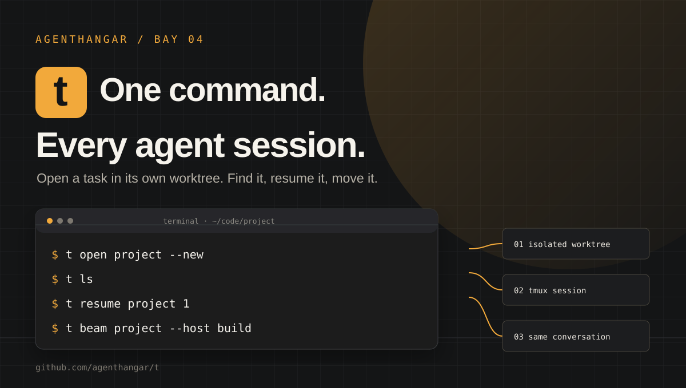

# t

Evaluate coding workflows with `t eval config`, then `t eval runs start`.
The configuration picker launches the selected run directly; `t eval runs list`
opens the run picker in a terminal, with progress and per-workflow benchmark results.
Redirected and JSON lists stay static. See [workflow evaluations](docs/evaluations.md).

`t ls` shows observed local/cloud token percentages and participating models
(★ marks the lead). Use `t system usage show` for the searchable workflow,
session and eval usage view, or `t system usage list --json` to export records.
Unknown usage and cost remain unavailable; workflow attribution is recorded at launch.



**Your sessions. Any terminal.**

Move Claude Code and Codex conversations between configured SSH hosts, keeping
their Git worktrees and saved history together.

t manages sessions in tmux and gives each task its own Git worktree. It includes
Claude Code and Codex session workflows, plus Cursor transfer tools.

<p>
  <a href="#agents"><picture><source media="(prefers-color-scheme: dark)" srcset="docs/media/logos/claude-dark.svg"></picture></a>
  &nbsp;&nbsp;&nbsp;&nbsp;
  <a href="#agents"><picture><source media="(prefers-color-scheme: dark)" srcset="docs/media/logos/openai-dark.svg"></picture></a>
  &nbsp;&nbsp;&nbsp;&nbsp;
  <a href="#agents"><picture><source media="(prefers-color-scheme: dark)" srcset="docs/media/logos/cursor-dark.svg"></picture></a>
</p>

Supported workflows vary by agent; see the [support matrix](#agents).
[Logos belong to their respective owners](docs/media/logos/README.md).

[Get started](#install) · [Work from anywhere](#work-from-anywhere) · [Commands](#commands) · [Configuration](#configuration) · [Agent support](#agents) · [Coming soon](#coming-soon) · [AgentHangar](https://agenthangar.ai)

## Work from anywhere

- **Start with your agent.** `t session open my-project` gives Claude Code an isolated
  worktree and tmux session; add `--codex` to use Codex. Detach and come back to
  the same session whenever you need it.
- **Move between local and cloud development.**
  `t session move my-project 1 --host cloud` moves the session to a configured
  SSH host; `t session move my-project 1 --from cloud` brings it back. Use your
  own workstation or cloud VM with t and your agent installed.
- **Continue through a connection loss.** For fresh Codex CLI sessions, choose
  `t workflow` → Codex → your workflow → **Inference & routing** →
  **On cloud connection failure** → **Ask which local model**. Selecting a ready
  local model immediately continues the task locally; when connectivity returns,
  choose whether to return to cloud. See [local recovery](docs/local-workers.md#when-the-internet-is-unavailable)
  for checkpoint limits and setup.
- **Take it on the go.** Connect to that host from your phone's SSH terminal.
  `t session list` shows the sessions, `t session read my-project 1 --dump`
  lets you scroll their output, and `t session open my-project 1` reconnects
  you. A detached session stays available while its host stays awake and reachable.
- **Submit to an existing AgentCore runtime.** `t agentcore invoke` submits JSON
  using your existing AWS CLI profile; continue with the same session ID and use
  `t agentcore stop` to terminate it. See the [supported workflow](docs/agentcore.md)
  for setup and limitations. Automated tests cover the CLI contract; live AWS
  behavior remains unverified.

**Coming soon:** [Teleport for SSH access](https://github.com/agenthangar/t/issues/10).

## Install

You need **zsh, Python 3, Git, and tmux**. Install `fzf` for the interactive pickers,
`gh` for GitHub integration, and `rsync`/SSH for moving sessions between hosts.
The test suite runs on macOS and Linux with Python 3.12.

To try a fresh install and worktree session in a disposable Docker container, see
the [playground guide](docs/playground.md).

With Homebrew:

```sh
brew install agenthangar/tap/t
t
```

Homebrew installs the formula without changing your home directory. Run `t` in a
terminal for guided setup: choose agents, review shell and agent integrations,
select repositories, and start a session. Missing agent tools are optional installs.
The review shows the commands and configuration changes before applying them.
Setup and terminal session launch find native agents in `~/.local/bin` before that
directory is on your shell's `PATH`. Choose agent sign-ins separately: select
Claude, Codex, or both, or leave the checklist empty to skip. Only selected
sign-ins run after review; you can install an agent now and run `t login` later.
Agents already signed in are labeled **logged in** and listed separately from
the optional login choices, with their status repeated in review.
Shell links follow Homebrew's stable `opt` path across upgrades; there is no manual
shell configuration step before starting your first session.

Setup discovers primary checkouts under `~/code`, `~/config`, and the current
directory, skipping session worktrees. It can also offer to install GitHub CLI
and run `gh auth login`. With GitHub connected, choose organizations and repositories
to clone. Nothing is selected for cloning by default; destinations are shown as
`~/code/<organization>-<repository>` to avoid worktree-name collisions. Existing
matching clones are detected and preserved.

Available Tailscale peers are offered as optional remote hosts. After reviewed
registration is saved, choose **Verify SSH now** or **Later**. Verification runs
OpenSSH in your terminal so you can review and accept its native host fingerprint
prompt; it does not install t or configure access remotely. Failed or refused
verification keeps the registration and continues to the next host. All setup steps can be skipped
or canceled. On a choice screen, `q` or Esc goes back and keeps your choices,
including checkboxes changed before pressing Enter. At review, `n` or Esc goes
back; `q` cancels setup. Ctrl-C cancels from any screen. Completed actions remain
in place if a later step fails.

Returning users run `t` to choose a work session. Run `t config onboard` (or choose
**Find repositories and hosts** from the session entry screen) to discover newly
cloned repositories, connect GitHub, or add hosts later. Discovery runs during
setup, not in the background. Explicit commands, help, lists, status, and machine
output never start onboarding. Bare `t` without a terminal prints help.

If an older installation shadows Homebrew, `type -a t` identifies which copy your
shell is running. `t system integrate` remains available for explicit maintenance.

Or install a versioned release directly:

```sh
curl -fsSL https://raw.githubusercontent.com/agenthangar/t/main/scripts/install-release.py | python3
```

This installs the latest tagged release under `~/.local/share/t/releases/` and
links the command into `~/bin`. No repository checkout or pip packages are needed.
The installer verifies the release archive's SHA-256 checksum before unpacking it.
Set `XDG_DATA_HOME` or `T_INSTALL_DIR` to choose another installation location.
You can also download and inspect the installer before running it with Python 3.

The installer appends a marked t startup block to `${ZDOTDIR:-$HOME}/.zshrc`,
creating the file when needed and preserving existing content. Previously documented
startup snippets are retained without adding a second plugin source. It prints an exact
`source` command for the current terminal; a new interactive zsh loads t automatically.
The block follows `~/bin/t` and Homebrew upgrades. A canonical Git installation
automatically selects the current t development worktree without changing that link.
Links-only updates do not edit shell startup files.

For an older or incomplete installation, run:

```sh
t doctor                    # read-only setup and launch-resource diagnostics
t doctor --repair           # repair zsh startup and a missing ~/bin/t link
# Then run the exact source command printed by repair, or open a new terminal.
```

`t install` offers missing shell setup as a preselected, reviewed action even when
all agents are already installed; deselecting it or cancelling writes nothing.
`t system diagnose --repair` is the equivalent grouped spelling. Repair is additive
and repeatable; an edited managed block or a conflicting `~/bin/t` is reported for
manual review. It does not install agents, log in, change trust/permissions, or reload
tmux. Other diagnostic findings retain their suggested explicit actions. Startup
inspection reads the rc file without executing user shell code; after loading it,
`whence -w t` should report `t: function`.

For fork/open failures on another host, run `t doctor` there immediately after
the failure, or `t hosts run HOST t system diagnose`. Keep the exact launch error
with the report. The **Launch resources** section shows PTY usage/limits, process
limits, and recent macOS kernel PTY failure counts; unavailable evidence is
labeled. It does not allocate test terminals, restart tmux, execute shell startup,
fetch Git refs, or enable GitHub CLI telemetry. A normal snapshot cannot rule out
an earlier transient failure. `--repair` fixes shell wiring, not kernel resources.

Doctor also shows the latest five **Recent session attempts**, including recorded
failures before an agent or pane log existed. Use `t doctor --recent 20` (or
`t system diagnose --recent 20`) for more. Each receipt shows the operation,
timestamp, agent, workspace, conversation identity, last stage, operation exit
code and retained error when available. Completed launches do not prove the
agent's later exit status; incomplete and log-only sessions stay explicitly unknown.
The report includes up to eight diagnostic lines from the last 16 KiB of the
associated log, with terminal controls and common credentials removed. Older
attempts use saved excerpts so a later launch's errors are not attributed to them.
The latest legacy session log can still be shown, labeled as shared evidence
that may include earlier attempts.
Missing, rotated, unsafe or older unbounded evidence is labeled. Errors that
predate lifecycle recording cannot be recovered retrospectively. Doctor never
creates diagnostic state or reads agent conversation transcripts.

```sh
t agent install            # choose and install agent CLIs; review their vendor commands
t repo add ~/config/my-project  # register a checkout you already have
t config setup             # select checkouts under ~/config and optional SSH hosts
t session open my-project  # start an isolated worktree + tmux slot
t session list             # running sessions across every repository
```

Sessions open directly into the agent without displaying internal shell commands.
Detach from tmux with `Ctrl-b d`; reattach with `t session open my-project 1`.

New slot worktrees use an identifiable directory such as
`$DEV_WORKTREE_ROOT/t/t-12`, `cashfwd/cashfwd-4`, or `hive/hive-7`.
The slot argument remains numeric (`t session open t 12`), as do tmux slot IDs
and history associations. Existing numeric directories such as `t/12` are reused
without being moved. Saved conversations retain their exact IDs and paths;
resume can rebuild either layout after a worktree is swept. Codex receives that
directory name when opening a workspace; this does not group every worktree
under one common heading in the app. Live GUI rendering is not verified by the
automated compatibility tests.

Both layouts work with CLI open/resume, navigation,
and retained history. If both `t/12` and `t/t-12` exist, slot actions refuse to
choose: inspect the two worktrees and use `t resume t 12` to select a
specific conversation. t never resolves this collision by moving either tree.

Upgrade t's CLI and shell plugin together on each host before using labeled
worktrees. A current sender checks the destination's layout capability before
stopping its source writer; an older receiver is refused with an update hint.
A current receiver can accept an older sender's numeric path. Older commands
do not understand labeled worktrees: upgrade on that host before opening or
resuming them. Transfer preserves the exact cwd and requires matching configured
worktree roots; different home directories or roots are refused before the
source is stopped. Attach on the source host, align the configuration for future
work, or use history's verified resume into a fresh local workspace. Existing
worktrees and agent history should not be manually renamed to bridge hosts.

`t open` browses sessions across all local repositories, including from inside a
worktree; `t open my-project` filters to that repo. Attached CLI sessions are hidden by default; `--attached` includes them. Idle sessions and
inactive CLI sessions remain visible. An explicit slot still opens directly.

`t resume 5` browses every saved conversation associated with slot 5 in the
current repository. `t resume t 5` and `t session resume t 5` name the repository
explicitly. The slot browser uses retained conversation history internally. It retains inactive and live conversations, archived records, and records
whose worktrees or transcripts have been removed. It always asks you to select a
conversation before resuming, including when only one exists.

History uses the same session information as `t ls`: status and active context,
recorded interface, agent glyph and model, host, session, and
working-on summary. Saved conversations keep their recorded metadata; missing
historical model or interface evidence stays unknown. The picker aligns these
fields and keeps the summary visible on small terminals. Its details pane shows
full values, date, branch and commit evidence, every associated PR, and the exact
conversation ID. At 80×24 and larger the pane opens by default; **Ctrl-/** toggles
it on smaller screens, and **Shift-↑/↓** scrolls it. PR suffixes use **O** open,
**M** merged, **C** closed, and **?** unknown; extra PRs show a count.

History shows 50 conversations per page. Search covers all pages; Ctrl-F and
Ctrl-B move between pages, Ctrl-/ opens details, Enter resumes the exact selected
conversation, and Escape cancels. Ctrl-R or `--refresh` refreshes metadata from
registered hosts without downloading their transcripts. Unreachable hosts retain
their cached records. `--limit N --page N --json` provides paginated metadata;
without a terminal the command only prints an aligned table, retaining dates,
branches, PR states, and full conversation IDs. JSON also includes the normalized
`display` fields and recorded metadata provenance. PR state reads use the cache;
Ctrl-R or `--refresh` updates it explicitly.

A live terminal conversation attaches to its existing owner. A foreground owner
offers an explicit handoff path. Legacy Desktop owners must release their writer
before CLI resume. An inactive conversation reuses
its original workspace only when recorded ownership and revision still match;
otherwise it gets a new slot branch based on the verified historical commit.
For example, `t session resume t 4` can resume an inactive conversation into a
new slot while another conversation uses slot 4. Codex writer checks protect
the selected conversation and its destination workspace.
Existing dirty work stays in its source workspace. If the historical commit is
unavailable, the picker explicitly offers current main or cancel. Legacy history
can lack commit, host, title, or PR evidence; these details stay unknown. Associated
PRs require structured tool evidence or a matching branch and commit; incidental
links appear separately in details. History records are private under
`$XDG_STATE_HOME/t/history/v1` (default `~/.local/state/t/history/v1`).


`t resume` includes saved conversations from every registered host by default.
Discovery matches repository identity, so host aliases, home directories and
worktree roots can differ. Canonical checkouts, swept Codex rollouts, and renamed
workspaces with the exact recorded Git origin also appear. `--remote` remains a
compatibility option. Only a selected remote transcript is downloaded and its
identity is checked before use; unavailable hosts retain cached history.

Claude and Codex use **t transfer** for cross-host moves and resumes. Legacy
`DEV_HANDOFF` and desktop opening settings are ignored. The transfer preserves
its existing ownership, checkpoint, and worktree safety checks.

Selected local resumes also reconcile the original workspace before creating a new
worktree. If it still belongs to the conversation, current commits and eligible
uncommitted changes are carried forward, including nonignored untracked files.
Outstanding changes are committed as a local checkpoint using normal Git hooks.
Missing or recycled workspaces use the recorded historical revision instead;
unsafe current sources stop the resume without losing their work.

With t transfer, after selection, cross-host saved resume verifies the latest recorded workspace on the
prior host, including its conversation, repository, branch and worktree generation.
It carries the actual branch tip, including unpushed commits. Outstanding tracked,
staged and ordinary nonignored untracked code is committed there as a local
checkpoint with normal Git identity and hooks, then transferred privately without
pushing to origin. Private credentials or agent artifacts, a changed workspace,
live ownership, conflicts, or diverged conversation revisions stop the resume.
Existing destination branches and files are preserved by allocating a fresh slot.
If the host is unreachable, a warning identifies the local-code fallback; a
validated local or cached transcript is still required. Missing local revisions
retain the explicit main-or-cancel choice. Discovery and cancellation never
checkpoint work. Live moves using t retain the existing commit/push and transcript
sync transaction; they require the source to reach the destination.

An inactive conversation remains selectable when its historical slot now runs
another conversation. It resumes in a safely allocated workspace; the existing
owner and its files stay intact. Selecting an exact live conversation attaches
to that owner. `--fg` and `--host` retain their selected destinations.
`t resume api 2` opens the shared filtered picker for conversations associated
with slot 2, including live and saved work and conversations later moved to
another slot. Even one conversation waits for selection. Ctrl-F shows inactive
work; Ctrl-A shows all, and Escape cancels without attaching or resuming.
Without a terminal, an explicit slot retains newest-saved selection.

Saved Codex candidates are cached under `${XDG_CACHE_HOME:-~/.cache}/claude-sessions`.
Repeated `t resume` calls reuse unchanged metadata; each invocation checks for new,
changed, removed, or replaced rollouts and index/WAL changes. One discovery snapshot
serves every worktree in a resume scan. Other saved-conversation lookups reuse the
same cache. Live ownership is checked afresh before resume; deleting the disposable
`candidates-*.json` files simply rebuilds them on the next lookup.

For example, run `t resume my-project --days all` again after cancelling the picker:
unchanged discovery metadata is reused, while new conversations appear immediately.
Terminal progress messages identify ownership checks, saved-candidate discovery,
and metadata loading. Open/close session scans, session lists, history, and issue
commands also report discovery stages. Redirected output and JSON remain quiet.

`t open`, `t resume`, and `t kill` share the Air picker design:
**Tab marks ✓ and Enter acts on the selection**. A plain green checkmark
stays readable in its own gutter beside the pointer on the dark cyan focused row.
All searchable pickers and inline menus share cyan headings, muted hints and
spacing that adapts to terminal width and height. macOS shows native key labels
such as `⌃F`, `⌃S`, `↩ Return`, `⎋ Esc` and `⇥ Tab`; other systems show Ctrl-F,
Ctrl-S, Enter, Esc and Tab. The shortcuts below work on both.
In `t open`, press **Ctrl-K** to kill only the focused session, independently of
marks. This confirms that session and retains close safety checks. For example,
run `t open --attached`, focus a session, and press **Ctrl-K**.
The picker stays open and removes the closed row without rediscovering sessions.
Search, filters, and marks on other rows are preserved; failed or canceled closes
leave the row available.
Type full phrases to search, including spaces and the letter k. Tab marks rows; Ctrl-K closes the focused session. Session searches match literal phrases, ignoring case.
Ctrl-F toggles filters without leaving the list; Ctrl-X resets filters. Ctrl-T cycles state. Ctrl-G/O/R matches the highlighted row’s agent/host/repo; repeat the shortcut to clear that filter. Ctrl-D matches interface (CLI or desktop) in open and close. Ctrl-S toggles sorting; Ctrl-Y cycles sort choices. Open and resume default to last turn, newest first, and also offer repository, agent, host and session. Unknown turn timestamps sort last. Close offers repository, agent, host and session. Turning filters or sorting off preserves their choices. Sorting off restores snapshot order.

The header highlights active filters and sorting, with explicit ON/OFF text.
Mac shortcuts use ⌃ and ⌥; other systems show Ctrl and Alt.
Filtering keeps your
search and removes hidden marks. Choices use the current snapshot without
expanding repository scope or fetching new sessions.

`●` means a CLI terminal is attached or a desktop conversation is loaded;
`○` means unattached/unloaded. A `✓` **inside** the row means an agent has loaded
conversation context, independently of terminal attachment. It does not mean the
agent is generating. `↻` means work continued after a merged PR (edits or commits
not known to have landed); “not marked” is not proof that work is finished.
The separate `✓` in the left selection gutter means you marked that row to open.

Resume never invents a historical interface. Resume and close use the same
inline filter shortcuts and on/off keys as open.
Resume sorts by the last actual user turn, newest first; unknown times come last.
Ctrl-Y cycles last turn, repository, agent, host/origin and session.
Numeric slots sort naturally, e.g. 2 before 10.
Text sorts ascend, then use newest turn and session identity to break ties.
Filters, reset and on/off preserve the selected sort; Ctrl-Y cycles back to last-turn sorting.
For example, `t resume --live` followed by Ctrl-Y groups live and saved sessions by
repository. Live labels remain visible alongside their last-turn time.
The open picker shows a LAST TURN column alongside session and task text. Narrow terminals shorten timestamps in local time; full timestamps remain searchable. There is no details preview or new-session shortcut. Start fresh explicitly with
`t open api --new`. Resume and close retain **Ctrl-/** for full details.
Search still matches the full task and metadata when a compact row shortens them.

The default views are unattached sessions for `t open`, inactive conversations
for `t resume`, and unattached sessions with no pending work for `t kill`. Kill
requires a clean worktree and proof that its commits have landed; open/unknown
PRs and uncertain work stay hidden until Ctrl-P or Ctrl-A. `t resume --live`
and `t open --attached` start with all rows; Ctrl-F restores their defaults.

CLI opens use this terminal for the first selection and new tabs for the rest,
falling back to new windows in Terminal when tabs cannot be created safely
(including switching away during creation). Attach commands remain available
if opening a terminal fails. Commands never target an existing tab. `--fg` opens one session. In `t kill`, mark sessions with Tab and
press Enter to confirm and close the whole selection without further prompts.
Explicit targets still confirm live-agent interruption unless `-y` is supplied.
Desktop ownership checks apply in both cases.

Worktree sessions use the fetched default branch recorded in `origin/HEAD`,
falling back to fetched `origin/main` or `origin/master` when that record is missing
or dangling. After a remote default-branch change, refresh the record with
`git fetch origin` and `git remote set-head origin -a`.
`t repo create` can create
and register a GitHub repository with the expected setup, showing its plan first.
To use an existing GitHub repository, run `t repo clone https://github.com/owner/repo.git`.
Use `t system diagnose` when something is missing.

## Commands

Run `t` or `t help` for a short overview, then `t help <noun>` or
`t <noun> <verb> --help` for details. Commands use the `t <noun> <verb>` form,
with `t share` as the context sharing command.
Contributors can find the behavior, keyboard, and appearance rules in the
[command and terminal contract](ui/README.md).

Every existing-repository argument accepts its registered short alias, checkout
directory basename, or unambiguous local origin repository name. For example, with `app=/path/to/application`, `t session cd app 2`
and `t session cd application 2` enter the same worktree. Exact aliases take
precedence; if several different checkouts match the same basename or origin name, use an
explicit alias. Origin names come from local Git metadata, without a network request,
and preserve case. Remote opens resolve names on the selected host. Remote resumes
use verified repository identity for local matches; target-only names resolve on
the selected host.
New aliases, paths, search text and delegated commands keep their literal meaning.

The older spellings still work; `t help aliases` lists them. Bare `t config`
continues to open its interactive menu.

For opening sessions, `t session open --help` shows a concise reference with
examples; `t help session open` adds session targeting, defaults, and remote
behavior. Start a fresh Codex session in the current repo with
`t open --codex --new` (`codex` without `--` is a repository name).
Session-cache refresh and history indexing run in the background. Startup still
prepares the worktree, checks ownership, and captures launch settings and revision
evidence before returning control. It never changes an active checkout in the
background.

Opening and resuming serialize local tmux launches for the same worktree and
conversation, including repository aliases. Foreground launches recheck ownership
before invoking the agent. A failed tmux launch reports the failure instead
of sending a second launch into an existing pane. Unavailable registered hosts
produce highlighted warnings while resume and session pickers continue with
local and reachable hosts. Saved resumes still check known owners and local
launch locks; ownership on an unavailable host cannot be verified. A failed local
ownership scan still stops the launch. To start a fresh conversation locally, use
`t session open my-project --here --new --cli`.
Codex tmux sessions in freshly allocated worktrees can start while other held
Codex writers have unresolved workspace metadata. The lifecycle receipt retains
those writer IDs; known same-workspace owners and reservations still block.
Reused workspaces, saved resumes and transfers retain stricter writer checks.
Remote ownership scans time out after 15 seconds rather than waiting indefinitely
for a host's login shell.

### Work

| Command | Purpose |
| --- | --- |
| `t session open <repo> [slot]` | Open or reattach a task; `--new` starts another, `--codex` selects Codex, `--cli` resumes in the terminal |
| `t issue list [repo] [-a]` | List issues in the current, named, or all registered GitHub repositories |
| `t issue status [repo] <number>` | Inspect existing work without starting an agent |
| `t issue start [repo] [number ...]` | Continue or start work on one or several issues |
| `t issue open [repo] [number ...]` | Open one or several GitHub issues in your browser |
| `t share` / `t share --to claude` | Review captured conversation context and start a new agent session; `--to` also works without a terminal when the source is known |
| `t share --to agent:id [--file summary.md] [--attach history.md]` | Share context with an exact existing conversation; `--file` supplies your own text |
| `t share targets` / `t share inbox` / `t share read <message-id>` | Find conversations and read received shares |
| `t session list [-r] [-a]` | List sessions across local or remote hosts and repositories |
| `t session close <repo> <slot>` / `t session restart <repo> <slot>` | Stop a slot or recover a stuck agent in the same conversation |
| `t session push` / `t session pop` | Move between foreground and detached tmux |
| `t session resume` / `t session search <query>` | Find and resume saved conversations; search finds Claude transcripts by content, then resumes the selected one |
| `t session cd [repo] [slot]` / `t session read <repo> [slot]` | Enter a worktree or read its terminal log (`--dump` writes plain output) |
| `t session move [repo] [slot] [-r] [--host <host>]` | Select current sessions, then a destination, or move an explicit slot; `--from <host>` pulls it here or sends directly with `--host` |
| `t remote open [host] [repo] [slot]` | Choose a host and attach to an existing session; `--new` starts fresh |
| `t remote resume [host] [repo] [slot] [--all]` | Choose a host and resume saved history discovered there |
| `t remote kill [host] [repo] [slot|all] [-y|--yes]` | Close sessions on their discovered remote hosts; preserve saved conversations and worktrees |
| `t move [repo] [slot] [-r] [--host <dest>]` | Alias for `t session move`; `t remote move` remains compatible with `--remote` |
| `t session view-plan` / `t session paste` | View a Claude session plan or pass an attachment |
| `t repo list` / `t repo locate <repo>` / `t repo cd <repo>` | List names and paths, print a checkout path, or enter it in the shell |
| `t repo add [path] [--alias NAME]` | Register an existing checkout; omit path to use the current checkout |
| `t repo create` / `t repo clone <github-url> [alias]` | Create a repository or clone and register an existing one |
| `t cursor list` / `t cursor resume [id]` / `t cursor send [id]` | List, resume, or move Cursor CLI chats |
| `t hosts run <host> <command>` | Run a command through the host's login zsh |
| `t hosts` | Show host-management commands and examples |
| `t hosts list [--json]` | List registered SSH host aliases and targets |
| `t hosts show <alias>` | Show a host's target and defaults |
| `t hosts add <alias> <target> [--default]` | Register an SSH config name, address, or user@host |
| `t hosts edit <alias> <target> [--default]` | Change a registered host's target |
| `t hosts remove <alias>` | Unregister a host and clear its defaults; `delete` and `rm` also work |
| `t hosts default [alias] [--clear]` | Show, set, or clear the legacy `t beam` default destination |

`hosts` manages remote machines. Run `t hosts` to see its commands,
`t hosts list` to list machines, and `t hosts <verb>` to manage them or run remote commands.
For example, `t hosts add mini chris@mini.local --default` registers `mini` and
makes it the default destination for legacy `t beam`; `t session move` still asks for a destination. Configure SSH keys,
ports, and jump hosts in `~/.ssh/config`; registering a host saves local
settings without connecting to it or installing software there.

In `t config open` → **Hosts** → **Add host**, t scans for new online Tailscale
hosts each time you open the picker. Choose **Refresh Tailscale hosts** to check
again while the menu is open, or **Enter SSH host manually** for another target.
Registered and pending hosts are excluded by their known names and addresses.
Choosing a peer stages its registration; review **Save changes** to apply it.
After saving added or changed SSH targets, choose **Verify SSH now** or **Later**.
Verification uses the normal OpenSSH fingerprint prompt, once per distinct target;
renaming an alias or changing the default host does not connect. Ctrl-C stops the
remaining verifications and keeps the saved configuration. Explicit `t hosts add`
and `t hosts edit` remain noninteractive.

For manual entry, enter an SSH target such as
`alice@mini.example`; the short name is prefilled as `mini` (with a numeric suffix
if needed). To rename a registered host, choose Hosts → host → Short name,
then Save changes. SSH targets and default-host references are preserved.
First-run onboarding also generates unique short names for selected hosts.

`t session move` (also `t move`) opens a multi-selection picker of current local
Claude and Codex CLI conversations, then a destination host picker. Tab
marks sessions; Enter moves the marks or the focused session. Use `-r`/`--remote`
to include registered remote sources, `--all` to browse every repository, or name
`api` to scope selection. The current checkout scopes the default view; outside
a checkout all repositories appear. Attached and detached sessions are included;
saved history and desktop reservations are excluded. Selection also opens inside
an agent. `--host mini` supplies the destination explicitly; a configured default
never bypasses selection. Every alias of each selected source host is excluded.
When checkout names differ across machines, the source host verifies repository
scope before including the session. For example, `t move api 2 --host local`
can receive a session whose remote checkout has a different directory name.

Worktree moves check Git push access before stopping the source, then commit its
final edits and publish a unique transfer snapshot. They do not overwrite a
same-numbered branch from another host. A busy or divergent destination lands in
a fresh slot at the exact source revision. Update t on both hosts for this protocol.
If publication fails after stopping, the source files and checkpoint remain there;
Git's diagnostic and source-history recovery guidance are shown.

Multiple selections move sequentially with detached destinations. All identities
are rechecked after both pickers before any move. A failure or cancellation stops
the remaining moves and reports completed, failed and unattempted sessions.
`t session move api 2 --host mini` bypasses session selection. Scripts must supply
a slot or `--session ID`, a destination, and `--detach`. `--from HOST` receives
here; combine it with `--host DEST` for a direct remote-to-remote move. The legacy
`t beam` shortcut retains its implicit-current and default-host behavior.

Use the `remote` family to choose where to work:

```sh
t remote open                         # choose a host, then an existing session there
t remote open mini api 2        # attach to this slot on mini
t remote open mini api --new    # start fresh on mini
t remote resume mini api        # choose saved history discovered on mini
t remote resume mini --all       # all repositories, regardless of remote login directory
t remote kill api 9             # discover slot 9's remote host and confirm before stopping a live agent
t resume t 11                          # mark conversations with Tab, then Enter
t session resume --all                  # local and remote-only repositories; clone only after selection
t session move -r                      # choose current sessions, then their destination
t session move api 2 -r                # discover the source, then choose its destination
t session move api 2 --from mini --host cloud
t session move api 2 --from mini --host cloud --detach
```

`remote` also accepts command families. The host follows the complete action
and always identifies the source machine:

```sh
t remote session ls                        # list all registered remote hosts
t remote session ls mini                   # list only mini
t remote workflow list mini --json         # inspect mini's workflows
t remote config show mini                  # inspect mini's settings
t remote move mini api 2                    # move FROM mini; choose a destination
t remote move mini api 2 --to local         # bring that session here
t remote session move mini api 2 --to cloud --detach
t remote kill mini api 9                    # close only mini's session
```

Finite lists and status queries query distinct registered SSH targets once, in
host order, without opening a picker. Actions operate on one chosen host; missing
choices require a terminal. `t remote --host mini session ls` makes the host
explicit if its name could also mean a repository. Repo-first `remote move` and
`remote kill` keep their existing owner discovery. The released move form
`--from SOURCE --host DEST` remains compatible; use `--to` for new remote examples.
Open/resume run on their chosen source host. Move asks separately for its destination.
Explicit live close targets still confirm unless `--yes`, and saved work remains.

Nested commands reuse the normal command implementation, flags, review screens,
and safeguards. A normally inferred current repository follows its verified
identity to the source host; checkout paths and aliases may differ. Lists that
normally cover every repository keep that behavior. Unsupported caller-shell or
browser operations explain the limitation before connecting.

Single-host output and exit status are preserved. Multi-host text uses host headings;
commands supporting JSON return `{"results": {"host": ...}, "errors": {"host":
{"status": 255, "message": "..."}}}`. Partial results remain visible and any failure
returns nonzero. An empty host list is a successful empty result. Queries are
bounded and never recursively query the peers' own hosts. Mutations never fan out
implicitly; session lifecycle ownership checks still span hosts where required.

Basic unscoped lists also work with older peers. Other commands check protocol
support before execution; upgrade an older peer with
`t hosts run mini t system update`. Cancel selection with Esc/Ctrl-C (130).
Transfer failures preserve the existing recovery behavior: the destination never
starts from an unverified or stale snapshot.

`remote open` shows the chosen host’s sessions in a local picker and opens additional
selections in local terminal tabs before attaching the first session.
The explicit `[repo] [slot] --host HOST` form remains compatible. Unflagged
repository-only targets that could be mistaken for hosts require `--host`.
`remote open` browses the chosen host; an empty inventory does not create a
session. `--new` explicitly requests a fresh session. `remote resume H`
discovers saved history on H, while `session resume --host H` carries locally
discovered history to H. A live selection with a different `--host` is refused
before any batch action and provides an exact `session move` command. Matching
host aliases may attach to the existing owner. Desktop resume remains local.

### Configuration and tools

For local coding delegation, open **t config → Local worker & models** or run
`t config local`. Review installation of Codex/Ollama, select and download a local
model, and connect the worker to Codex through MCP. The lead keeps its conversation;
workers use isolated repository snapshots and return findings, patches, and test
evidence. `t config local --show` is read-only. See [local workers](docs/local-workers.md)
for setup, cancellation, limits, and automated setup examples. In **Workflow →
Inference & routing → Local model**, downloaded artifacts offer **Test model**
without downloading them again. Benchmarks and artifact/runtime details have
separate views. `t config models install MODEL --yes` also reuses completed files
and verifies inference; downloaded weights alone do not mean Ready.

Shared local inference: `t config` → **Local worker & models** shows model usage,
requests, provider setup, CLI help and desktop-app launch actions. Use
`t config models runtime monitor --view cli` or `--view gui` to monitor the same
runtime. See [shared model usage](docs/local-workers.md#shared-model-usage) for
queueing, memory caching, cancellation and read-only status commands.

| Command | Purpose |
| --- | --- |
| `t config open` / `t config show` / `t config edit` | Open the settings menu, print settings, or edit its source |
| `t config setup` | Register repositories and optional SSH hosts |
| `t profile init` / `t profile edit` / `t profile show` / `t profile apply <repo>` | Manage a reusable AGENTS.md profile |
| `t policy check` / `t policy show` / `t policy apply` | Inspect or apply an explicitly configured permission policy |
| `t login` / `t agent login` | Review and run logins for logged-out or expiring tools; see [login behavior](docs/login.md) |
| `t agent install` / `t agent status` / `t agent trust <dir>` | Install agents, inspect their status, or trust a folder |
| `t system integrate` / `t system update` / `t system diagnose` | Link t into this account, update it, or diagnose the installation |
| `t config onboard` | Repeat guided setup and discover agents, repositories, and hosts |
| `t help [noun [verb]]` / `t help agents` / `t help aliases` | Read command help, agent support, and compatibility aliases |

The sessions MCP entry point (`t mcp`) is used for registration and tool serving;
it is not part of the everyday interactive command set. Agent capabilities vary:
see [Agent support](#agents) or `t help agents`.

Send a new objective to a live local Claude or Codex terminal slot with:

```sh
t session goal api 3 'Finish the login tests, then report the remaining failures'
t session goal api 3 'Investigate the timeout before making further changes' --json
```

Both repository and slot are required. This submits an instruction to the exact
current conversation; it does not claim the agent has adopted or completed it.
Inspect the session's composer for drafts or dialogs before sending input.
Desktop, foreground, and remote instruction delivery are not supported.

The sessions MCP server exposes `open_session`, `resume_session`, `kill_session`,
`restart_session`, `send_instructions`, `pause_session`, and `set_session_goal`,
alongside its three discovery tools. Lifecycle tools take explicit `repo` and
numeric `slot`; close also requires `confirm: true`. Open and resume use the
existing ownership/worktree checks and leave the CLI slot detached, with an
attachment command in the result. Resume restores the newest saved conversation;
to continue a paused live turn, send an instruction such as "Continue the current
objective". Instruction, pause, and goal tools require the full current
`session_id` and refuse stale owners or the calling agent. Use
`session_command` with `{"command":"list"}` to retrieve current IDs for both agents.

`session_command` covers every `t session` verb, using `command` and an array of
literal CLI `arguments`. For example:

```json
{"command":"goal","arguments":["api","3","Finish the login tests"]}
```

List returns structured session rows, history returns JSON, read dumps output,
and cd returns the resolved directory. Terminal-dependent workflows (push, pop,
move, interactive search/paste, and conditional lifecycle modes) return
`terminal_required` with the exact command, without starting work or a picker.
Codex Desktop integration has been removed. `t app`, `t session open-app`, and
`--app` are no longer supported. Use CLI session open/resume and `t session move`.
Saved conversations and worktrees are preserved; old reservation markers prevent
automatic worktree cleanup, and exact history resume still verifies writer locks.

Pause requests the default Escape interrupt key; it does not suspend processes,
stop background subagents, or guarantee queued work remains paused. Goal is a
conversational objective change, not an agent-native goal API. Delivery results
report `acknowledged: false`; inspect subsequent agent output to verify the effect.
Installation registers the `sessions` MCP server with installed Codex and Claude Code
clients. `t mcp install` retries registration; existing registrations, including
custom or disabled entries, are preserved. Set `T_NO_MCP=1` to skip installation.
Search includes saved Claude transcripts and Codex active/archived rollouts under
`CODEX_HOME` (default `~/.codex`), excluding injected context and subagent rollouts.
After registration, refresh MCP tools or reopen the client if tools are unavailable.
The same lookup backend is available without runtime MCP tools:

```sh
t mcp --call find_sessions '{"query":"dashboard mobile","repo":"t"}'
t mcp --call session_detail '{"session":"SESSION_ID"}'
```

Only the original three lookup tools are automatically allowed. Installing or
running `t mcp install` replaces the old blanket `mcp__sessions` permission with
those lookup rules, preserving custom per-tool rules and deny/ask settings.

Slow terminal session/host scans and saved-history discovery show a small spinner
after a short delay. It clears before results, pickers, or errors; redirected,
JSON, MCP, and remote scanner output stays free of progress animation.

`ls` and `list` are interchangeable for `session`, `repo`, `cursor`, `hosts`,
`issue`, and `workflow`. Root `t ls` and `t list` both list sessions.
Session lists always print a read-only table, including in terminals with fzf.
Use `t open` to select and open sessions. Pipe to `cat` for complete values.
The old `t repos` family has been removed; use `t repo list`, `t repo locate`,
`t repo cd`, and `t repo add`.

### Existing spellings

Older scripts and habits continue to work. Use `t help aliases` for the full list;
these are the common migrations:

| Existing | Grouped command |
| --- | --- |
| `t open`, `t ls`, `t kill`, `t beam` | `t session open`, `t session list`, `t session close`, `t session move` |
| `t push`, `t pop`, `t find`, `t plan` | `t session push`, `t session pop`, `t session search`, `t session view-plan` |
| `t new`, `t checkout` | `t repo create`, `t repo clone` |
| `t setup` | `t config setup` |
| `t instructions --init/--edit/--show`; `t instructions <repo> --apply` | `t profile init/edit/show`; `t profile apply <repo>` |
| `t permissions`, `t permissions --show/--apply` | `t policy check`, `t policy show/apply` |
| `t install`, `t trust`, `t integrate`, `t update`, `t doctor` | `t agent install`, `t agent trust`, `t system integrate`, `t system update`, `t system diagnose` |

If a CLI cannot reconnect but its tmux slot is still live, run
`t session restart <repo> <slot>` from a separate terminal. `--dry-run` shows the target
first. Restart saves the pane text, including any visible unsent draft, to a
private file under `${XDG_CACHE_HOME:-~/.cache}/t/restart/`; it prints that path
before stopping the client. Only visible draft text can be recovered this way;
copy any draft that extends beyond the pane before restarting. The saved text is
not submitted automatically. The old client must exit before the same conversation
resumes in the same pane; worktree edits and dev servers stay in place. Use
`t session open <repo> <slot>` to attach. For a remote slot, use
`t hosts run <host> t session restart <repo> <slot>`.
Every Codex recovery resumes with `--no-daemon` so relaunching one conversation
does not reconnect through the shared server used by other windows. Recovery
refuses to stop an `app-server` process or proceed without `--no-daemon` support.

For sessions opened through `t`, a local monitor automatically offers **Save draft
and restart** or **Dismiss** when a recognized final connection error remains
visible, or when tmux reports that the agent pane has exited (even if the screen
still shows work in progress). An exited Codex or Claude pane offers to resume its
verified conversation; an unverified pane shows the attention panel below.
A bright, bordered panel appears in the center of the affected terminal,
including over SSH, and works without a model connection. Press **r** to restart
or **q** to dismiss; **Enter** defaults to Dismiss. Offers are bound
to the exact conversation and process or exited pane; a changed or recovered
session is left alone. Completion and error messages stay in the window that
opened recovery, and are skipped if that window has left the affected pane.
An open recovery menu does not expire while waiting for your choice; Restart
always rechecks the conversation and process before acting.
Detached sessions get the offer when you return. Dismissal suppresses repeats until
the error clears. While recovery is needed, the status bar shows a shortcut to
reopen the menu: normally **Ctrl-b**, then **Shift-r** (uppercase **R**). It uses
your configured tmux prefix and chooses another key if **R** is already bound;
follow the shortcut shown in the status bar. Reopening checks the current pane
again and does not restart anything until you choose **r** in the menu. The hint
disappears when the failure clears. Authentication and rate-limit errors do not
trigger recovery.
If the monitor cannot verify the conversation, a panel asks you to copy your draft
before quitting and relaunching. It stays visible until dismissed. The monitor
keeps checking and, after dismissal, can offer recovery once the conversation is
verified.

Fresh local slots can open while a configured remote host is offline. Saved
resumes warn and check reachable owners; known owners still block conflicting
launches. Existing workspaces and live transfers retain their ownership checks.

Codex CLI starts and resumes (including `--fg` and transfers) use `--no-daemon`.
Each session uses its own backend, avoiding feature-setting conflicts with
a running shared server while preserving model, effort, and speed preferences.
The shared server and its other clients keep running.

For existing sessions, Codex's **Background server has incompatible feature settings** screen,
**Cannot use the background server / Experimental feature request failed** screen,
and its startup menu reporting a stopped or unreachable background server,
get a separate **Run without daemon this time** offer. It relaunches only
that client with `--no-daemon`, retaining its exact conversation (or a verified fresh
launch if startup failed before creating one). It leaves the shared server and
global settings alone. The failure is checked again before stopping the client.
An older CLI and a newer daemon can disagree on shared feature defaults even
without overrides; see the [investigation and disposable reproduction](docs/codex-background-server.md).

Codex's **Failed to start turn … invalid cwd: No such file or directory** error
offers **Save draft and restart here**. If the slot's worktree still exists,
recovery resumes the exact conversation with that directory explicitly selected and
`--no-daemon`. This also handles a shared daemon rooted in a deleted worktree.
`t session restart <repo> <slot>` recognizes the same error. A missing worktree is refused
without recreating or resetting it.

Automatic worktree cleanup keeps directories still used by an agent, shared server,
updater, or their helpers, even after the tmux session closes. Deleting a daemon's
working directory can break its next restart and disconnect other sessions. Cleanup
retries after those processes exit; an incomplete process check also keeps the directory.

Codex and Claude use their existing `t session open` slots. `t cursor resume <chat-id>` now
opens or attaches a dedicated Cursor tmux session with the same recovery menu. On
first use, it adds a `sessionStart` entry to Cursor's `~/.cursor/hooks.json`, preserving
other hooks, to track the current chat even after `/new` or `/resume`. Cursor sessions
use chat IDs rather than numbered dev slots. The monitor starts when a managed session
is opened/resumed and exits when no managed sessions remain; it needs no service
manager. Export `T_RECOVERY_DISABLE=1` before opening sessions to disable automatic
monitor startup. Native desktop apps and CLIs launched outside `t` are not monitored.
The monitor runs from a stable directory and reloads its code after an update.
Before opening another Cursor chat, `t` requires existing Cursor CLIs to have verified
current chat IDs; close an untracked CLI first to avoid duplicate conversation owners.

### Sharing context between agents

```sh
t share                              # choose a recipient, review context, start a new session
t share --to claude                  # hand this conversation to a new Claude session
t share --to claude --from codex:<conversation-id> --json
t share --to claude --file summary.md --attach history.md
t share targets --json
t share --to codex:<conversation-id> --file summary.md
t share --to claude:<conversation-id> --host mini --file - < summary.md
t share inbox
t share read <message-id>
t share read <message-id> --attachment history.md
t share --retry <message-id>
```

For a new session, `t share` identifies the current conversation or offers a
searchable source picker, lets you choose Claude, Codex, or Cursor, and shows the
context before launch. It selects the original request and recent conversation
messages within a stated limit. This is an extract of selected messages, not a
generated summary. Capturing Cursor chats is not currently supported; in a
terminal, enter context yourself or use `--file` with UTF-8 text.
`--from agent:id` selects an exact source; `--from agent` filters the interactive picker.
An agent-only `--to` starts a new local session in a new worktree at the source
HEAD. After the terminal review, `t` enters the new session. The source session
remains open, and uncommitted edits stay in its worktree. Without a terminal,
provide `--to` and an identifiable source (or `--from agent:id`); the new
session remains detached and `t` prints how to open it. `--json` returns the
launch result without entering the session.

To address an existing conversation, use `--to agent:id`. An exact destination
with `--file` sends directly; without `--file`, the captured context is reviewed
in a terminal. With `--host`, an agent-only `--to` offers a picker for existing
remote conversations; new remote sessions are not supported. The recipient
reads a delivered share with `t share inbox` and `t share read`; reading does
not remove it or interrupt the receiving agent. Use `--for agent:id` with those
commands outside the receiving conversation. Messages remain on the receiving
host without automatic expiration. The combined context and UTF-8 attachments
have a 10 MiB limit. If delivery is uncertain, retry the saved message with
`t share --retry <message-id>`.

### Working on GitHub issues

```sh
t issue list                         # current repo, or all registered repos from ~
t issue list --all                   # all registered repos, even inside a checkout
t issue list api --state all         # all issues in the registered "api" repo
t issue list --repo owner/repo       # choose a GitHub repository explicitly
t issue list owner/repo --json       # machine-readable GitHub issues
t issue status 123                   # inspect ownership without starting work
t issue status api 123 --json        # structured discovery for a registered repo
t issue start                        # select one or several open issues
t issue start api 123 124            # work on two independent issues
t issue start https://github.com/owner/repo/issues/123 --codex
t issue open api 123 124             # open several issues in your browser
t issue open                         # select issues to open interactively
t issue open https://github.com/owner/repo/issues/123
```

Every verb accepts a registered repository alias, checkout basename, local origin repository name, or GitHub `owner/repo`, either
positionally or with `--repo`. `list` shows the current checkout's issues, or
issues from all registered GitHub repositories when run outside a checkout;
`-a`/`--all` widens the list from inside a checkout. Its `REPO`, `ISSUE`,
`STATE`, and `TITLE` columns identify each result, and `--json` includes the
canonical repository. `--state all` includes closed issues and is independent
of the repository scope. An explicit repository and `--all` conflict.

Without a repository, `status`, `start`, and `open` use the current registered checkout.
Outside a checkout, `status` requires an explicit repository; `start` and `open` can present
a repository picker interactively. An issue URL already names its
repository. Supplying a repo both positionally and with `--repo` is an error.
JSON, remote scans, and other non-interactive commands never prompt.

`list` and `status` are read-only. `open` accepts issue numbers or URLs and asks
GitHub CLI to open each in the user's browser. With no issue number, it uses the
same multi-select issue picker; it does not start an agent or create a worktree.
An explicit GitHub `owner/repo` or issue URL does not require a registered
checkout for `open`.

`start` accepts explicit issue numbers or a
GitHub issue URL. With no number, it presents the same multi-select picker used
for sessions; Space or Tab marks issues, and Enter starts the marked issues.
Ctrl-A shows all issues; Ctrl-F restores open issues; Ctrl-/ shows full details. Each issue
is checked independently for an existing owner. The command starts all new
sessions before attaching to one. Additional CLI sessions open in terminal tabs,
with attach commands printed when tabs are unavailable.

Before starting, `t issue` checks local and registered remote hosts, including
ordinary Git worktrees and agent activity outside `t`. It also checks GitHub PRs,
issue references and branch names, Codex Cloud tasks using your Codex CLI login,
and Cursor Cloud agents using `CURSOR_API_KEY`. Checks are read-only; the command
does not post issue comments, assign issues, or stop cloud agents.

A verified existing session attaches in place. A unique saved workspace is selected
automatically and goes through the existing resume workflow, with local ownership
checks enforced. Ambiguous matches show their evidence for review.
Pasted terminal output and other incidental transcript references are listed as
mentions, not owners, and do not block continuation. Issue markers, direct task
assignments, and branch/commit evidence identify work to continue. A legacy saved
workspace with issue commits resumes without a stop/publish handoff; local live
sessions attach in place. Local work never enters the external-agent takeover flow.
Number- or title-only matches still require selection; selecting local work is
enough to continue, without a second typed acknowledgment.
If several conversations belong to a saved workspace, the normal resume picker
still selects the conversation to continue.

Status and the existing-work picker show host/session, agent and model, interface,
working-on summary, conversation ID, last-turn timestamp, worktree, branch, evidence,
and available continuation commands. The picker includes a details preview. JSON
keeps version 1 and adds `mentions` alongside `matches`, plus `owners` and
`association` details on workspace rows; a live session in a workspace does not by
itself prove that its current conversation owns the issue.

A unique explicitly referenced or issue-linked GitHub PR is continued automatically
in a fresh local worktree, using its exact published commit and reusing the PR.
Other PR matches and published branches use the existing selection picker. A branch
without a PR can also be recovered; the new agent opens a PR for its continued work.
Published state is checked again before launch. This works even if the original host
is offline, but recovers only pushed commits, not unpushed changes or conversations.
An external task can be left running or taken over after you stop or hand it off
and publish a PR. Takeover starts from that PR's exact published commit in a fresh
local worktree and asks the agent to update the existing PR. Unpublished cloud
edits must be exported or published first. New work uses your configured CLI agent
(`--claude` and `--codex` override it) and is instructed to implement, test, and
open a PR, following the repository's merge and deployment instructions.

Unavailable registered hosts (including incompatible remote scanners) are warned
and skipped. Unconfigured optional providers (Cursor without `CURSOR_API_KEY`, or
an absent Codex CLI) are also warned and skipped. No override is needed:

```sh
t issue start my-project 123  # continue local work or recover a linked GitHub PR, even with an offline host
```

Skipped hosts may still have unseen active work. Known owners still block or route
to the existing session. Other failed discovery checks block new work;
`--allow-incomplete-check` permits those gaps, but never bypasses local discovery
or known-owner checks. `status` retains skipped sources in `incomplete` with
`skipped: true`, and returns exit status
2 when discovery is incomplete, 0 when complete; command failures return 1.
A closed issue is reported without launching work. In a batch, failures are
reported per issue and the command returns nonzero after processing the rest.

Discovery covers only accessible accounts and identifiable issue references.
Private cloud work without a repository/issue reference may be undiscoverable;
task titles and branch numbers are candidates, not proof. A local launch lock
prevents concurrent `t issue` invocations from creating duplicate local sessions,
but does not provide an atomic lock across cloud services or machines. Issue
associations and launch briefs stay in private Git metadata; the initial task
also carries its association so moved conversations remain discoverable.

The installer adds an issue-first workflow to Codex's global `AGENTS.md` (and an
existing `AGENTS.override.md`) and Claude's global `CLAUDE.md`, respecting
`CODEX_HOME` and `CLAUDE_CONFIG_DIR`. It preserves your prose and updates only its
marked block; symlinks or malformed markers are reported for manual repair.
For a new fix or enhancement in a public repository, the agent must verify
visibility, create or reuse an open issue, and record its URL before editing code.
An issue supplied through `t issue` already satisfies the rule. Sessions without
a task still open normally and wait for your request. This is agent guidance,
not a filesystem write gate; it applies in new sessions that load these files.
Existing sessions and cloud environments need the same rule in their own
instructions. New `t profile init` templates also include it for repository use.

Every command has `-h`. Repo-aware commands infer the repository from your current
directory, so `t session open 2` and `t session cd 2` work inside a registered repository.

`t repo clone` uses `~/code/<repo>` and the repository name as its alias by default.
Use `--path DIR` to choose another destination, or `--dry-run` to inspect the plan.
It accepts GitHub HTTPS and SSH clone URLs. Re-running it preserves a matching
clone, including uncommitted work; a conflicting destination or alias is refused.
It registers only on this machine and leaves the GitHub repository and its settings
unchanged. Sessions support `main`, `master`, and custom default branches through
`origin/HEAD`. Checkout warns if no fetched origin default can be resolved.

Configure named staged workflows in `t config open` → **Workflows**, or use
`t workflow` for the editor (`t help workflow` for command help). The former `t config workflow` routes remain
compatibility aliases.
Start with **Codex**, **Claude**, or **Cursor**, then choose a workflow to edit.
Each tool has its own workflows, default, and repository assignments. Browsing
a tool's settings does not change which tool starts sessions; the default tool
and repository tool overrides remain in `t config`.
Existing workflows stay under Codex. Previously shared Claude preferences get
an independent copy, retaining Claude model defaults, permissions, delivery
preferences, instructions and assignments, with Codex model stages removed.
New Claude and Cursor scopes start with one model and native defaults. Their
model pickers query their own CLI; an unavailable catalogue still allows
inheritance or a custom model ID.
Workflow rows show **Global default**, **Assigned to N repos**, or **Not assigned**.
Repository counts include explicit, non-excluded assignments; a disabled definition
is marked **Disabled**. Being enabled does not mean a workflow is assigned.
Choose **Use recommended defaults** for `gpt-6.1-sol` / medium in the main
conversation and bounded review with `gpt-6-astra` / medium. **Edit default workflow** and
**Edit named workflow** give each stage separate model and reasoning-effort controls.
Workflow context is scoped to the current checkout, including linked worktrees:
`t workflow context --tool codex` (add `--json` for scope and policy metadata).
Updates ask before rebuilding managed global and repository instructions and back
up originals first. Unattended updates defer that migration.

Test runners use a local snapshot by default. Configuring a remote runner does
not select it; choose remote defaults explicitly or pass `--target NAME`.
Use `t runners runs watch ID --timeout 60 --json` for a bounded wait, or
`t runners runs watch 'OWNER/REPO#PR@HEAD_SHA' --timeout 60 --json` for checks
pinned to a PR head. A pending wait does not mean success or cancel the job.

All three stages offer **Agent selects by task**. Before delegating, the agent
chooses a concrete supported reasoning effort for that stage's worker.
Task-based Implementation uses a bounded implementation worker; the main session
coordinates the work and follows up on its results. The main session's fixed
launch effort is shown separately and does not determine the worker's effort.
An explicit Implementation effort keeps implementation in the main session at
that level. Planning and Review use workers when selected. **Pull requests →
Agent review before PR → Disabled** disables the pre-PR review step, including a
selected review worker, while retaining its model and effort settings.
These are delegation instructions for the agent;
`t` does not change a running turn's effort or run its own task classifier.
Reasoning pickers group **Agent selects by task** under **Automatic**, and
explicit levels under **Fixed effort**. These headings are not selectable;
reopening a picker preserves its selected effort.
**Use this workflow** enables or suppresses the entire workflow. **Use multiple models**
opens **Use one model for all work**, followed by checkboxes for **Planning**,
**Implementation**, and **Review**. Mark the one-model choice with Space to clear
all separate stages, then press Enter and save. Marking any stage clears the
one-model choice; clearing the final stage selects it again.
Unchecked Planning and Review use the main model;
skipping review is a separate choice under Pull requests.
Leave Implementation unchecked to use the session's default model and reasoning effort,
which remain editable alongside any selected stages. Separate stage choices stay
saved when unchecked. One-model mode uses the editable session model and effort.
**Model** chooses a model for this workflow. **Inherit default** uses the tool's
top-level `t config` model and displays that model beside the choice.
**Reasoning effort** likewise shows a chosen level or the inherited setting.
When the workflow chooses its own model and leaves effort unset, the tool's
native effort setting applies. Unavailable native values are labeled **Tool setting**.
Markdown and behavior preferences still apply.
**Permissions** opens the selected tool's permission choices directly and shows
the selected preset, such as **Full access**, in the workflow menu. Codex offers **Ask for approval**, **Approve for me**, **Full access**,
and **Read only**. Claude offers **Ask for approval**, **Approve edits**, **Auto**,
**Full access**, and **Plan only**. **Default · Tool permissions** clears the workflow override and uses native permissions.
These choices apply on the next CLI start or resume in the workflow's scope;
running sessions keep their permissions. Explicit
permission arguments take precedence. Saving a workflow does not rewrite native
permission defaults or command allowlists.
To apply different settings to one repository, create and edit a named workflow,
then select it under **Repository assignments → your repository**.
These defaults apply when starting or resuming a CLI session in that repository
and its worktrees. Explicit launch arguments win; running turns keep their settings.

Clearing a model uses the account's agent default. Choosing a model without an
effort leaves effort selection to the native tool. Codex and Claude defaults are
stored separately, and switching back to multiple models retains these choices.
Model choices include the current and recommended values, a live Codex catalogue,
a custom ID, and explicit refresh. Current, recommended and custom models remain
usable offline. Changing a stage model preserves its selected effort. Saving the
implementation model updates this workflow's next Codex launch/resume defaults;
task-based implementation delegates a worker using that model at a chosen effort.
Every stage accepts `auto` or an explicit effort (`minimal`, `low`, `medium`,
`high`, `xhigh`, `max`, `ultra`). Older saved `one-level-lower` values for
Implementation and Review now behave as `auto` without rewriting settings on read.

Open **t workflow → PRs, previews & tests → Tests → Test runners** to configure
runners for the workflow you are editing. **t config → Test runners** also lets you
choose a global default, named workflow, or registered repository. Use runner settings to test current uncommitted work on
managed GitHub-hosted Linux/macOS machines or a registered SSH host. One immutable
snapshot serves every target; source files need no commit or push. Bootstrap a
dedicated private GitHub broker explicitly, then run:

```sh
t runners list
t runners runs start -- python3 -m pytest
t runners runs status RUN_UUID --json
```

See [test runners](docs/test-runners.md) for configuration, explicit untracked
inputs, artifacts, costs, cancellation and resource cleanup.

Create and assign reusable workflows directly:

```sh
t workflow add careful             # copy the current default, without selecting it
t workflow add quick --from careful
t workflow use careful              # select the global default
t workflow use quick --repo api     # api follows the shared quick definition
t workflow exclude --repo api       # disable only api; remember its source
t workflow inherit --repo api       # remove api's override; follow global
t workflow list --all               # list named definitions and usage
t workflow open quick               # open quick in the staged editor
t workflow quick                    # shorthand for open quick
t workflow delete quick --replacement careful  # move its assignments, then delete
```

The compatibility route `t config workflow quick` also opens the named editor.
Use `--tool codex`, `--tool claude`, or `--tool cursor` to select its catalogue;
otherwise the account tool is used. Existing verb names take precedence; use
`open NAME` for a workflow named like a verb. **Delete workflow** in the editor
stages removal until Save. A default or assigned workflow requires a replacement
(including excluded assignments, whose exclusion is retained); the last workflow
cannot be deleted. `t workflow delete NAME` deletes an unassigned definition.

Repository settings open one workflow selector: **Inherit global**, the named
workflows, or **Disabled**. Selecting a named workflow applies that definition;
editing it affects all its consumers. Disabled retains the previous source and
suppresses workflow instructions. Existing custom repository policies remain
available as **Current custom workflow** without exposing another editor here.
The tools screen shows the global choice and the current registered repository's
effective assignment, including linked worktrees, for example
**Global: standard · t: fast**. This summary does not change the editing scope.
Menu choices stay pending until
**Save changes**; discard publishes nothing.

**Frontend design** and **PRs, previews & tests** provide choices with explicit defaults:

| Setting | Choices |
| --- | --- |
| Pull requests → Agent review before PR | Enabled or Disabled |
| Pull requests → When to open PR | Automatically when ready or Only when I ask |
| Pull requests → PR type / Merge PR | Draft or ready; Automerge or When I ask |
| Local preview → Global → Preview timing | Automatically when ready or Only when I ask |
| Local preview → Global → Approval before PR | Wait for my approval or No approval needed |
| Local preview → Frontend → Preview | Enabled or Disabled |
| Local preview → Frontend → Preview timing | Inherit global or choose a timing override |
| Local preview → Frontend → Approval before PR | Inherit global or choose an approval override |
| Local preview → Frontend → Implement before approval | Yes or No |
| Frontend design → Design approach | Separate HTML prototype or In the app |
| Frontend design → Design systems | Automatically (default) or Off; choose sources per repository |
| Local preview → Frontend → Preview method | Fast reload or Build |
| Local preview → Frontend → Open in browser | Use default, Automatically, or Only when I ask |
| Local preview → CLI → Preview | Enabled or Disabled |
| Local preview → CLI → Planning preview | Before implementation (default) or Only when requested |
| Local preview → CLI → Planning preview approval | Required (default) or Not required |
| Local preview → CLI → Preview timing | Inherit global or choose a timing override |
| Local preview → CLI → Approval before PR | Inherit global or choose an approval override |
| Local preview → CLI → Preview method | Install locally or Run from the repo |
| Local preview → CLI → Run command | Use default, Automatically, or Only when I ask |
| Tests → When to run tests | Local during work, before preview, before PR, or On PR CI |
| Tests → Test runners | Configure targets, defaults, and artifacts |

**Use default** removes an override and displays the effective fallback. Defaults
are resolved at use time and are never copied into stored overrides. Preview
subtypes inherit shared preview timing and approval. Native model, effort and
permissions can inherit the selected tool's settings.

The default behavior is: review enabled; PR opening and merging on request; ready
PRs; previews enabled and prepared when ready; preview approval required; a
standalone HTML design prototype with approval before implementation; fast web
reload and automatic browser opening; CLI planning before implementation with
approval; working CLI previews run from the repo and launch on request; relevant
local tests before PR. Existing explicit choices and repository/task rules win.

The workflow editor groups **Models**, **Behavior**, and **Manage**. Every settings
page has **Reset to defaults**; each individual choice also shows its default or
inherited value. Resets stay pending until **Save changes**. A page reset clears
only that page and its nested settings. **Reset workflow to defaults** restores
the selected tool's built-in policy while keeping the workflow's name, repository
assignments and per-repository design sources.

To inspect a repository's design source directly, open `t workflow`, choose its
agent, then **Repository assignments → your repository → Design system**.
The selection is stored in `~/.config/t/workflow.json` (or `$XDG_CONFIG_HOME/t/workflow.json`);
the referenced guidance stays in the repository, such as `DESIGN.md`.

**Frontend design → Design systems** shows a workflow default and its repositories.
Automatic discovery prefers root `DESIGN.md`, then a single root `design-system.md`
or `design_system.md`, then a single candidate. Ambiguous candidates require a
choice; an empty scan shows **No system found**. Each repository can inherit,
select a file/folder, or choose Off. Source pickers group defaults, candidates,
setup actions and navigation, without explanatory paragraphs. **Create design
system…** starts the reviewed drafting flow; it never silently creates files.

Preview and validation instructions require accurate reporting of limitations and
results. Opening a PR alone does not authorize a merge. These preferences guide
agents; they do not enforce execution or grant permission beyond the task.

**Agent review before PR → Disabled** lets the agent proceed from implementation
and the selected tests/previews to the configured PR-opening action without a
separate code-review pass. It suppresses review in the main conversation and a
selected review worker. **Enabled** requires the agent to review the diff
and validation before opening the PR. The model-stage selection decides who
reviews when review is enabled. This is an Enabled/Disabled toggle, defaulting to
Enabled; there is no Not set choice.
Skipping this agent review does not change required repository approvals, checks,
or explicit task instructions. To open a PR automatically without the review
pass, select **Disabled** and **When to open PR → Automatically when ready**.

Set **Preview timing** and **Approval before PR** in Local preview's **Global**
section. Each submenu inherits these choices unless you choose an override.
Rows show the setting followed by its effective value, such as **Inherit global**
· Automatically when ready; the inherited value is dimmed. Choosing Inherit global
removes the override, so future parent changes apply.
**Approval before PR** controls whether the agent waits for preview approval
before pushing or opening a PR.
Launch is configured once per type: **Frontend → Open in browser** and
**CLI → Run command**, each offering Use default, Automatically, or Only when I ask.
The shared Open/run preview control is removed. Older shared launch settings
remain effective; editing either type's launch choice preserves the other type's
resolved choice and replaces the legacy shared setting with independent choices.
**Frontend → Implement before approval: No** requires a lightweight frontend
preview and approval before substantial implementation. Work needed to create
that preview is allowed. **Yes** lets frontend implementation proceed without
that approval gate. CLI planning previews have independent timing and approval choices, using an
isolated interactive HTML prototype of proposed command behavior. Required approval
applies when a planning preview is due or requested; prototype work is allowed.
The existing CLI preview lets you try the working command separately. PR opening and
merging remain controlled by their separate settings.
**Local preview** contains **Frontend** and **CLI** submenus, each with its own
Enabled/Disabled setting. Both remain accessible so you can re-enable them.
Resolved preview preferences apply only to enabled types. Disabling a type
retains its settings and suppresses its preview guidance; disabling
both suppresses the shared preview rules too. Enabling alone does not start a preview.
The design-system preference remains active independently of preview enablement.

Choose **Frontend → Design system → Use repository design system** in a reusable
workflow. Then open **Repository assignments → repository** to assign that workflow
and select the repository's source. Assignment offers discovery immediately if the
workflow requests a source and none is selected; **Set up later** retains the assignment.
Discovery looks only at repository-owned documentation and implementations, including
terminal design systems. Results show paths and evidence; you can refresh, enter a
relative path, or clear the selection. Different repos using one workflow retain
independent sources, including when they inherit the global workflow.

**Add design-system guidance…** prepares an agent-assisted draft in an isolated
worktree after pending settings are saved or discarded and the launch is reviewed.
It inspects existing UI and documentation, drafts `DESIGN.md`, an `AGENTS.md`
reference, and grounded design/preview conventions. Review the actual changes in
that session; the task stops before publishing. Afterwards, refresh discovery from
the accepted worktree and select its source. Existing docs are preserved and
workflow approval policy is not copied into repository prose.

For example, edit `t workflow open standard`, enable repository design-system use,
then open `t workflow` → Repository assignments → your repo. Inspect the saved source
without scanning or prompting with `t workflow list --repo ALIAS --json`.

Frontend contains design approach, preview method, and browser
opening. CLI contains the local install/run method and **Run command**. Choose
**Automatically** to launch the project's supported preview command once the CLI
preview is prepared, or **Only when I ask** to leave the command ready to run on
request. The method determines whether to use the development installation or
run from the repo. Interactive commands need a supported interactive terminal;
if one is unavailable, the agent reports that and provides the command.
Browser opening and CLI command launch do not change
the resolved timing. An automatic launch waits
until a request-only preview has been requested and prepared. Disabling CLI
preview suppresses command-launch guidance while retaining the choice.
For frontend work with Implement before approval set to No and automatic timing,
prepare the initial lightweight preview before substantial implementation.
With request-only timing, wait for the frontend preview request and subsequent approval.

The host instruction hierarchy stays unchanged: explicit task instructions and
repository rules remain authoritative. A selected repository assignment or inline
policy replaces the global workflow rather than combining with it. Repository
customization creates a copy; later edits to the original named workflow do not
flow into it. Within that
workflow, custom Markdown takes precedence over behavior preferences, which take
precedence over generic model-stage guidance. `t` preserves Markdown as written;
it does not try to interpret or detect conflicting prose.

Use **Text instructions → Edit text instructions** inside a workflow to write
ordinary headings, bullets and prose in your editor. Choose **Clear text instructions**
on that same page to remove the text without opening an editor. No JSON is needed.
The equivalent editing commands are:

```sh
t workflow instructions edit careful
t workflow instructions show careful
t workflow instructions edit --repo api
```

Omitting both `NAME` and `--repo` selects the current global default. `show` prints
only the original Markdown, including for an excluded repository. Editing with
`--repo` creates a repository-only copy only when text actually changes; exclusion
remains in effect. Named workflows carry their instructions when copied or assigned.
Choose **Clear text instructions** to stage their removal, then save. Saving an
empty file in the text editor also clears them. Discarding menu changes restores
the saved text; clearing instructions preserves the other workflow settings.
**Edit reusable instructions** still opens the separate `t profile edit` profile.

After merging a design-system draft, use **Frontend design → Design systems →
your repository → Scan again**. This checks the current worktree, registered
checkout and latest default branch from `origin`, without moving either checkout.
Sources found outside the current worktree are labeled; select the source and save,
then update your worktree before using the merged guidance there. Offline refresh
keeps local results and reports that the default-branch scan was unavailable.

The supplied public-repository issue-before-code rule is ordinary editable workflow
Markdown. `t workflow list` shows whether the supplied text is included;
use `t workflow instructions show` to read it and `instructions edit` to
change it. Installation migrates older saved workflows once, preserving existing
prose, and removes the separate managed public-issues block. Subsequent installs
preserve your edits or deliberate removal. Repository/task rules still take
precedence, and excluded workflows suppress their supplied instructions.


The implementation stage asks agents to inherit the parent's current speed
(including Fast or Ultrafast), independently of model and reasoning effort, and
recheck it at delegation or a supported subsequent-turn boundary. Actual selection
and inheritance depend on the runtime's exposed controls or documented behavior.
[Codex documents that subagents follow the root session's service-tier preference](https://learn.chatgpt.com/docs/agent-configuration/subagents#custom-agent-file-schema).
Agents must disclose unsupported or unverifiable speed; the policy does not promise
an immediate change during an active turn.

`t workflow edit [NAME]` is the advanced JSON editor for a shared definition;
`--repo api` edits an independent repository policy. NAME and `--repo` cannot be
combined. Set a repository editor's whole document to `null` to inherit the global
settings. Both editors use `VISUAL`, then `EDITOR`, then `vi`; unchanged or invalid
edits and unsuccessful editor exits publish nothing. Bare `t config edit` still
edits local shell configuration.

`t workflow list [--repo api]` prints scope, source, exclusion, model-stage
state, permissions, work preferences, custom-text presence, precedence and the effective
model settings. Single-model workflows show session defaults instead of inactive
stage rows. Add `--json` for machine output. `--all` lists
the named catalogue and usage; it cannot combine with `--repo`. A registered
`--repo` alias explicitly selects a repository without checkout inference or a
picker. Unsaved accounts show recommended defaults until explicitly activated.
Preferences live in `${XDG_CONFIG_HOME:-~/.config}/t/workflow.json`. Existing v1
preferences load as a `standard` named workflow and independent repository policies;
reading or reinstalling preserves the original file. The next explicit change
saves the v3 named-workflow format.
Existing v2 policies also remain valid without the optional `stages_enabled`
boolean (defaults to true) or `behaviors` object (defaults to no preferences).
Optional `model_stages` selects any nonempty combination of `planning`,
`implementation`, and `review`. Deselecting all stages sets
`stages_enabled=false` while retaining the saved selection. Legacy
`separate_stages` still selects planning/review helpers with Implementation active;
old settings keep their behavior and reads never rewrite them.
The optional `session_defaults` object stores `codex` and `claude` model/effort
defaults when Implementation is unchecked or all stages are off. Optional `permissions` maps `codex` to `ask`,
`auto`, `full`, or `read_only`, and `claude` to `manual`, `acceptEdits`, `auto`,
`bypassPermissions`, or `plan`. Omitted agents keep native permission defaults;
permissions apply independently of model stages and are suppressed when the
workflow is disabled or excluded. Inside `behaviors`, independent keys are
`pr_review`, `pr_open`, `pr_state`, `pr_merge`, `frontend_enabled`, `cli_enabled`, `local_preview`, `cli_preview`, `cli_launch`,
`frontend_implement_before_approval`, `frontend_design`, `design_system`,
`cli_planning_preview`, `cli_planning_approval`, `frontend_preview`, `frontend_browser`, and `test_timing`.
`design_system` accepts `auto` (default) or `off`; `repo` remains a compatibility spelling for `auto`; CLI planning timing accepts `before_implementation`
or `on_request`, and approval accepts `required` or `not_required`. A repository entry
may independently contain `"design_system": {"path": "DESIGN.md"}` or `"design_system": {"mode": "off"}`. Omitting this setting inherits the workflow default. Paths are relative
to the active worktree, never external or generated/dependency locations. Missing
sources remain stored until explicitly replaced or cleared. No read-time migration occurs.
`pr_review` accepts `review` (Enabled) or `skip` (Disabled); omission means Enabled
without materializing a stored value on read or an unchanged selection.
Skipping review retains the saved model-stage selection and reviewer settings.
`frontend_implement_before_approval` accepts `yes` or `no` directly.
Optional `frontend_preview_timing` / `cli_preview_timing` override `local_preview`.
Missing timing overrides inherit; they do not copy the current parent value.
Legacy `implement_before_approval` resolves into the frontend-only setting when
it is absent. Older `preview_approval` / `design_approval` also resolve there:
required maps to no, and not-required or continue maps to yes. Explicit frontend
values win. Retired `cli_implement_before_approval` is accepted in saved JSON but
has no effect. Reading older configuration does not rewrite it; clearing the
frontend choice must not restore retired aliases.
`frontend_enabled` and `cli_enabled` accept `enabled` or `disabled` independently.
Each explicit setting overrides the legacy `preview_target` (`frontend`, `cli`,
or `both`). Without either setting or a legacy target, both types are enabled.
Legacy targets remain readable without rewriting saved configuration.
`frontend_browser` accepts `automatic` or `on_request`; omission leaves browser
opening unspecified. `cli_launch` accepts the same values for running the prepared
CLI preview command; omission preserves existing command guidance. Clearing it
leaves the preview method and timing intact.
The editor presents supported choices. Legacy `worktree`, `preview`,
`validation`, and `delivery` fields remain readable; unknown keys or values are
rejected before any write.
Hidden `t config show --workflow` and `t config edit --workflow` compatibility
forms remain available; the former retains its JSON output.
Saving synchronizes a separate managed block in Codex's `AGENTS.md` (and existing
nonempty `AGENTS.override.md`) and Claude's `CLAUDE.md`, honoring `CODEX_HOME` and
`CLAUDE_CONFIG_DIR`. Personal prose and t's public-issue block are preserved;
malformed managed blocks, symlinks, and concurrent edits are refused. Repository
overrides follow the canonical checkout and its linked worktrees, including new
worktrees. These agent instructions apply in terminal and desktop sessions;
stage delegation remains guidance. Saved workflow settings select models at
supported CLI launch/resume boundaries, without switching active turns. Task instructions and
repository rules remain authoritative. Reinstalling refreshes saved workflows
without activating the defaults for other accounts.
Existing sessions must reload the updated instructions, or start a new session,
before relying on a changed workflow policy.

Explicit Codex model/effort changes in `t config` also update those fields in
native `config.toml`, preserving speed and other settings. Existing app
conversations may retain their selected model; saving defaults does not confirm
that a running conversation adopted them.

For preferred agent instructions, run `t profile init` to create an editable
profile at `${XDG_CONFIG_HOME:-~/.config}/t/instructions.md`, then
`t profile edit` to tailor its model, local preview, and pull request sections.
Set `T_AGENT_INSTRUCTIONS` to use another template file. `t repo clone` and `t config setup`
offer to seed `AGENTS.md` from the profile when run interactively; use
`--instructions` to apply it in a script or `--no-instructions` to skip the offer.
Noninteractive runs skip seeding unless you explicitly pass `--instructions`.
You can later run `t profile apply <repo>` for a registered alias, checkout basename, or local origin repository name. t updates
only its marked block, preserves the rest of `AGENTS.md`, and refuses malformed
markers or a symlink. Review the resulting diff and commit it when ready; t never
commits or pushes these instructions for you.

## Configuration

**Your preferences, or shared enterprise defaults.** Choose the agents and models
that work for you, and use a common open/resume/handoff workflow across supported
vendors. `t config open` sets agent defaults, models, effort, speed (Fast and
Ultrafast where supported), repository choices, and hosts. Teams can share those defaults alongside their preferred
workflows and agent configurations to standardize the parts of their setup that
matter.

The settings screen groups **Session defaults**, **Agents**, **Workflows**, **Runners**, **MCP server**,
**Repositories & worktrees**, **Remote hosts**, and **Finish**. Workflow has its
own section, separate from agent settings and local model setup; host registration
and the default beam destination stay together. Rows ending in **›** open a settings collection
or setup screen. All existing choices remain directly accessible on this screen.

The **MCP server → Sessions server** menu shows Codex enabled state and Claude
user-scope registration on this machine. Refresh status is read-only.
**Register missing clients now** reviews and applies registration immediately,
separately from config Save; first save or discard pending edits. Existing custom
or disabled entries are preserved. Reload the agent client to load newly registered
tools; configuration status alone does not verify an active client connection.

Manage the same server directly with `t mcp status [--json]`, `t mcp install`,
and `t mcp uninstall`. Uninstall removes only t-owned registrations and disables
automatic registration across updates until explicit install. Custom entries,
permissions, and transcripts are preserved. Bare `t mcp` remains the stdio server.

In `t config open` → Codex → Speed, choose the tool's own setting, Standard,
Fast, or Ultrafast. Faster modes appear when the selected model reports support;
select a model first, and use Refresh model list to check updated capabilities.
These defaults apply to new tmux and foreground sessions. Changing models resets
an unsupported speed to Standard. Existing `DEV_FAST[codex]=1` settings still mean
Fast; named `fast` and `ultrafast` values are also supported. Claude keeps its
Fast mode setting. `t config show` displays the saved speed for each tool.

To register an existing checkout quickly, run `t repo add /path/to/my-project`,
or run `t repo add` from anywhere inside it. The checkout directory name becomes
its alias; `--alias NAME` overrides it. Repeating the command reuses the existing
registration. `--dry-run` previews it. Add changes only local registration; it
preserves branches, files and remotes and does not clone onto other hosts.

`t config setup` scans `~/config` by default; pass another folder explicitly,
for example `t config setup ~/code`. In `t config open` → Repositories → Register
repo, the path starts at `~/config` and the alias is suggested from the checkout.
Changes in that menu stay pending until you review and save.

To change a repository alias, open `t config open` → Repositories → select the
repository → Short name, then Save changes. Its tool, branch, and worktree
overrides move to the new name.

Configure which MCP tools load in each agent's own settings. t preserves those
settings and provides its own optional sessions MCP server for Claude Code;
it does not centrally manage other MCP servers. The optional permission policy
below can also be shared across supported agents. See the [agent matrix](#agents)
for the capabilities available in each vendor's tool.

The plugin reads `${XDG_CONFIG_HOME:-~/.config}/t/local.zsh`; override its location
with `T_LOCAL_RC` before sourcing the plugin. Start with [local.zsh.example](local.zsh.example)
or use `t config setup` / `t config open`.

```zsh
DEV_REPOS[api]="$HOME/code/my-api"
DEV_AGENT[api]=codex
REMOTE_HOSTS[workstation]=user@workstation
```

Local config is executable zsh: keep it private and only load trusted files. The
Python CLI reads a generated data-only bridge in `~/.config/t/config.sh`, never
executes your config. SSH hosts need the same plugin loaded in their `.zshrc`.
Use a matching home-relative repository layout on machines that exchange work.
No SSH server, credentials, or network tunnel is provisioned by t.

### Permissions and folder trust

Use **t workflow → Permissions** for permissions scoped to a named workflow or
repository. Those choices affect CLI launches and resumes through `t`.
Codex presets use the native sandbox, approval-policy and reviewer settings
described in the [official OpenAI documentation](https://learn.chatgpt.com/docs/sandboxing).

Installing t preserves existing agent choices. Automatic folder trust and the
maintainer's personal permission defaults are not enabled for a standalone install.
Use `t agent trust <dir>` to make a deliberate folder-trust change. To opt into automatic
trust for registered repositories, set `export T_AUTO_TRUST=1` in your local config.
The `t config` TUI shows **Automatic folder trust** and lets you enable or disable it.
Trust is synced when creating/reusing worktrees, starting or resuming terminal
sessions, using each agent's CLI trust store; both canonical repositories and individual worktrees
are registered. `t trust --all` also includes existing session worktrees.
Cursor desktop and VS Code use a separate workspace trust database, which is
updated when present; restart those apps after syncing to load the saved trust.
`t trust --status --all` reports the saved trust state. Explicit Codex `untrusted`
entries remain untrusted, including their linked worktrees. Claude desktop can
still ask for confirmation when opening a folder through a deep link.

To use your own permission rules, point `T_PERMISSIONS_DIR` at a directory containing
`permissions.allow` and `permissions.retire`, inspect `t policy check`, then apply
with `t policy apply`. Agent mode/network/subagent defaults require the
separate `T_PERMISSION_DEFAULTS=1` opt-in or `--defaults`; a missing policy is a no-op.
Custom rules and existing explicit choices are preserved. `T_NO_TRUST`,
`T_NO_PERMISSIONS`, `T_NO_AGENT_MODES`, and `T_NO_SUBAGENT_MODEL` disable those paths.

### Updates and development

Releases follow a [patch-first pre-1.0 policy](docs/releases.md): routine changes
increment the patch number (`0.1.9` → `0.1.10`), while substantial milestones
receive an explicitly chosen minor version. Nightly automation publishes a new
patch when main has unreleased commits and passing Linux CI, then updates Homebrew.

```sh
t --version       # version, active source path/branch, and current worktree
t system update --check   # check now for a newer release
t system update           # latest tagged release; Git installs update main instead
t system update --all     # this machine, then every registered SSH host
t system update --relink  # repair links from the selected source, without fetching
t system update --local   # switch to the registered/local t checkout and update main
t system update --local ~/code/t  # select a checkout explicitly, including from Homebrew
```

`t --version` identifies the code being used separately from your current Git
worktree. For example, inside a development worktree:

```text
t abc1234 (checkout)
  Source: /code/.worktrees/t/t-6 (branch dev/t-6)
  Worktree: /code/.worktrees/t/t-6 (branch dev/t-6)
```

The first line keeps the release or checkout revision. `Source` is the active
installation, even when an explicit executable selects a different checkout.
`Worktree` is the current directory's Git root (including from subdirectories),
or `none (outside Git)`. Packaged sources show `release`; detached checkouts show
`detached HEAD`. Version checks never prompt or check for updates.

`--all` updates this machine first, then each registered host from `t hosts list`
in alias order. Each machine uses its existing Homebrew, release, or Git updater.
SSH authentication must already work without a password prompt. Unreachable
hosts and failed updates are reported while the remaining hosts continue; any
failure returns a nonzero status. Ctrl-C returns 130 and stops the remaining
updates, preserving completed work. With no registered hosts, only this machine
is updated. `t update --all` is the equivalent compatibility alias. `--all`
cannot be combined with `--check`, `--local`, `--dev`, or `--relink`.

When you use `t` interactively, it checks for a newer version in the background
about once a day (retrying sooner after a failed check). A later command offers
**Skip**, **Skip until next version**, or **Update now** if a newer version is
available. Skip continues the command and may prompt again later. Skip until next
version hides that specific release or Git commit until a newer one is found.
Update now runs `t system update`, reloads the shell integration when needed, and
continues with your command. The check never installs anything
by itself; `t system update --check` runs a check immediately, and `T_NO_UPDATE_CHECK=1`
disables the interactive checks and prompts.
Developer worktrees, scripts, help, and internal commands do not prompt.

The clean main checkout of `agenthangar/t` also checks the version in the Homebrew
tap. When main has newer commits, a **Homebrew release needed** reminder offers
**View changes** or **Later** (24 hours, including across updates to main and
background checks). `t system update --check` reports this immediately.
Publishing a GitHub release triggers the workflow that updates the tap; the
reminder compares against the tap's actual version until that update completes.

You can still run `t system update` directly or let `dots` run it as part of your dotfiles
update. Your configuration and agent conversations remain outside the installation.
If the command's link is broken, rerun the install command above. To install a
specific release:

```sh
curl -fsSL https://raw.githubusercontent.com/agenthangar/t/main/scripts/install-release.py | python3 - --version v0.3.1
```

To use merged changes before the next release, `t system update --local [PATH]` switches
your user links from Homebrew or a release to a local Git checkout. Without a
path, it looks for the registered `t` repository, then the current checkout,
then the active Git installation. It fetches and fast-forwards canonical `main`
before relinking; a worktree path resolves to its canonical checkout. Future
`t system update` calls continue updating that checkout. Homebrew's package is left
installed; run its `t system integrate` command to switch your user links back.

Contributors can also install a Git checkout directly:

```sh
git clone https://github.com/agenthangar/t.git ~/code/t
~/code/t/install.sh
```

For a Git installation, `t system update` fetches and fast-forwards `main`. The canonical
clone stays on `main`; develop in a session worktree (`t session open t` after
registering the t repository). Inside each `dev/t-*` or `cursor/*` worktree,
`t` automatically uses that worktree's CLI and shell helpers. Two sessions can
develop independently; commands outside those worktrees keep using canonical main.
`t system update --dev` confirms scoped development availability and changes no
shared links, hooks, prompts, settings, or shell startup. No combined preview or
activation command is needed. Child helpers retain their command's source even
when they change directory; a tmux server cannot retain that source for other sessions.
Existing installations need this source-selection support installed once before
automatic selection works. A development installer does not upgrade an older
canonical installation. Ordinary `t system update` updates canonical main without
resetting or removing development worktrees.
Dirty or divergent canonical checkouts are refused. Avoid editing canonical main:
its files are the installed command. A full install enables a repository-local
pre-commit hook to guard that live checkout. If you already set `core.hooksPath`,
the installer preserves it; include t's guard in that custom hook path yourself.

To repair a Git installation directly, run `~/code/t/install.sh`.

### Optional integrations

The installer adds t's hooks and the sessions MCP server without replacing unrelated
settings. `T_NO_MCP=1` and `T_NO_CODEX_HOOKS=1` opt out. The `t-session-start` hook
supports both Claude and Codex. Installation migrates standard legacy registrations
to this name. `claude-stamp-tmux` remains a compatibility alias for existing custom
commands; unrelated hooks and hook approval records are preserved.

Registering the Codex hook does not approve it. In the Codex CLI, use `/hooks`
to review and trust `t-session-start --agent codex`. New or changed hooks are
skipped until approved, so session tracking can be incomplete. Setup, install,
and `t system diagnose` provide this guidance and preserve approval records.

[t's original dotfiles](https://github.com/agenthangar/dotfiles) provide optional
clipboard bridging and personal shell utilities. They are
not prerequisites. On that installation, `dots --all` updates dotfiles and t, and
the adapter preserves existing personal permission/trust choices.

## Agents

Features differ by agent. This matrix is generated from the command's own help and
checked in CI; optional dotfiles integrations are identified explicitly.

```text
  surface                                                     ✱ claude                                   ⬡ codex                                                        ◆ cursor
  ----------------------------------------------------------  -----------------------------------------  -------------------------------------------------------------  -------------------------------------------------
  t agent install (login · update · reinstall)                ✓                                          ✓                                                              ✓
  dev slots: t session open / list / close / read / paste     ✓                                          ✓ t session open --codex · DEV_AGENT                           ✗ no slot — t cursor list
  t session push / pop                                        ✓                                          ✓                                                              ✗ no slot
  t session resume (saved conversations)                      ✓                                          ✓ (rollouts and thread index)                                  → t cursor resume
  t session move / --from                                     ✓ (t)                                      ✓ (t)                                                          → t cursor send [id] --host / --from
  SessionStart stamps (registry · opened · origin)            ✓ settings.json hook                       ✓ hooks.json (trust once at startup)                           ✗ no hook wired
  t session view-plan                                         ✓                                          ✗ codex keeps no plan files (says so)                          ✗
  /tpush · /tpop slash commands                               ✓ ~/.claude/commands                       ✓ ~/.codex/prompts                                             ✗
  t session search (transcript search)                        ✓                                          ✗ claude transcripts only                                      ✗
  t system diagnose agent row (version · login · hook)        ✓                                          ✓                                                              ✓ version · login
  t policy check (selected policy)                            ✓ ~/.claude/settings.json                  ✓ ~/.codex/rules/t.rules (argv prefixes) · sandbox network on  ✓ ~/.cursor/cli-config.json (argv + env prefixes)
  default permission mode (opt in with --defaults)            ✓ auto (permissions.defaultMode)           ✓ full access (approval never · danger-full-access)            ✗ left as cursor-agent set it
  default subagent model (seeded when the config names none)  ✓ sonnet (env.CLAUDE_CODE_SUBAGENT_MODEL)  ✓ gpt-6-sol ([agents] default_subagent_model)                  ✗ not seeded
  t agent trust (folder trust · optional auto trust)          ✓ ~/.claude.json projects                  ✓ ~/.codex/config.toml [projects]                              ✓ ~/.cursor/projects/<slug> marker
  nosleep (hold sleep while an agent works)                   ✓ caffeinate child · net bytes             ✓ net bytes                                                    ✓ net bytes
```

## Coming soon

These integrations are planned and are not available in the current release:

- **Teleport support for SSH workflows** — [track progress](https://github.com/agenthangar/t/issues/10).

## Development

```sh
python3 -m pip install -r requirements-dev.txt
python3 -m pytest --cov --cov-fail-under=97
zsh -n t.plugin.zsh
```

Local test runs skip native macOS UI tests because their disposable app opens
windows and takes desktop focus.
For intentional native terminal verification on a disposable macOS runner:

```sh
python3 -m pytest --run-macos-ui
```

Default CI runs Linux only. To explicitly run macOS and native desktop checks
on disposable runners, manually launch CI with `run_macos=true`. Selecting the
test file or `-m macos_ui` alone does not enable desktop interaction.

The installer has no pip runtime dependencies. Older Python versions use the
[bundled TOML parser](libexec/vendor/README.md).
Read [CONTRIBUTING.md](CONTRIBUTING.md) and [AGENTS.md](AGENTS.md) before changing
session ownership, worktree cleanup, or the remote protocol.

MIT — [license](LICENSE). Built by [AgentHangar](https://agenthangar.ai).

### Opt-in startup advisory checks

Set `export T_VULNERABILITY_CHECK=1` before interactive bare `t` to display cached
repository-related installed-tool advisories and refresh them in the background. Unset it to
disable. This limited check never upgrades software or changes services; see
[coverage, cache behavior and privacy](docs/vulnerabilities.md).

Periodic checks are separately opt-in: `t system advisories enable` starts a
per-user background worker; `status` reads results and `disable` stops it.
No boot service is installed. See the advisory documentation for supported
package identities, unknown coverage, local notices and OSV request metadata.

Workflow changes automatically publish native instructions and attempt bounded
propagation to supported running sessions and registered hosts. Inspect status with
`t workflow list`. Later saves and session starts retry pending updates automatically.
Live instruction reload and current-turn model changes cannot be verified or forced.
See [the terminal contract](ui/README.md) for scope, retries and runtime limits.


Run `t workflow` in a terminal to open the workflow editor, or `t workflow NAME`
to open a named definition directly. In **Use multiple models**, Enter or Back
(q/Esc) retains the checked choices as pending edits; Save still reviews and
publishes the transaction. Choose a named
workflow under its CLI tool, edit its model steps, work and delivery choices, or text instructions,
then review and save. Repository assignments and the global default share this
transaction. Cancel leaves saved settings unchanged.
Use the footer's **Save changes** action (`s`) to review pending edits. The
workflow and config menus do not repeat it as a menu row.
Explicit commands accept `--tool codex|claude|cursor`, for example
`t workflow list --tool claude --all` and
`t workflow instructions show --tool cursor --repo api`.
Without `--tool`, commands use the configured default tool, or the selected
repository's tool override when `--repo` is supplied.
`t runners list`, `t runners edit` and `t runners runs start` accept the same
`--tool` selector for that tool's test runners.
Cursor workflows apply through `t`'s Cursor launch and resume paths. Model
parameters belong in its model ID. For Git workspaces, `t` prepares an ignored
`.cursor/rules/t-agent-workflow.mdc` containing only that workspace's policy.
Direct `cursor-agent` launches and live attachments do not refresh this rule.
Outside Git, configured Cursor launches apply model defaults and report that
workspace instructions could not be installed.
The save review shows only pending changes, grouped by workflow or repository,
with previous and new values. Text edits show changed lines; unchanged workflows
and unchanged instruction text are omitted.
In both `t config` and `t workflow`, Ctrl+C with unsaved edits offers **Keep
editing**, **Review and save**, or **Discard changes and exit**, including from
nested menus. Review and save still shows the changes before writing them.
With no pending changes, Ctrl+C exits immediately.

`t workflow list` prints a read-only summary; `--all` lists named workflows and
`--json` preserves machine output. Text instructions override behavior preferences
and model-stage guidance. **PRs, previews & tests** separates these decisions:

| Group | Choices |
| --- | --- |
| Pull requests | Review Enabled/Disabled; open automatically or on instruction; create draft or ready; Automerge or When I ask. |
| Local preview | Default for when to preview. |
| Local preview → Frontend | Enabled/Disabled; inherit or override timing; implement before approval; Fast reload or Build; browser opening. |
| Local preview → CLI | Enabled/Disabled; inherit or override timing; install locally or run from the repo; launch automatically or on request. |
| Tests | When tests run, plus Test runners configuration. |

Every workflow setting resolves to a displayed default. **Use default** removes
an override; **Use global default** changes the repository's whole workflow
assignment. Repository design-source overrides survive assignment changes.
These preferences never bypass required checks. Selecting On PR CI avoids routine
local test runs. Legacy saved choices remain readable and are converted into
separate choices only when you edit them. Single-model launch defaults remain a
separate setting from these instructions to the agent.

## Standalone sleep protection

The `t` package also installs [`nosleep`](docs/nosleep.md), a standalone macOS
command for keeping the machine awake while work is active. Run `nosleep --help`,
`nosleep config`, or `nosleep config --show`. It starts only when requested and
retains existing nosleep settings and hotspot credentials.
Use **t config → Nosleep** for the same settings editor, nearby-network selection,
macOS discovery permission setup, and hotspot passwords. Its live dashboard shows
the selected network's availability even when fallback is disabled.

Session discovery is served from a shared in-memory cache with hourly expiry
and asynchronous disk persistence. See [session cache behavior and storage](docs/session-cache.md).
