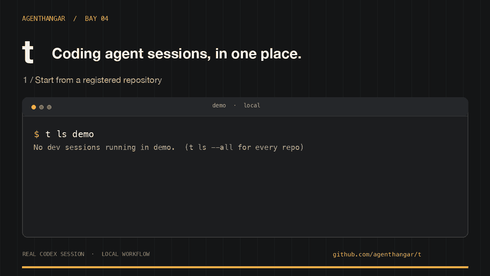

# t


**A 24/7 coding utility. Take your work with you.**

Start a task with your coding agent, keep it running on a remote machine, and
pick it up from your laptop or a phone's SSH terminal. Move between local and
cloud development, or bring a local Codex conversation into its macOS desktop
app with the running web preview beside it.

t manages sessions in tmux and gives each task its own Git worktree. It includes
Claude Code and Codex session workflows, plus Cursor transfer tools.

<p>
  <a href="#agents"><picture><source media="(prefers-color-scheme: dark)" srcset="docs/media/logos/claude-dark.svg"></picture></a>
  &nbsp;&nbsp;&nbsp;&nbsp;
  <a href="#agents"><picture><source media="(prefers-color-scheme: dark)" srcset="docs/media/logos/openai-dark.svg"></picture></a>
  &nbsp;&nbsp;&nbsp;&nbsp;
  <a href="#agents"><picture><source media="(prefers-color-scheme: dark)" srcset="docs/media/logos/cursor-dark.svg"></picture></a>
</p>

Supported workflows vary by agent; see the [support matrix](#agents).
[Logos belong to their respective owners](docs/media/logos/README.md).

[Get started](#install) · [Work from anywhere](#work-from-anywhere) · [Commands](#commands) · [Configuration](#configuration) · [Agent support](#agents) · [Coming soon](#coming-soon) · [AgentHangar](https://agenthangar.ai)



The [demo recording](docs/media/README.md) explains exactly what was captured.
Watch the [MP4](docs/media/demo.mp4) or use the [static poster](docs/media/demo-poster.png).

## Work from anywhere

- **Start with your agent.** `t session open my-project` gives Claude Code an isolated
  worktree and tmux session; add `--codex` to use Codex. Detach and come back to
  the same session whenever you need it.
- **Move between local and cloud development.**
  `t session move my-project 1 --host cloud` moves the session to a configured
  SSH host; `t session move my-project 1 --from cloud` brings it back. Use your
  own workstation or cloud VM with t and your agent installed.
- **Take it on the go.** Connect to that host from your phone's SSH terminal.
  `t session list` shows the sessions, `t session read my-project 1 --dump`
  lets you scroll their output, and `t session open my-project 1` reconnects
  you. A detached session stays available while its host stays awake and reachable.
- **Move between terminal and desktop.** On macOS, `t session open my-project 1 --app` opens
  the same local Codex conversation in the desktop app, along with its web
  preview and referenced Markdown plan. The worktree and dev server stay in
  place. To return, run `t session open my-project 1 --cli`. If Codex still has that
  conversation loaded, follow the command's release instructions and retry;
  other desktop chats can stay open. It resumes the same conversation and
  attaches automatically. The `t app` commands remain available for scripts and advanced options.

- **Submit to an existing AgentCore runtime.** `t agentcore invoke` submits JSON
  using your existing AWS CLI profile; continue with the same session ID and use
  `t agentcore stop` to terminate it. See the [supported workflow](docs/agentcore.md)
  for setup and limitations. Automated tests cover the CLI contract; live AWS
  behavior remains unverified.

**Coming soon:** [Teleport for SSH access](https://github.com/agenthangar/t/issues/10).

## Install

You need **zsh, Python 3, Git, and tmux**. Install `fzf` for the interactive pickers,
`gh` for GitHub integration, and `rsync`/SSH for moving sessions between hosts.
The test suite runs on macOS and Linux with Python 3.12. Desktop handoff is macOS-only.

To try a fresh install and worktree session in a disposable Docker container, see
the [playground guide](docs/playground.md).

With Homebrew:

```sh
brew install agenthangar/tap/t
"$(brew --prefix agenthangar/tap/t)/bin/t" system integrate
```

Homebrew installs the formula without changing your home directory. `t system integrate`
explicitly links the command, helper scripts, and agent prompts into your account
and adds optional agent hooks. The links target Homebrew's stable `opt` path, so
they keep working when the Cellar version changes. Use the full path above if an
older `~/bin/t` is already ahead of Homebrew on your PATH.

Or install a versioned release directly:

```sh
curl -fsSL https://raw.githubusercontent.com/agenthangar/t/main/scripts/install-release.py | python3
```

This installs the latest tagged release under `~/.local/share/t/releases/` and
links the command into `~/bin`. No repository checkout or pip packages are needed.
The installer verifies the release archive's SHA-256 checksum before unpacking it.
Set `XDG_DATA_HOME` or `T_INSTALL_DIR` to choose another installation location.
You can also download and inspect the installer before running it with Python 3.

Add these lines to **your own `~/.zshrc`**, then open a new terminal:

```zsh
export PATH="$HOME/bin:$PATH"
source "${${:-$HOME/bin/t}:A:h:h}/t.plugin.zsh"
```

The source expression follows the installed executable, including a development
worktree selected with `t system update --dev` or a Homebrew upgrade.
`t system integrate` prints it too. t does not replace your shell configuration,
tmux settings, SSH config, or global Git defaults.

```sh
t agent install            # choose and install agent CLIs; review their vendor commands
t config setup             # register local repositories and optional SSH hosts
t session open my-project  # start an isolated worktree + tmux slot
t session list             # see your running sessions
```

Detach from tmux with `Ctrl-b d`; reattach with `t session open my-project 1`.

`t open` browses sessions across all local repositories, including from inside a
worktree; `t open my-project` filters to that repo. Attached CLI and loaded desktop
sessions are hidden by default; `--attached` includes them. Idle sessions and
unloaded desktop workspaces remain visible. An explicit slot still opens directly.

`t history 5` browses every saved conversation associated with slot 5 in the
current repository. `t history t 5` and `t session history t 5` name the repository
explicitly. With no arguments, history infers your current slot or lets you choose
one. It retains inactive and live conversations, archived records, and records
whose worktrees or transcripts have been removed. It always asks you to select a
conversation before resuming, including when only one exists.

History shows 50 conversations per page. Search covers all pages; Ctrl-F and
Ctrl-B move between pages, Ctrl-/ opens details, Enter resumes the exact selected
conversation, and Escape cancels. Ctrl-R or `--refresh` refreshes metadata from
registered hosts without downloading their transcripts. Unreachable hosts retain
their cached records. `--limit N --page N --json` provides paginated metadata;
without a terminal the command only lists conversations.

A live terminal conversation attaches to its existing owner. A desktop or
foreground owner offers an explicit handoff path. An inactive conversation reuses
its original workspace only when recorded ownership and revision still match;
otherwise it gets a new slot branch based on the verified historical commit.
Existing dirty work stays in its source workspace. If the historical commit is
unavailable, the picker explicitly offers current main or cancel. Legacy history
can lack commit, host, title, or PR evidence; these details stay unknown. Associated
PRs require structured tool evidence or a matching branch and commit; incidental
links appear separately in details. History records are private under
`$XDG_STATE_HOME/t/history/v1` (default `~/.local/state/t/history/v1`).

`t open`, `t resume`, and `t kill` share the compact resume picker design:
**Space/Tab marks ✓ and Enter acts on the selection**. **Ctrl-A** shows all
sessions; **Ctrl-F** restores the default filters. **Ctrl-T** toggles attached
sessions in `t open` and `t kill`, **Ctrl-L** toggles live sessions in `t resume`,
and **Ctrl-P** toggles pending work in `t kill`. Each key keeps your search. The
header shows the active filters and hidden count. **Ctrl-/** opens a wrapped
full-detail preview.
Rows keep agent, interface, status, model, session and task/PR details; resume
also keeps recency and origin.

The default views are unattached sessions for `t open`, inactive conversations
for `t resume`, and unattached sessions with no pending work for `t kill`. Kill
requires a clean worktree and proof that its commits have landed; open/unknown
PRs and uncertain work stay hidden until Ctrl-P or Ctrl-A. `t resume --live`
and `t open --attached` start with all rows; Ctrl-F restores their defaults.

CLI opens use this terminal for the first selection and new tabs for the rest,
with attach commands when tabs are unavailable; desktop selections open in the
app. `--fg` opens one session. `t kill` confirms each live selection as usual
unless `-y` is supplied, and desktop release checks still apply.

Repositories need a fetched `origin/main` for worktree sessions. `t repo create` can create
and register a GitHub repository with the expected setup, showing its plan first.
To use an existing GitHub repository, run `t repo clone https://github.com/owner/repo.git`.
Use `t system diagnose` when something is missing.

## Commands

Run `t` or `t help` for a short overview, then `t help <noun>` or
`t <noun> <verb> --help` for details. Commands use the `t <noun> <verb>` form,
with `t share` as the context sharing command.
The older spellings still work; `t help aliases` lists them. Bare `t config`
continues to open its interactive menu.

For opening sessions, `t session open --help` shows a concise reference with
examples; `t help session open` adds session targeting, defaults, and remote
behavior. Start a fresh Codex session in the current repo with
`t open --codex --new` (`codex` without `--` is a repository name).

Opening and resuming serialize local tmux launches for the same worktree and
conversation, including repository aliases. Foreground launches recheck ownership
before invoking the agent. A failed tmux launch reports the failure instead
of sending a second launch into an existing pane. When a configured remote host
cannot be checked, t refuses an unverified saved-session revival; retry after
the host is reachable. An existing verified local session still attaches. To
deliberately start a different conversation locally, use
`t session open my-project --here --new --cli`.
Remote ownership scans time out after 15 seconds rather than waiting indefinitely
for a host's login shell.

### Work

| Command | Purpose |
| --- | --- |
| `t session open <repo> [slot]` | Open or reattach a task; `--new` starts another, `--codex` selects Codex, `--app` opens the desktop app, `--cli` resumes in the terminal |
| `t issue list [repo] [-a]` | List issues in the current, named, or all registered GitHub repositories |
| `t issue status [repo] <number>` | Inspect existing work without starting an agent |
| `t issue start [repo] [number ...]` | Continue or start work on one or several issues |
| `t share --to agent:id --file summary.md [--attach history.md]` | Share selected context with an exact Claude, Codex, or Cursor conversation |
| `t share targets` / `t share inbox` / `t share read <message-id>` | Find conversations and read received shares |
| `t session list [-r] [-a]` | List sessions across local or remote hosts and repositories |
| `t session close <repo> <slot>` / `t session restart <repo> <slot>` | Stop a slot or recover a stuck agent in the same conversation |
| `t session push` / `t session pop` | Move between foreground and detached tmux |
| `t session resume` / `t session search <query>` | Find and resume saved conversations; search finds Claude transcripts by content, then resumes the selected one |
| `t session cd [repo] [slot]` / `t session read <repo> [slot]` | Enter a worktree or read its terminal log (`--dump` writes plain output) |
| `t session move <repo> [slot] --host <host>` | Move a session to a host; `--from <host>` pulls it here |
| `t session view-plan` / `t session paste` | View a Claude session plan or pass an attachment |
| `t session open-app [push\|pull] [repo] [slot]` | Advanced Codex handoff options for macOS, including preview, plan, and thread selection; `t app` is the short form |
| `t repo list` / `t repo locate <repo>` / `t repo cd <repo>` | List names and paths, print a checkout path, or enter it in the shell |
| `t repo create` / `t repo clone <github-url> [alias]` | Create a repository or clone and register an existing one |
| `t cursor list` / `t cursor resume [id]` / `t cursor send [id]` | List, resume, or move Cursor CLI chats |
| `t hosts run <host> <command>` | Run a command through the host's login zsh |
| `t hosts` | Show host-management commands and examples |
| `t hosts list [--json]` | List registered SSH host aliases and targets |
| `t hosts show <alias>` | Show a host's target and defaults |
| `t hosts add <alias> <target> [--default]` | Register an SSH config name, address, or user@host |
| `t hosts edit <alias> <target> [--default]` | Change a registered host's target |
| `t hosts remove <alias>` | Unregister a host and clear its defaults; `delete` and `rm` also work |
| `t hosts default [alias] [--clear]` | Show, set, or clear the default destination for session moves |

`hosts` manages remote machines. Run `t hosts` to see its commands,
`t hosts list` to list machines, and `t hosts <verb>` to manage them or run remote commands.
For example, `t hosts add mini chris@mini.local --default` registers `mini` and
makes it the default destination for `t session move`. Configure SSH keys,
ports, and jump hosts in `~/.ssh/config`; registering a host saves local
settings without connecting to it or installing software there.

### Configuration and tools

| Command | Purpose |
| --- | --- |
| `t config open` / `t config show` / `t config edit` | Open the settings menu, print settings, or edit its source |
| `t config setup` | Register repositories and optional SSH hosts |
| `t profile init` / `t profile edit` / `t profile show` / `t profile apply <repo>` | Manage a reusable AGENTS.md profile |
| `t policy check` / `t policy show` / `t policy apply` | Inspect or apply an explicitly configured permission policy |
| `t login` / `t agent login` | Review and run logins for logged-out or expiring tools; see [login behavior](docs/login.md) |
| `t agent install` / `t agent status` / `t agent trust <dir>` | Install agents, inspect their status, or trust a folder |
| `t system integrate` / `t system update` / `t system diagnose` | Link t into this account, update it, or diagnose the installation |
| `t help [noun [verb]]` / `t help agents` / `t help aliases` | Read command help, agent support, and compatibility aliases |

The sessions MCP entry point (`t mcp`) is used for registration and tool serving;
it is not part of the everyday interactive command set. Agent capabilities vary:
see [Agent support](#agents) or `t help agents`.

### Existing spellings

Older scripts and habits continue to work. Use `t help aliases` for the full list;
these are the common migrations:

| Existing | Grouped command |
| --- | --- |
| `t open`, `t ls`, `t kill`, `t beam` | `t session open`, `t session list`, `t session close`, `t session move` |
| `t push`, `t pop`, `t find`, `t plan`, `t app` | `t session push`, `t session pop`, `t session search`, `t session view-plan`, `t session open-app` |
| `t repos ls/path/cd`, `t new`, `t checkout` | `t repo list/locate/cd`, `t repo create`, `t repo clone` |
| `t setup` | `t config setup` |
| `t instructions --init/--edit/--show`; `t instructions <repo> --apply` | `t profile init/edit/show`; `t profile apply <repo>` |
| `t permissions`, `t permissions --show/--apply` | `t policy check`, `t policy show/apply` |
| `t install`, `t trust`, `t integrate`, `t update`, `t doctor` | `t agent install`, `t agent trust`, `t system integrate`, `t system update`, `t system diagnose` |

If a CLI cannot reconnect but its tmux slot is still live, run
`t session restart <repo> <slot>` from a separate terminal. `--dry-run` shows the target
first. Restart saves the pane text, including any visible unsent draft, to a
private file under `${XDG_CACHE_HOME:-~/.cache}/t/restart/`; it prints that path
before stopping the client. Only visible draft text can be recovered this way;
copy any draft that extends beyond the pane before restarting. The saved text is
not submitted automatically. The old client must exit before the same conversation
resumes in the same pane; worktree edits and dev servers stay in place. Use
`t session open <repo> <slot>` to attach. For a remote slot, use
`t hosts run <host> t session restart <repo> <slot>`.
Every Codex recovery resumes with `--no-daemon` so relaunching one conversation
does not reconnect through the shared server used by other windows. Recovery
refuses to stop an `app-server` process or proceed without `--no-daemon` support.

For sessions opened through `t`, a local monitor automatically offers **Save draft
and restart** or **Dismiss** when a recognized final connection error remains
visible, or when tmux reports that the agent pane has exited (even if the screen
still shows work in progress). An exited Codex or Claude pane offers to resume its
verified conversation; an unverified pane shows the attention panel below.
A bright, bordered panel appears in the center of the affected terminal,
including over SSH, and works without a model connection. Press **r** to restart
or **q** to dismiss; **Enter** defaults to Dismiss. Offers are bound
to the exact conversation and process or exited pane; a changed or recovered
session is left alone. Completion and error messages stay in the window that
opened recovery, and are skipped if that window has left the affected pane.
An open recovery menu does not expire while waiting for your choice; Restart
always rechecks the conversation and process before acting.
Detached sessions get the offer when you return. Dismissal suppresses repeats until
the error clears. While recovery is needed, the status bar shows a shortcut to
reopen the menu: normally **Ctrl-b**, then **Shift-r** (uppercase **R**). It uses
your configured tmux prefix and chooses another key if **R** is already bound;
follow the shortcut shown in the status bar. Reopening checks the current pane
again and does not restart anything until you choose **r** in the menu. The hint
disappears when the failure clears. Authentication and rate-limit errors do not
trigger recovery.
If the monitor cannot verify the conversation, a panel asks you to copy your draft
before quitting and relaunching. It stays visible until dismissed. The monitor
keeps checking and, after dismissal, can offer recovery once the conversation is
verified.

Fresh Codex sessions (`t open --new`, including `--fg`) start with `--no-daemon`.
Each new session uses its own backend, avoiding feature-setting conflicts with
a running shared server while preserving model, effort, and speed preferences.
The shared server and its other clients keep running.

For existing sessions, Codex's **Background server has incompatible feature settings** screen,
**Cannot use the background server / Experimental feature request failed** screen,
and its startup menu reporting a stopped or unreachable background server,
get a separate **Run without daemon this time** offer. It relaunches only
that client with `--no-daemon`, retaining its exact conversation (or a verified fresh
launch if startup failed before creating one). It leaves the shared server and
global settings alone. The failure is checked again before stopping the client.
An older CLI and a newer daemon can disagree on shared feature defaults even
without overrides; see the [investigation and disposable reproduction](docs/codex-background-server.md).

Codex's **Failed to start turn … invalid cwd: No such file or directory** error
offers **Save draft and restart here**. If the slot's worktree still exists,
recovery resumes the exact conversation with that directory explicitly selected and
`--no-daemon`. This also handles a shared daemon rooted in a deleted worktree.
`t session restart <repo> <slot>` recognizes the same error. A missing worktree is refused
without recreating or resetting it.

Automatic worktree cleanup keeps directories still used by an agent, shared server,
updater, or their helpers, even after the tmux session closes. Deleting a daemon's
working directory can break its next restart and disconnect other sessions. Cleanup
retries after those processes exit; an incomplete process check also keeps the directory.

Codex and Claude use their existing `t session open` slots. `t cursor resume <chat-id>` now
opens or attaches a dedicated Cursor tmux session with the same recovery menu. On
first use, it adds a `sessionStart` entry to Cursor's `~/.cursor/hooks.json`, preserving
other hooks, to track the current chat even after `/new` or `/resume`. Cursor sessions
use chat IDs rather than numbered dev slots. The monitor starts when a managed session
is opened/resumed and exits when no managed sessions remain; it needs no service
manager. Export `T_RECOVERY_DISABLE=1` before opening sessions to disable automatic
monitor startup. Native desktop apps and CLIs launched outside `t` are not monitored.
The monitor runs from a stable directory and reloads its code after an update.
Before opening another Cursor chat, `t` requires existing Cursor CLIs to have verified
current chat IDs; close an untracked CLI first to avoid duplicate conversation owners.

### Sharing context between agents

```sh
t share targets --json
t share --to codex:<conversation-id> --file summary.md --attach history.md
t share --to claude:<conversation-id> --host mini --file - < summary.md
t share inbox
t share read <message-id>
t share read <message-id> --attachment history.md
t share --retry <message-id>
```

The sending agent writes the summary and selects any UTF-8 text attachments; `t`
does not extract transcripts or generate a summary. A share addresses one exact
conversation, where the receiving agent reads it on request. Reading does not
remove the share. Sending does not interrupt or start the receiving agent. Use `--from agent:id` if the
source conversation cannot be inferred, or `--for agent:id` with `inbox` and
`read` outside the receiving conversation. `--host` selects a configured SSH
host. `--json` is available on every form. Messages remain on their receiving
host without automatic expiration. The combined summary and attachments have a
10 MiB UTF-8 limit. A send receipt confirms storage; if delivery is uncertain,
retry the saved message with `t share --retry <message-id>`.

### Working on GitHub issues

```sh
t issue list                         # current repo, or all registered repos from ~
t issue list --all                   # all registered repos, even inside a checkout
t issue list api --state all         # all issues in the registered "api" repo
t issue list --repo owner/repo       # choose a GitHub repository explicitly
t issue list owner/repo --json       # machine-readable GitHub issues
t issue status 123                   # inspect ownership without starting work
t issue status api 123 --json        # structured discovery for a registered repo
t issue start                        # select one or several open issues
t issue start api 123 124            # work on two independent issues
t issue start https://github.com/owner/repo/issues/123 --codex
```

Every verb accepts a registered repository alias or GitHub `owner/repo`, either
positionally or with `--repo`. `list` shows the current checkout's issues, or
issues from all registered GitHub repositories when run outside a checkout;
`-a`/`--all` widens the list from inside a checkout. Its `REPO`, `ISSUE`,
`STATE`, and `TITLE` columns identify each result, and `--json` includes the
canonical repository. `--state all` includes closed issues and is independent
of the repository scope. An explicit repository and `--all` conflict.

Without a repository, `status` and `start` use the current registered checkout
or present a repository picker interactively. An issue URL already names its
repository. Supplying a repo both positionally and with `--repo` is an error.
JSON, remote scans, and other non-interactive commands never prompt.

`list` and `status` are read-only. `start` accepts explicit issue numbers or a
GitHub issue URL. With no number, it presents the same multi-select picker used
for sessions; Space or Tab marks issues, and Enter starts the marked issues.
Ctrl-A toggles between open and all issues; Ctrl-/ shows full details. Each issue
is checked independently for an existing owner. The command starts all new
sessions before attaching to one. Additional CLI sessions open in terminal tabs,
with attach commands printed when tabs are unavailable.

Before starting, `t issue` checks local and registered remote hosts, including
ordinary Git worktrees and agent activity outside `t`. It also checks GitHub PRs,
issue references and branch names, Codex Cloud tasks using your Codex CLI login,
and Cursor Cloud agents using `CURSOR_API_KEY`. Checks are read-only; the command
does not post issue comments, assign issues, or stop cloud agents.

A verified existing session attaches in place. A saved conversation goes through
the existing resume workflow. Ambiguous matches show their evidence for review.
An external task can be left running or taken over after you stop or hand it off
and publish a PR. Takeover starts from that PR's exact published commit in a fresh
local worktree and asks the agent to update the existing PR. Unpublished cloud
edits must be exported or published first. New work uses your configured CLI agent
(`--claude` and `--codex` override it) and is instructed to implement, test, and
open a PR, following the repository's merge and deployment instructions.

Unreachable hosts, missing provider credentials, old remote versions, and failed
checks block new work. `--allow-incomplete-check` explicitly permits proceeding
with those gaps; it does not override a known owner. `status` returns exit status
2 when discovery is incomplete, 0 when complete; command failures return 1.
A closed issue is reported without launching work. In a batch, failures are
reported per issue and the command returns nonzero after processing the rest.

Discovery covers only accessible accounts and identifiable issue references.
Private cloud work without a repository/issue reference may be undiscoverable;
task titles and branch numbers are candidates, not proof. A local launch lock
prevents concurrent `t issue` invocations from creating duplicate local sessions,
but does not provide an atomic lock across cloud services or machines. Issue
associations and launch briefs stay in private Git metadata; the initial task
also carries its association so moved conversations remain discoverable.

The installer adds an issue-first workflow to Codex's global `AGENTS.md` (and an
existing `AGENTS.override.md`) and Claude's global `CLAUDE.md`, respecting
`CODEX_HOME` and `CLAUDE_CONFIG_DIR`. It preserves your prose and updates only its
marked block; symlinks or malformed markers are reported for manual repair.
For a new fix or enhancement in a public repository, the agent must verify
visibility, create or reuse an open issue, and record its URL before editing code.
An issue supplied through `t issue` already satisfies the rule. Sessions without
a task still open normally and wait for your request. This is agent guidance,
not a filesystem write gate; it applies in new sessions that load these files.
Existing sessions and cloud environments need the same rule in their own
instructions. New `t profile init` templates also include it for repository use.

Every command has `-h`. Repo-aware commands infer the repository from your current
directory, so `t session open 2` and `t session cd 2` work inside a registered repository.

`t repo clone` uses `~/code/<repo>` and the repository name as its alias by default.
Use `--path DIR` to choose another destination, or `--dry-run` to inspect the plan.
It accepts GitHub HTTPS and SSH clone URLs. Re-running it preserves a matching
clone, including uncommitted work; a conflicting destination or alias is refused.
It registers only on this machine and leaves the GitHub repository and its settings
unchanged. If the remote has no `main` branch, checkout succeeds with a warning:
`t session open` needs a fetched `origin/main` to create task worktrees.

For preferred agent instructions, run `t profile init` to create an editable
profile at `${XDG_CONFIG_HOME:-~/.config}/t/instructions.md`, then
`t profile edit` to tailor its model, local preview, and pull request sections.
Set `T_AGENT_INSTRUCTIONS` to use another template file. `t repo clone` and `t config setup`
offer to seed `AGENTS.md` from the profile when run interactively; use
`--instructions` to apply it in a script or `--no-instructions` to skip the offer.
Noninteractive runs skip seeding unless you explicitly pass `--instructions`.
You can later run `t profile apply <repo>` for a registered alias. t updates
only its marked block, preserves the rest of `AGENTS.md`, and refuses malformed
markers or a symlink. Review the resulting diff and commit it when ready; t never
commits or pushes these instructions for you.

On macOS, `t session open my-project --app` creates a fresh isolated worktree and
opens that folder in a new desktop app window with Codex mode explicitly selected,
without starting a terminal agent. Name a reserved slot to reopen its saved
conversation (`t session open my-project 3` automatically uses the app). A slot
without a saved conversation opens its workspace in Codex mode. When several
conversations share the worktree and no exact thread is recorded, reopening
reports the ambiguity; select the intended conversation in the desktop app,
or use `t app pull my-project 3 --thread <id>` to return that conversation to CLI.
Exit any foreground terminal agent in that workspace before reopening. With `--app`, if
that slot is running
Codex in tmux, `t` hands the same conversation to the app. It waits for that
conversation's backend to release ownership before opening it; a shared Codex
backend can take about a minute after the CLI exits. The command shows progress
and keeps the slot reserved if release cannot be verified within 75 seconds.
`--app` requires a
worktree-enabled repo and a local Codex installation. Creating a new window also
requires Accessibility access for the terminal running `t` to invoke the app’s
New Window menu. Reopening a saved conversation uses its native link directly
and does not require Accessibility. It cannot launch a desktop workspace on a remote host.
The desktop slot stays reserved in private Git worktree metadata so automatic
cleanup and a later terminal launch cannot reuse it while the app may still be
working. `t session list` has separate status, UI, model, session, and context
columns. UI shows `▣ desktop` or `› cli`; model keeps the agent icon and the last
recorded model name (`-` when unavailable). Inactive desktop slots show their
last recorded conversation title. Status uses `● ✓` for a loaded conversation
and `○` for inactive. On macOS, live desktop context is verified from rollout files held open
by the desktop backend; a saved reservation alone stays inactive. Loaded context
can remain in the backend after a window closes, and does not mean a turn is
currently generating. To continue in the CLI, run this on the Mac running the
desktop session:

```sh
t session open my-project 3 --cli
```

`open --cli` checks whether that exact conversation is still loaded. If it is,
finish its turn and follow the command's release instructions, then retry. For
a `t` worktree, releasing the selected chat in Codex can leave other chats and
the app open; the command restores an archived conversation on the next try.
Codex-managed worktrees need different handling because archiving can also
queue worktree cleanup, so follow the command's guidance for that workspace.
Once released, `open --cli` resumes the same conversation and attaches.
Opening a desktop slot without `--cli` continues in the app. The handoff preserves
the worktree, changes, dev server, and thread history. For a
worktree started with `t session open --app`, it selects the only saved conversation;
if several chats share the worktree, use `t app pull my-project 3 --thread <id>`
to select one, then open it. A previously pushed slot defaults to its handed-off
thread. `t app pull` resumes without attaching; `--dry-run` previews either direction.
Handoffs check Codex's per-conversation writer lock and refuse if another loaded
conversation is known to share the worktree. Codex can hold other thread locks
without entries in its saved-conversation index. Those unindexed locks produce
a diagnostic during opening and handoffs; they do not block every worktree.
An unindexed lock is not proof of an unrelated conversation, and the selected
thread must still pass its own ownership checks. Closing a slot keeps stricter
checks because it releases the worktree reservation.
Pull resumes with `--no-daemon`, so an unrelated
background server cannot stall the transfer. It never quits the app or stops
its backend. Codex versions without a verifiable writer lock use conservative
release checks. The reservation is released only after the exact CLI process
owns the conversation's lock and its resumed thread is verified; a failed
handoff keeps the worktree protected.

Fresh Codex starts use `--no-daemon`; ordinary saved resumes retain their configured
backend behavior. See the
[session lifecycle validation guide](docs/session-lifecycle-validation.md) for
the automated checks and the separate real-desktop acceptance procedure.

To close a desktop slot, run `t kill my-project 3` (or `t session close my-project 3`). It stops that
slot's parked terminal and dev server and releases its reservation while
preserving the saved conversation and worktree. Archive that chat in Codex
before closing its slot while the app is running; finish or stop any active
turn first. Other chats and the app can stay open. If the chat remains
unarchived, close Codex before retrying. An empty desktop workspace can be
closed while Codex stays open when no saved conversation or live writer belongs
to its worktree. The close rechecks ownership after cleanup and retains the
reservation if a conversation appears. This releases t's slot reservation; it
does not close app windows or delete the worktree.

## Configuration

**Your preferences, or shared enterprise defaults.** Choose the agents and models
that work for you, and use a common open/resume/handoff workflow across supported
vendors. `t config open` sets agent defaults, models, effort, speed (Fast and
Ultrafast where supported), repository choices, and hosts. Teams can share those defaults alongside their preferred
workflows and agent configurations to standardize the parts of their setup that
matter.

In `t config open` → Codex → Speed, choose the tool's own setting, Standard,
Fast, or Ultrafast. Faster modes appear when the selected model reports support;
select a model first, and use Refresh model list to check updated capabilities.
These defaults apply to new tmux and foreground sessions. Changing models resets
an unsupported speed to Standard. Existing `DEV_FAST[codex]=1` settings still mean
Fast; named `fast` and `ultrafast` values are also supported. Claude keeps its
Fast mode setting. `t config show` displays the saved speed for each tool.

To change a repository alias, open `t config open` → Repositories → select the
repository → Short name, then Save changes. Its tool, branch, and worktree
overrides move to the new name.

Choose Default opening mode in `t config open` for CLI or Desktop app (Codex on
macOS). Each repository also has an Opening mode override. `t session open --cli` and
`t session open --app` override that choice for one command; foreground and remote opens
use the CLI.

Configure which MCP tools load in each agent's own settings. t preserves those
settings and provides its own optional sessions MCP server for Claude Code;
it does not centrally manage other MCP servers. The optional permission policy
below can also be shared across supported agents. See the [agent matrix](#agents)
for the capabilities available in each vendor's tool.

The plugin reads `${XDG_CONFIG_HOME:-~/.config}/t/local.zsh`; override its location
with `T_LOCAL_RC` before sourcing the plugin. Start with [local.zsh.example](local.zsh.example)
or use `t config setup` / `t config open`.

```zsh
DEV_REPOS[api]="$HOME/code/my-api"
DEV_AGENT[api]=codex
REMOTE_HOSTS[workstation]=user@workstation
```

Local config is executable zsh: keep it private and only load trusted files. The
Python CLI reads a generated data-only bridge in `~/.config/t/config.sh`, never
executes your config. SSH hosts need the same plugin loaded in their `.zshrc`.
Use a matching home-relative repository layout on machines that exchange work.
No SSH server, credentials, or network tunnel is provisioned by t.

### Permissions and folder trust

Installing t preserves existing agent choices. Automatic folder trust and the
maintainer's personal permission defaults are not enabled for a standalone install.
Use `t agent trust <dir>` to make a deliberate folder-trust change. To opt into automatic
trust for registered repositories, set `export T_AUTO_TRUST=1` in your local config.
The `t config` TUI shows **Automatic folder trust** and lets you enable or disable it.
Trust is synced when creating/reusing worktrees, starting or resuming terminal
sessions, and opening Codex desktop workspaces. Claude Code desktop and Codex
share their CLI trust stores; both canonical repositories and individual worktrees
are registered. `t trust --all` also includes existing session worktrees.
Cursor desktop and VS Code use a separate workspace trust database, which is
updated when present; restart those apps after syncing to load the saved trust.
`t trust --status --all` reports the saved trust state. Explicit Codex `untrusted`
entries remain untrusted, including their linked worktrees. Claude desktop can
still ask for confirmation when opening a folder through a deep link.

To use your own permission rules, point `T_PERMISSIONS_DIR` at a directory containing
`permissions.allow` and `permissions.retire`, inspect `t policy check`, then apply
with `t policy apply`. Agent mode/network/subagent defaults require the
separate `T_PERMISSION_DEFAULTS=1` opt-in or `--defaults`; a missing policy is a no-op.
Custom rules and existing explicit choices are preserved. `T_NO_TRUST`,
`T_NO_PERMISSIONS`, `T_NO_AGENT_MODES`, and `T_NO_SUBAGENT_MODEL` disable those paths.

### Updates and development

```sh
t --version       # installed release, or developer checkout revision
t system update --check   # check now for a newer release
t system update           # latest tagged release; Git installs update main instead
t system update --relink  # repair links from the selected source, without fetching
t system update --local   # switch to the registered/local t checkout and update main
t system update --local ~/code/t  # select a checkout explicitly, including from Homebrew
```

When you use `t` interactively, it checks for a newer version in the background
about once a day (retrying sooner after a failed check). A later command offers
**Skip**, **Skip until next version**, or **Update now** if a newer version is
available. Skip continues the command and may prompt again later. Skip until next
version hides that specific release or Git commit until a newer one is found.
Update now runs `t system update`, reloads the shell integration when needed, and
continues with your command. The check never installs anything
by itself; `t system update --check` runs a check immediately, and `T_NO_UPDATE_CHECK=1`
disables the interactive checks and prompts.
Developer worktrees, scripts, help, and internal commands do not prompt.

The clean main checkout of `agenthangar/t` also checks the version in the Homebrew
tap. When main has newer commits, a **Homebrew release needed** reminder offers
**View changes** or **Later** (24 hours, including across updates to main and
background checks). `t system update --check` reports this immediately.
Publishing a GitHub release triggers the workflow that updates the tap; the
reminder compares against the tap's actual version until that update completes.

You can still run `t system update` directly or let `dots` run it as part of your dotfiles
update. Your configuration and agent conversations remain outside the installation.
If the command's link is broken, rerun the install command above. To install a
specific release:

```sh
curl -fsSL https://raw.githubusercontent.com/agenthangar/t/main/scripts/install-release.py | python3 - --version v0.3.1
```

To use merged changes before the next release, `t system update --local [PATH]` switches
your user links from Homebrew or a release to a local Git checkout. Without a
path, it looks for the registered `t` repository, then the current checkout,
then the active Git installation. It fetches and fast-forwards canonical `main`
before relinking; a worktree path resolves to its canonical checkout. Future
`t system update` calls continue updating that checkout. Homebrew's package is left
installed; run its `t system integrate` command to switch your user links back.

Contributors can also install a Git checkout directly:

```sh
git clone https://github.com/agenthangar/t.git ~/code/t
~/code/t/install.sh
```

For a Git installation, `t system update` fetches and fast-forwards `main`. The canonical
clone stays on `main`; develop in a session worktree (`t session open t` after
registering the t repository). From that worktree, `t system update --dev` makes its files
live. Ordinary `t system update` switches back without resetting or removing the worktree.
Dirty or divergent canonical checkouts are refused. Avoid editing canonical main:
its files are the installed command. A full install enables a repository-local
pre-commit hook to guard that live checkout. If you already set `core.hooksPath`,
the installer preserves it; include t's guard in that custom hook path yourself.

To repair a Git installation directly, run `~/code/t/install.sh`.

### Optional integrations

The installer adds t's hooks and the sessions MCP server without replacing unrelated
settings. `T_NO_MCP=1` and `T_NO_CODEX_HOOKS=1` opt out. The `claude-stamp-tmux` hook
keeps its historical executable name and also supports Codex.

[t's original dotfiles](https://github.com/agenthangar/dotfiles) provide optional
iCloud transcript sync, clipboard bridging, and personal shell utilities. They are
not prerequisites. On that installation, `dots --all` updates dotfiles and t, and
the adapter preserves existing personal permission/trust choices.

## Agents

Features differ by agent. This matrix is generated from the command's own help and
checked in CI; optional dotfiles integrations are identified explicitly.

```text
  surface                                                     ✱ claude                                   ⬡ codex                                                        ◆ cursor
  ----------------------------------------------------------  -----------------------------------------  -------------------------------------------------------------  -------------------------------------------------
  t agent install (login · update · reinstall)                ✓                                          ✓                                                              ✓
  dev slots: t session open / list / close / read / paste     ✓                                          ✓ t session open --codex · DEV_AGENT                           ✗ no slot — t cursor list
  t session push / pop                                        ✓                                          ✓                                                              ✗ no slot
  t session resume (dead slots)                               ✓                                          ✓ (its sqlite thread index)                                    → t cursor resume
  t session move / --from                                     ✓                                          ✓ (rollout + .origin)                                          → t cursor send [id] --host / --from
  t session open-app (desktop + browser preview)              ✗ Codex conversations only                 ✓ local macOS slot → same thread                               ✗
  csync (iCloud union of transcripts)                         ✓ projects + plans                         ✓ codex-sessions                                               ✓ cursor-chats
  SessionStart stamps (registry · opened · origin)            ✓ settings.json hook                       ✓ hooks.json (trust once at startup)                           ✗ no hook wired
  t session view-plan                                         ✓                                          ✗ codex keeps no plan files (says so)                          ✗
  /tpush · /tpop slash commands                               ✓ ~/.claude/commands                       ✓ ~/.codex/prompts                                             ✗
  t session search (transcript search)                        ✓                                          ✗ claude transcripts only                                      ✗
  t system diagnose agent row (version · login · hook)        ✓                                          ✓                                                              ✓ version · login
  t policy check (selected policy)                            ✓ ~/.claude/settings.json                  ✓ ~/.codex/rules/t.rules (argv prefixes) · sandbox network on  ✓ ~/.cursor/cli-config.json (argv + env prefixes)
  default permission mode (opt in with --defaults)            ✓ auto (permissions.defaultMode)           ✓ full access (approval never · danger-full-access)            ✗ left as cursor-agent set it
  default subagent model (seeded when the config names none)  ✓ sonnet (env.CLAUDE_CODE_SUBAGENT_MODEL)  ✓ gpt-6-sol ([agents] default_subagent_model)                  ✗ not seeded
  t agent trust (folder trust · optional auto trust)          ✓ ~/.claude.json projects                  ✓ ~/.codex/config.toml [projects]                              ✓ ~/.cursor/projects/<slug> marker
  nosleep (hold sleep while an agent works)                   ✓ caffeinate child · net bytes             ✓ net bytes                                                    ✓ net bytes
```

## Coming soon

These integrations are planned and are not available in the current release:

- **Teleport support for SSH workflows** — [track progress](https://github.com/agenthangar/t/issues/10).

## Development

```sh
python3 -m pip install -r requirements-dev.txt
python3 -m pytest --cov --cov-fail-under=97
zsh -n t.plugin.zsh
```

Local test runs skip native macOS UI tests because their disposable app opens
windows and takes desktop focus. Handoff logic still runs against fake UI APIs.
For an intentional desktop check on macOS with Swift and Accessibility access:

```sh
python3 -m pytest tests/test_app_macos.py --run-macos-ui
```

CI explicitly opts in on disposable runners. Selecting the test file or
`-m macos_ui` alone does not enable desktop interaction.

The installer has no pip runtime dependencies. Markdown rendering uses a small
vendored library with its [license and provenance](libexec/vendor/README.md).
Read [CONTRIBUTING.md](CONTRIBUTING.md) and [AGENTS.md](AGENTS.md) before changing
session ownership, worktree cleanup, or the remote protocol.

MIT — [license](LICENSE). Built by [AgentHangar](https://agenthangar.ai).
